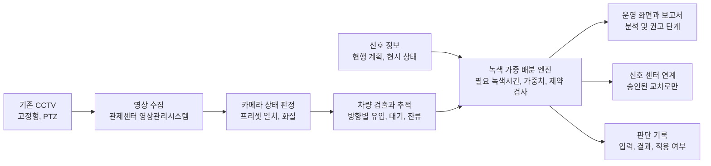

# 교차로 CCTV 영상 기반 녹색신호 가중 배분 시스템

**시흥시와 시흥도시공사를 1차 고객으로 하는 창업 기획서**

기준일 2026년 11월 13일

## 사업 제안

교차로에 이미 설치된 고정형 CCTV와 PTZ(회전 및 확대) CCTV의 영상을 분석해 방향별로 기다리는 차량과 새로 들어오는 차량을 센다. 특정 방향에 차가 몰리면 그 방향의 녹색신호에 가중치를 더 주고, 한산한 방향의 녹색시간을 그만큼 줄여 교차로 전체의 대기를 줄인다. 새 검지기나 전용 카메라를 설치하지 않고, 기관이 이미 가진 CCTV와 신호 정보를 연결해 쓰는 소프트웨어를 만든다.

1차 고객은 시흥시와 시흥도시공사다. 시흥에서 효과와 운영 절차를 검증한 뒤 같은 문제를 가진 전국 지자체와 공공기관으로 넓힌다. 신호시간을 바꾸려면 관할 경찰과 협의해야 하므로 신호를 건드리지 않는 분석 단계에서 시작하고, 권고 단계를 거쳐 승인받은 교차로에서만 실제 제어로 넘어간다.

| 항목 | 결정 |
| --- | --- |
| 해결할 문제 | 시간대별로 고정된 녹색시간이 방향별 수요 변화를 따라가지 못해 한 방향에만 대기 차량이 쌓이는 문제 |
| 입력 | 교차로의 기존 고정형 및 PTZ CCTV 영상, 현행 신호계획, 신호 상태 정보 |
| 핵심 알고리즘 | 영상으로 방향별 필요 녹색시간을 추정하고, 신호주기는 그대로 둔 채 현시별 녹색시간을 필요량에 비례해 다시 나눈다 |
| 안전장치 | 최소 및 최대 녹색시간과 보행 녹색시간을 지키고, 주기마다 바뀌는 폭을 제한한다. 하류가 막힌 방향에는 녹색을 늘리지 않고, 영상을 믿을 수 없으면 현행 계획으로 돌아간다 |
| 도입 단계 | 분석 → 권고(그림자 운영) → 승인받은 교차로 제어 |
| 수익 | 분석 서비스, 시범 구축, 교차로 단위 연간 사용료, 연계 설치, 유지관리 |

현재는 기획과 공개자료 조사만 마친 상태다. 시흥시와 시흥도시공사의 구매 의사는 아직 확인하지 못했고, CCTV 영상과 신호 자료 제공이나 경찰 협의도 이루어지지 않았다. 이 문서의 수치는 설계를 위한 가상 설정값이며 달성한 성능이 아니다.

## 목차

- [1. 해결할 문제](#1-해결할-문제)
- [2. 고객과 협의 상대](#2-고객과-협의-상대)
- [3. 제품과 도입 단계](#3-제품과-도입-단계)
- [4. 시스템 구조](#4-시스템-구조)
- [5. 영상 분석](#5-영상-분석)
- [6. 녹색신호 가중 배분 알고리즘](#6-녹색신호-가중-배분-알고리즘)
- [7. 신호 연계와 안전장치](#7-신호-연계와-안전장치)
- [8. 개인정보와 영상 보안](#8-개인정보와-영상-보안)
- [9. 기존 사례와 차별화](#9-기존-사례와-차별화)
- [10. 검증 계획](#10-검증-계획)
- [11. 성과 지표와 검수 기준](#11-성과-지표와-검수-기준)
- [12. 수익모델과 판매 경로](#12-수익모델과-판매-경로)
- [13. 원가와 확장](#13-원가와-확장)
- [14. 개발 범위와 역할](#14-개발-범위와-역할)
- [15. 위험과 대응](#15-위험과-대응)
- [16. 참고 자료](#16-참고-자료)

## 1. 해결할 문제

### 1.1 고정된 녹색시간과 바뀌는 수요

신호 교차로는 보통 시간대별로 정해 둔 신호계획에 따라 운영된다. 같은 시간대에는 주기와 현시별 녹색시간이 매일 같다. 그러나 교통 수요는 요일, 행사, 공사, 사고, 학교 하교 시간에 따라 달라지고, 출근 시간과 퇴근 시간에는 차가 몰리는 방향이 반대가 된다. 계획이 수요와 맞지 않으면 한 방향은 녹색이 끝나도 차가 남고, 다른 방향은 지나갈 차가 없는데 녹색이 켜져 있다.

### 1.2 실시간 대응에 드는 비용

수요에 맞춰 신호를 바꾸려면 방향별 교통량과 대기열을 실시간으로 파악해야 한다. 보통 접근로마다 루프 검지기, 영상 검지기, 레이더 같은 장비를 설치해 교통량과 대기열을 측정하는데, 교차로마다 장비와 공사, 통신 비용이 든다. 시흥시도 국토교통부 지자체 ITS 국고보조사업으로 AI 영상처리 기반 스마트 교차로를 구축해 왔지만[R5](#r5-시흥시-its-구축-보도-2021), 모든 교차로에 같은 장비를 설치하기는 어렵다.

교차로에는 방범, 교통 관제, 불법 주정차 단속처럼 다른 목적으로 설치한 CCTV가 있다. 이 영상으로 방향별 대기를 잴 수 있다면 검지 장비가 없는 교차로에도 수요에 맞춘 신호 운영을 적용할 수 있다. 시흥시 교차로 몇 곳에 어떤 CCTV가 설치되어 있는지, 그중 접근로 대기열이 보이는 화각이 몇 곳인지는 아직 확인하지 않았다. 첫 번째 검증 과제로 CCTV 현황과 화각부터 파악한다.

### 1.3 시흥시에서 확인한 교통 기반

| 시점 | 내용 | 출처 |
| --- | --- | --- |
| 2021년 9월 보도 | ITS 국고보조사업 3년 연속 선정. 2020년까지 스마트 교차로, 보행알리미, 교통 CCTV, 신호제어기 무선 온라인 연계를 구축했다. 스마트 교차로는 AI 영상처리로 접근 차량과 보행자 정보를 모아 신호운영 방안을 도출한다 | [R5](#r5-시흥시-its-구축-보도-2021) |
| 2026년 3월 시작 | 배곧동과 정왕동 주요 교차로의 실시간 신호정보를 민간 내비게이션에 제공한다. 신호제어기 정보가 한국도로교통공단 연계 시스템을 거쳐 전달된다 | [R6](#r6-시흥시-실시간-신호정보-서비스-보도-2026) |
| 2026년 4월 발표 | 광역 긴급차량 우선신호 시스템을 주요 도로 교차로 400곳에 우선 적용할 계획이다 | [R7](#r7-시흥시-광역-긴급차량-우선신호-보도-2026) |
| 2026년 10월 보도 | 횡단보도 17개소에서 AI로 영상을 분석해 보행신호를 자동으로 연장하는 시스템을 운영하기 시작했다. 설치 지점은 시흥경찰서와 협의해 골랐고, 센터시스템은 시흥시 도시정보통합센터에 구축했다 | [R8](#r8-시흥시-보행신호-자동연장-보도-2026) |

시흥시는 영상 AI와 신호 연계 사업을 이미 진행하고 있다. 이 제품은 기존 스마트 교차로의 검지 자료와 신호정보 연계 체계를 입력으로 받아 쓰도록 설계한다. 배곧동과 정왕동 일부 교차로는 신호제어기 정보를 외부 시스템으로 보내고 있으므로, 해당 교차로의 신호 상태를 받아 쓸 수 있는지 먼저 확인한다.

## 2. 고객과 협의 상대

### 2.1 시흥시

시흥시 철도과 첨단교통팀은 ITS 기본계획, 교통량 DB 분석, ITS 및 BIS 구축과 운영을 맡는다[R1](#r1-시흥시-its-담당업무). 교통행정과는 교통시설과 경찰서 교통안전심의 관련 업무를 맡는다[R2](#r2-시흥시-교통행정과-업무안내). 사용자이자 구매 부서의 첫 후보는 첨단교통팀이다. 보행신호 자동연장 시스템의 센터시스템이 시흥시 도시정보통합센터에 구축되었으므로[R8](#r8-시흥시-보행신호-자동연장-보도-2026), 영상 분석 서버도 같은 센터에 두는 방안을 먼저 검토한다.

첫 면담에서 확인할 질문은 다음과 같다.

- 신호계획을 바꾸고 싶었지만 근거 자료가 부족했던 교차로와 시간대가 있는가
- 스마트 교차로 장비가 있는 교차로와 없는 교차로는 각각 몇 곳인가
- 교차로 CCTV의 종류(고정형, PTZ), 설치 목적, 영상에 접근하는 방식은 무엇인가
- 신호시간 변경은 누가 어떤 절차로 승인하는가
- 이런 사업의 예산은 어느 사업 항목에서 나오고, 계약 방식은 무엇인가

### 2.2 시흥도시공사

시흥도시공사는 시흥시 공영주차장을 운영한다[R3](#r3-시흥도시공사-공영주차장-운영). 2019년 보도에 따르면 시흥시가 시설관리공단을 도시공사로 바꾸려 한 목적은 도시개발사업의 개발이익을 시에 재투자하는 것이었다[R9](#r9-시흥도시공사-전환-보도-2019). 공사에 교차로 신호 운영 권한이 있다고 가정하지 않으며, 다음 두 가지 수요 가설을 검증한다.

- **도시개발사업지구의 신규 교차로:** 공사가 도시개발사업을 시행한다면, 사업지구에 교차로를 새로 만들 때 CCTV 위치와 화각, 신호 연계를 설계 단계에서 반영하는 편이 나중에 장비를 덧붙이는 것보다 비용이 적을 것으로 본다. 고양시도 AI 신호 시스템의 확대 대상으로 도시개발사업지구를 검토하고 있다[R10](#r10-고양시-실시간-교통신호-시스템-보도-2026). 공사가 현재 시행 중인 사업 목록과 완공한 교통시설을 시에 인계하는 절차는 아직 확인하지 않았다.
- **공영주차장 주변 교차로:** 주차장 진출입로와 맞닿은 교차로에서 주말과 행사 때 진출입 차량이 한 방향으로 몰리는지 공영주차장 이용 자료로 확인한다.

공사가 시의 교통 관련 사업을 위탁받아 운영하는 범위도 함께 확인한다. 위탁 범위에 교통시설 운영이 포함되면 공사가 운영 주체로서 고객이 될 수 있다.

### 2.3 확장 고객

| 고객군 | 진입 경로 | 확인할 것 |
| --- | --- | --- |
| 전국 시와 군의 ITS 부서 | 직접 계약, 지자체가 세우는 국토교통부 지자체 ITS 국고보조사업 계획에 포함 | 사업 계획 일정, 기존 ITS 사업자, CCTV 보유 현황 |
| 지방 도시공사와 개발사업을 맡는 공공기관 | 개발사업지구 교통시설 설계 단계 | 교통시설 설계와 지자체 인계 절차 |
| ITS 및 스마트 교차로 사업자 | 분석과 녹색 배분 모듈 공급 | 연계 규격, 기술 권리, 장애 책임 분담 |

확장 순서는 시흥, 시흥과 맞닿은 경기도 내 시, 전국 순으로 잡는다. 지역마다 CCTV 운영 부서, 신호제어 사업자, 경찰 협의 방식이 다르므로 시흥에서 만든 점검 목록과 연계 모듈을 다른 지역에 얼마나 그대로 적용할 수 있는지에 따라 확장 속도가 결정된다.

### 2.4 신호 운영 권한과 승인 경로

도로교통법 제3조 제1항은 특별시장, 광역시장, 제주특별자치도지사, 시장, 군수(이하 "시장등")가 신호기를 설치하고 관리하도록 정한다. 같은 법 제147조 제1항에 따라 시장등은 도로교통법에 따른 권한이나 사무의 일부를 시·도경찰청장이나 경찰서장에게 위임하거나 위탁할 수 있다[R12](#r12-도로교통법). 실제로 고양시는 AI 신호 시스템을 고양경찰서와 협의해 시범운영했고[R10](#r10-고양시-실시간-교통신호-시스템-보도-2026), 시흥시 보행신호 자동연장 시스템은 시흥경찰서와 협의해 설치 지점을 정했다[R8](#r8-시흥시-보행신호-자동연장-보도-2026).

시흥시에서 신호시간 변경 권한이 시와 경찰 사이에 어떻게 나뉘어 있는지, 실시간 자동 변경을 누가 어떤 조건으로 승인하는지는 아직 확인하지 않았다. 시흥시와 시흥경찰서에 이 절차를 확인하는 것이 제어 단계로 가기 위한 첫 과제다.

| 역할 | 대상 후보 | 확인할 것 |
| --- | --- | --- |
| 사용자 | 시 ITS 담당자, 교통정보센터와 관제센터 운영자 | 어떤 교차로와 시간대의 혼잡을 반복해서 다루는가 |
| 구매와 예산 | 시 ITS 사업 부서, 공사 사업 부서 | 예산 항목, 국고보조사업 포함 가능성, 계약 방식 |
| 영상 보유 | 도시정보통합센터, 교통 CCTV 운영 부서 | 카메라 위치와 종류, 화각, 영상 접근 방식, 목적 추가 절차 |
| 신호 승인 | 시흥경찰서, 경기남부경찰청(확인 필요) | 신호시간 변경 승인 절차, 자동 변경을 허용하는 범위 |
| 신호 연계 | 신호제어기와 신호 센터 운영 사업자 | 신호 상태를 수신하고 녹색시간 변경 명령을 주고받는 인터페이스 규격 |

## 3. 제품과 도입 단계

### 3.1 제품 구성

| 구성 | 하는 일 |
| --- | --- |
| 영상 분석 모듈 | CCTV 영상에서 차량을 검출하고 추적해 방향별 유입, 대기, 배출, 잔류를 주기마다 계산한다 |
| 카메라 상태 판정 | PTZ 화면이 등록된 프리셋 화각에 있는지, 화질이 측정에 충분한지 판정한다 |
| 녹색 가중 배분 엔진 | 방향별 필요 녹색시간에서 가중치를 구하고, 제약을 지키는 현시별 녹색시간을 산출한다 |
| 신호 연계 어댑터 | 신호 상태를 받아 권고 녹색시간을 전달하거나, 승인된 범위 안에서 녹색시간 변경 명령을 보낸다 |
| 운영 화면 | 교차로마다 방향별 혼잡도와 현행 녹색시간, 권고 녹색시간, 변경 근거, 카메라 상태를 보여 준다 |
| 기록과 보고 | 모든 판단의 입력, 결과, 적용 여부를 저장하고 적용 전후 비교 보고서를 만든다 |

### 3.2 도입 단계

| 단계 | 실제 신호 변경 | 기관이 얻는 것 | 필요한 것 |
| --- | --- | --- | --- |
| 1. 분석 | 없음 | 방향별 교통량과 대기 통계, 시간대별 신호계획 조정안 | 영상 접근 권한과 현행 신호계획 확보 |
| 2. 권고(그림자 운영) | 없음 | 주기마다 계산한 권고 녹색시간, 운영자 검토 기록, 예상 효과 | 신호 상태 실시간 수신 |
| 3. 제어 | 승인된 교차로와 시간대, 변경폭 안에서 자동 적용 | 실제 지체 감소와 부작용 측정 | 경찰 승인, 신호 센터 연계, 안전장치 검증 |

분석 단계만으로도 상품이 된다. 시간대별 신호계획을 다시 짤 때 근거가 되는 방향별 수요 통계와 조정안을 제공하므로, 실시간 제어 승인을 받기 전에도 계약할 수 있다. 분석 단계에서 제공하는 시간대별 조정안은 6장의 가중 배분 산식을 시간대별 평균 수요에 적용해 만든다.

### 3.3 첫 제품에서 제외하는 것

- 신호주기 길이를 바꾸는 제어와 비주기 제어
- 여러 교차로의 옵셋을 함께 바꾸는 연동 최적화
- 차량번호 인식, 얼굴 인식, 단속 기능
- 새 카메라와 검지기 설치
- PTZ 카메라를 직접 회전하거나 확대하는 기능

## 4. 시스템 구조



*그림 1 기존 CCTV 영상에서 녹색시간 배분까지의 처리 흐름*

기관 내부망에 둔 분석 서버는 관제센터의 영상관리시스템이나 카메라 스트림에서 영상을 받아 메모리에서 분석한다. 원본 영상은 저장하지 않으며 방향별 집계값, 카메라 상태, 판단 기록만 남긴다. 서버 한 대가 동시에 처리할 수 있는 카메라 수는 실제 영상 해상도와 처리 프레임 수로 시험한 뒤 정한다.

## 5. 영상 분석

### 5.1 카메라 종류별 처리

| 구분 | 고정형 | PTZ |
| --- | --- | --- |
| 화각 | 설치 후 고정 | 관제 운영자의 조작으로 바뀐다 |
| 검지 영역 설정 | 카메라마다 한 번 | 교통 측정에 쓰는 프리셋마다 한 번 |
| 측정 조건 | 화질 기준을 넘을 것 | 등록된 프리셋 화각과 일치하고 화질 기준을 넘을 것 |
| 주요 위험 | 야간이나 우천, 역광일 때, 또는 대형차에 가려질 때 인식이 어려움 | 고정형 카메라의 위험 요인에 더해, 관제 중 화면을 돌리거나 확대하면 측정이 끊김 |

### 5.2 PTZ 카메라 처리

방범과 관제용 PTZ 카메라는 운영자가 사건을 따라 화면을 돌리기 때문에, 고정형처럼 검지 영역을 한 번 그려 두고 계속 쓸 수 없다. 다음 방식으로 처리한다.

1. **프리셋 등록:** 교통 측정에 쓸 화각을 기관과 합의해 카메라 프리셋으로 등록하고, 그 화각의 기준 영상과 검지 영역을 저장한다.
2. **일치 판정:** 몇 초 간격으로 현재 화면과 기준 영상의 특징점을 맞춰 두 화면 사이의 평면 변환(호모그래피)을 구한다. 변환량이 허용값 안이면 검지 영역을 그만큼 옮겨 측정을 계속하고, 허용값을 넘으면 그 카메라를 측정 불가로 표시한다.
3. **자동 재개:** 운영자가 화면을 돌렸다가 프리셋으로 되돌리면 일치 판정을 거쳐 측정을 다시 시작한다.
4. **카메라 조작 금지:** 시스템은 카메라를 움직이지 않는다. 개인정보 보호법 제25조 제5항은 설치 목적과 다른 목적으로 영상정보처리기기를 임의로 조작하는 것을 금지하며[R13](#r13-개인정보-보호법), 관제 업무가 교통 측정보다 우선한다.

프리셋으로 돌아왔을 때 화각이 얼마나 정확히 맞는지는 카메라 기종마다 다르므로 현장에서 측정한다. 시간대별로 PTZ 카메라가 프리셋 화각을 유지하는 비율을 기록하고, 유지 비율이 낮은 카메라는 제어 대상에서 제외한다.

### 5.3 방향별 지표

검지 영역은 접근로마다 진입선, 정지선, 대기 영역, 하류 출구 영역으로 나눠 그리고, 각 영역을 신호 현시의 이동류(직진, 좌회전, 우회전)와 연결한다.

| 지표 | 정의 | 쓰임 |
| --- | --- | --- |
| 유입 대수 $A$ | 한 주기 동안 진입선을 지난 차량 수 | 수요 추정 |
| 녹색 시작 대기 $N$ | 녹색이 시작될 때 대기 영역에 정지해 있는 차량 수 | 혼잡도 표시 |
| 배출 대수 $D$ | 녹색 동안 정지선을 지난 차량 수 | 처리량 확인 |
| 잔류 대기 $R$ | 녹색이 끝날 때까지 정지선을 지나지 못하고 남은 차량 수 | 녹색 부족 판단 |
| 포화 차두시간 $h$ | 대기열이 끊김 없이 빠져나갈 때 차량 사이의 시간 간격 | 필요 녹색시간 계산 |
| 하류 점유율 $O$ | 출구 쪽 저장 구간의 차량 수를 저장 가능 대수로 나눈 값 | 하류 막힘 검사 |
| 관측 한계 도달 | 대기열 끝이 화면 밖으로 넘어간 상태 | 실제보다 수요가 적게 측정된 상태를 표시 |

차종은 승용차, 버스, 화물차, 이륜차로 나눠 세고, 필요하면 승용차 환산 대수로 바꾼다. 포화 차두시간은 처음에는 차로당 2.0초(시간당 1,800대) 같은 표준값으로 시작하고, 녹색 동안 대기열이 연속으로 빠져나가는 구간의 영상에서 교차로별 값을 다시 추정한다.

### 5.4 신호 상태와 영상 시각 맞추기

잔류 대기와 배출 대수를 계산하려면 각 현시의 녹색 시작과 종료 시각을 알아야 한다. 신호 상태는 신호제어기나 신호 센터에서 받는 것을 원칙으로 하고, 영상 시각과 신호 시각의 차이를 주기적으로 보정한다. 시흥시 배곧동과 정왕동은 신호제어기 정보가 외부로 연계되고 있으므로[R6](#r6-시흥시-실시간-신호정보-서비스-보도-2026) 이 경로를 먼저 확인한다. 화면에 신호등이 보일 때 색을 인식하는 방식은 시각 보정을 검사하는 보조 수단으로만 쓴다.

### 5.5 검출과 추적 모델

차량 검출은 사전학습된 YOLO 계열 검출기로, 추적은 ByteTrack 같은 다중 객체 추적기로 시작한다[R18](#r18-ultralytics-객체-추적-문서). 시흥 교차로 영상에서 사람이 표시한 표본으로 검출기를 추가 학습하고, 주간, 야간, 우천 조건의 정확도를 따로 잰다. 상용 배포에 쓸 모델과 코드의 사용권 조건은 공급사 안내로 확인하고 비용에 반영한다[R19](#r19-ultralytics-라이선스-안내).

### 5.6 품질 판정과 측정 불가 처리

현시마다 주기 단위로 프리셋 일치 여부, 프레임 수신율, 검출 신뢰도, 가려짐 정도를 확인해 측정 품질을 판정한다. 결측은 0으로 채우지 않는다. 교차로에서 한 현시라도 측정할 수 없으면 다음 주기 목표를 현행 신호계획으로 설정하고, 6.5절의 점진 적용 방식에 따라 현행 녹색시간으로 서서히 되돌린다.

## 6. 녹색신호 가중 배분 알고리즘

### 6.1 원칙

- 인접 교차로와 연동을 유지하고 기존 신호제어기의 주기식 운영 방식 안에서 동작하도록 신호주기 $C$와 옵셋은 현행 계획 그대로 둔다.
- 황색과 전적색 시간은 바꾸지 않는다.
- 바꾸는 것은 현시별 녹색시간의 배분뿐이다. 한 주기의 녹색시간 합 $G = C - L$은 일정하다. 여기서 $L$은 모든 현시의 황색과 전적색 시간을 더한 값이다.

### 6.2 방향별 필요 녹색시간

이동류 $m$의 수요는 최근 주기 유입 대수의 지수평균에 직전 주기의 잔류 대기를 더해 추정한다. $\beta$는 최근 주기를 얼마나 크게 반영할지 정하는 값이다.

$$\bar A_m(k) = \beta A_m(k) + (1 - \beta) \bar A_m(k-1)$$

$$\hat Q_m = \bar A_m(k) + R_m(k)$$

이동류 $m$에 필요한 녹색시간은 출발 손실시간 $\ell_s$에, 차로당 대기 차량 수와 포화 차두시간 $h_m$을 곱한 값을 더한 것이다. $n_m$은 차로 수다. 현시 $i$의 필요 녹색시간 $r_i$는 그 현시에 속한 이동류 가운데 가장 큰 값이다. $\rho_i$는 기관이 정하는 방향 우선 계수로 기본값은 1이며, 버스 노선이나 간선도로처럼 우선할 방향이 있을 때만 조정한다.

$$r_i = \rho_i \max_{m \in i} \left( \ell_s + \frac{h_m \hat Q_m}{n_m} \right)$$

### 6.3 가중치와 목표 녹색시간

차가 몰리는 방향일수록 필요 녹색시간이 커지고, 그만큼 가중치도 커진다. 녹색시간 합 $G$를 가중치 비율로 나눈 값이 목표 녹색시간이다.

$$w_i = \frac{r_i}{\sum_j r_j}, \qquad g_i^{\ast} = w_i G$$

웹스터 신호시간 설계 방식에서 각 현시의 임계 수요 비율에 비례해 녹색시간을 나누는 원리와 같다. 다만 설계 당시 조사한 수요 대신 주기마다 영상으로 측정한 수요를 쓴다는 점이 다르다. 필요 녹색시간의 합이 $G$를 넘으면 녹색 재배분만으로는 대기를 해소할 수 없는 과포화 상태로 표시하고 운영자에게 알린다.

### 6.4 제약

현시마다 하한과 상한을 정하고, 목표 녹색시간이 이 범위를 벗어나면 경계값으로 고정한 뒤 남은 녹색시간을 나머지 현시에 가중치 비율로 다시 나눈다. 고정할 현시가 더 없을 때까지 반복한다. 모든 현시의 하한 합이 $G$보다 크거나 상한 합이 $G$보다 작으면 범위를 만족하는 배분이 없으므로 현행 계획을 유지하고 경고를 남긴다.

| 제약 | 하한 또는 상한 | 이유 |
| --- | --- | --- |
| 최소 녹색 | 차량 최소 녹색시간과 보행 최소 녹색시간 중 큰 값을 하한으로 설정 | 차량 신호와 함께 켜지는 횡단보도의 보행시간을 보장함 |
| 최대 녹색 | 상한은 기관이 정한 최대 녹색 | 다른 방향의 대기가 지나치게 길어지는 것을 방지 |
| 현행 대비 허용 폭 | 현행 녹색시간에서 $B$초 이내 | 한 번에 계획에서 크게 벗어나지 않게 함 |
| 하류 막힘 | 하류 점유율이 $\theta$ 이상이면 상한을 현재 녹색시간으로 | 빠져나갈 공간이 없는 방향에 녹색을 더 주면 교차로 안에 차가 갇힌다 |
| 관측 한계 도달 | 대기열이 화면 밖으로 넘었으면 하한을 현재 녹색시간으로 | 수요를 적게 잰 방향의 녹색을 줄이지 않음 |

최소 녹색, 최대 녹색, 현행 대비 허용 폭을 함께 쓰면 현시 $i$의 기본 범위는 다음과 같다. $g_i^{0}$은 현행 녹색시간이다.

$$\max\left(g_i^{\min}, g_i^{0} - B\right) \le g_i \le \min\left(g_i^{\max}, g_i^{0} + B\right)$$

보행 최소 녹색은 경찰청 신호기 설치와 관리 기준의 보행시간 산정 방식과 각 횡단보도 길이로 정하고, 교통약자 보호구역은 그 구역의 기준을 따른다. 정확한 산정식은 기관과 확인한다.

### 6.5 점진 적용

목표 녹색시간으로 한 번에 바꾸지 않고, 주기마다 현재 값과 목표의 차이 가운데 $\alpha$만큼만 움직인다. 현재 값과 목표 모두 합이 $G$이고 범위 안에 있으므로, 둘 사이의 값도 합이 $G$이고 범위 안에 있다. 결과는 정수 초로 반올림하되, 소수점 아래가 큰 현시부터 1초씩 더해 합을 $G$로 맞춘다.

$$g_i(k+1) = g_i(k) + \alpha \left( g_i^{\ast} - g_i(k) \right)$$

주기마다 실행하는 순서는 다음과 같다.

```text
주기 k가 끝나면:
1. 카메라 상태와 측정 품질을 확인한다. 측정 불가 현시가 있으면 목표를 현행 계획으로 둔다.
2. 이동류별 유입, 잔류, 하류 점유율, 관측 한계 도달 여부를 계산한다.
3. 현시별 필요 녹색시간과 가중치를 계산한다.
4. 현시별 하한과 상한을 정한다.
5. 범위 안에서 녹색시간 합 G를 가중치 비율로 나눠 목표를 구한다.
6. 현재 값에서 목표 쪽으로 alpha만큼 움직이고 정수 초로 맞춘다.
7. 계산한 녹색시간은 분석과 권고 단계에서 화면에 표시하고 기록으로 남기며, 제어 단계에서는 신호 센터로 보낸다.
8. 입력, 가중치, 걸린 제약, 결과, 적용 여부를 기록한다.
```

계산과 전송은 주기 $k+1$이 시작되기 전에 끝나야 한다. 늦으면 주기 $k+1$은 직전 값으로 운영하고 지연을 기록한다. 신호 센터의 명령 반영 시점이 늦다면 적용 대상을 주기 $k+2$로 미룬다.

### 6.6 가상 계산 예시

다음 값은 산식을 설명하기 위한 가상 설정이다.

| 설정 | 값 |
| --- | --- |
| 신호주기 $C$ | 120초, 4현시 |
| 황색과 전적색 | 현시마다 황색 3초, 전적색 2초, 합계 $L$ = 20초 |
| 녹색시간 합 $G$ | 100초 |
| 현행 녹색시간 | P1 30초, P2 20초, P3 30초, P4 20초 |
| 최소와 최대 녹색 | 15초, 45초 |
| 현행 대비 허용 폭 $B$ | 10초 |
| 출발 손실시간과 포화 차두시간 | 2초, 차로당 2.0초 |
| 점진 계수 $\alpha$ | 0.5 |

퇴근 시간에 동서 직진 방향으로 차가 몰린 상황이다.

| 현시 | 이동류 | 차로 수 | 평균 유입 | 잔류 | 필요 녹색시간 |
| --- | --- | --- | --- | --- | --- |
| P1 | 동서 직진 | 2 | 30대 | 6대 | $2 + 2.0 \times 36 / 2 = 38$초 |
| P2 | 동서 좌회전 | 1 | 8대 | 0대 | $2 + 2.0 \times 8 / 1 = 18$초 |
| P3 | 남북 직진 | 2 | 16대 | 0대 | $2 + 2.0 \times 16 / 2 = 18$초 |
| P4 | 남북 좌회전 | 1 | 6대 | 0대 | $2 + 2.0 \times 6 / 1 = 14$초 |

1. 필요 녹색시간 합은 88초로 $G$ = 100초보다 작으므로 과포화가 아니다. 가중치는 P1부터 0.432, 0.205, 0.205, 0.159이고, 목표는 43.2초, 20.5초, 20.5초, 15.9초다.
2. P1은 현행 30초에서 허용 폭 10초를 더한 40초가 상한이므로 40초로 고정한다. 남은 60초를 P2, P3, P4에 18 : 18 : 14로 나누면 21.6초, 21.6초, 16.8초이며 모두 범위 안에 있다.
3. 다음 주기에는 현행 값에서 목표 쪽으로 절반만 움직인다. 35.0초, 20.8초, 25.8초, 18.4초를 정수로 맞추면 **35초, 21초, 26초, 18초**다.
4. 수요가 그대로면 그다음 주기는 **38초, 21초, 24초, 17초**가 되고, 이후 목표값에 가까워진다.

동서 직진의 녹색시간은 30초에서 35초, 38초로 늘고, 남북 직진은 30초에서 26초, 24초로 준다. 남북 직진의 필요 녹색시간은 18초이므로 24초면 잔류가 생기지 않을 것으로 예상한다. 실제로 잔류가 생기면 다음 주기의 $R$이 커져 남북 직진의 가중치가 다시 올라간다.

### 6.7 비교 대상

| 정책 | 설명 | 비교하는 이유 |
| --- | --- | --- |
| 현행 고정 계획 | 시간대별 신호계획 그대로 | 기준 |
| 표준 감응 제어 | 검지된 차량에 따라 녹색을 연장하는 방식 | 이미 쓰이는 수요 대응 방식과 비교 |
| 제안 방식 | 영상 측정값으로 녹색 가중 배분 | 제안 효과 |
| 제안 방식 + 완전 관측 | 시뮬레이터의 실제 대기열을 입력으로 사용 | 영상 측정 오차와 알고리즘 한계를 나눠 봄 |

표준 감응 제어는 SUMO의 감응 신호 기능으로 구현한다[R16](#r16-eclipse-sumo-traffic-lights). 맥스 프레셔나 강화학습 같은 연구용 방법은 첫 비교 이후 추가한다.

### 6.8 이후 확장

첫 제품이 현장에서 검증되면 다음 기능을 차례로 검토한다.

- 짧은 시간 뒤의 수요를 예측해 녹색시간을 미리 조정하는 기능
- 같은 도로축의 여러 교차로를 함께 보는 연동 조정
- 혼잡 시간대의 주기 길이 조정
- 버스 정보와 연계한 버스 우선 가중치

## 7. 신호 연계와 안전장치

### 7.1 단계별 연계

| 단계 | 연계 내용 |
| --- | --- |
| 분석 | 현행 신호계획 파일(시간대별 주기, 현시 구성, 녹색시간)을 받는다 |
| 권고 | 신호 상태(현시별 시작과 종료 시각)를 실시간으로 받는다 |
| 제어 | 다음 주기의 현시별 녹색시간을 신호 센터나 신호제어기로 보낸다 |

신호 센터와 신호제어기의 연계 규격은 무엇인지, 녹색시간 변경 명령을 받을 수 있는지, 변경 명령이 언제 반영되는지는 시흥시 신호제어 사업자와 확인한다. 연계가 어려운 신호제어기에서는 분석과 권고 단계까지만 제공한다.

### 7.2 안전장치

- 충돌하는 현시가 동시에 녹색이 되지 않게 하는 것, 황색과 전적색, 최소 녹색은 신호제어기가 최종 보장한다. 시스템은 이 범위 안의 녹색시간 배분값만 보낸다.
- 영상 측정 불가, 통신 단절, 계산 지연이 생기면 현행 계획으로 돌아간다.
- 운영자는 교차로별, 시간대별로 제어를 켜고 끌 수 있고, 즉시 해제할 수 있다.
- 현행 대비 허용 폭 $B$와 점진 계수 $\alpha$는 제어를 처음 적용할 때 작게 두고, 그림자 운영과 시범 결과를 보고 넓힌다.
- 모든 변경은 입력값, 걸린 제약, 적용 결과와 함께 기록하고, 기관과 경찰이 언제든 조회할 수 있게 한다.

## 8. 개인정보와 영상 보안

개인정보 보호법 제25조 제1항은 공개된 장소에 고정형 영상정보처리기기를 설치하고 운영할 수 있는 경우를 정하며, 제5호는 "교통정보의 수집ㆍ분석 및 제공을 위하여 정당한 권한을 가진 자가 설치ㆍ운영하는 경우"다[R13](#r13-개인정보-보호법).

방범용이나 불법 주정차 단속용으로 운영하는 CCTV에 교통정보 수집 목적을 더할 수 있는지에 대해, 개인정보보호위원회 질의응답 모음집(2024년 12월)은 교통정보 수집과 분석에 정당한 권한을 가진 공공기관이 행정예고나 의견청취 등의 절차로 관계 전문가와 이해관계인의 의견을 수렴하면 가능하다고 답한다[R14](#r14-개인정보보호위원회-질의응답). 이 답변은 2차 출처로 확인했으므로 원문을 다시 확인한다. 목적을 더하는 절차는 영상을 가진 기관이 진행하고, 우리 팀은 처리 방식 설명 자료를 제공한다.

시스템은 다음 원칙으로 설계한다.

- 원본 영상을 저장하지 않고, 방향별 집계값과 카메라 상태만 저장한다.
- 차량번호와 얼굴을 인식하지 않는다. 추적 번호는 교차로를 지나는 동안에만 쓰고 저장하지 않는다.
- 영상 처리는 기관 내부망에서 하고, 영상과 집계값을 외부 AI 서비스로 보내지 않는다.
- 모델 개선에 쓸 영상 표본은 기관의 승인을 받은 범위에서 비식별 처리한 뒤 쓰고, 보관 기간을 정한다.
- 안내판과 운영 관리 방침을 바꿔야 하는지는 기관이 판단하며, 우리 팀은 그 판단에 필요한 처리 방식 자료를 제공한다.

## 9. 기존 사례와 차별화

### 9.1 이미 있는 사례

AI 영상으로 교차로 교통량을 재고 신호를 조정하는 시도는 이미 여러 지자체에 있다.

| 지자체 | 내용 | 출처 |
| --- | --- | --- |
| 시흥시 | 2020년까지 AI 영상처리 스마트 교차로 구축, 2026년 횡단보도 17개소 보행신호 자동연장 운영 | [R5](#r5-시흥시-its-구축-보도-2021), [R8](#r8-시흥시-보행신호-자동연장-보도-2026) |
| 고양시 | 스마트 교차로의 방향별 CCTV로 교통량을 모아 AI가 신호시간을 산출하고 현장 신호제어기에 자동 적용한다. 화정로 7개 교차로에서 시범운영했고 신호시간을 최소 4초에서 최대 26초까지 조정한다. 2026년 5월 정식 운영 | [R10](#r10-고양시-실시간-교통신호-시스템-보도-2026) |
| 부산시 | 시범운영에서 실시간 신호제어 시스템은 교차로 지체시간 10% 이상, 스마트 감응신호 시스템은 36% 감소. 측정 주체와 방법은 기사에 없다 | [R11](#r11-부산시-ai-교통체계-보도-2026) |

따라서 AI 영상으로 신호를 조정한다는 것만으로는 차별점이 되지 않는다. 고양시 사례의 카메라가 스마트 교차로용으로 새로 설치한 것인지, 기존 방범 CCTV를 재사용한 것인지는 기사로 확인되지 않았다.

### 9.2 차별화 가설

| 가설 | 구현 | 검증 방법 |
| --- | --- | --- |
| 기존 CCTV를 재사용해 도입비를 낮춘다 | 방범과 교통 관제 CCTV 사용, PTZ 프리셋 판정 | 시흥 교차로 중 기존 CCTV로 측정 가능한 비율, 교차로당 도입비를 검지기 설치비와 비교 |
| 기존 스마트 교차로와 함께 쓴다 | 기존 검지 자료도 같은 입력 규격으로 받음 | 장비가 있는 교차로와 없는 교차로를 한 엔진과 한 화면으로 운영 |
| 배분 근거를 설명할 수 있다 | 가중치 산식과 입력값 공개, 운영자가 계수 조정 | 운영자가 권고 이유를 이해하고 수용하거나 거절한 기록 |
| 신호 변경 없이도 살 수 있다 | 분석 단계 상품(통계와 시간대별 조정안) | 경찰 승인 전에도 유료 계약이 가능한지 |

경쟁 제품의 기능과 성능은 공개 자료만으로 단정하지 않는다. 기관이 이미 쓰는 시스템과 같은 교차로, 같은 기간에서 비교할 기회를 찾는다.

## 10. 검증 계획

### 10.1 영상 측정 정확도

- 시흥시 협조 영상이나 공개 교통 영상에서 사람이 직접 센 값과 시스템 측정값을 비교한다.
- 방향별 5분 유입 대수 오차(WAPE), 녹색 시작 대기 차량 수의 평균 절대오차, 잔류 발생 판정의 정밀도와 재현율을 잰다.
- PTZ 카메라는 프리셋 이탈과 복귀를 맞게 판정했는지, 시간대별 측정 가능 비율이 얼마인지 잰다.
- 주간, 야간, 우천 결과를 나눠 보고한다.

### 10.2 시뮬레이션

SUMO와 TraCI로 가상 4지 교차로를 만들고, 6.7절의 네 정책을 같은 수요에서 비교한다[R15](#r15-eclipse-sumo-traci-신호-예제). 이후 시흥 실제 교차로의 도로 형상, 신호계획, 실측 교통량을 넣어 다시 비교한다.

| 시나리오 | 확인할 것 |
| --- | --- |
| 평상시 | 수요가 고르면 현행 계획과 큰 차이 없이 안정적으로 운영되는가 |
| 한 방향 수요 급증 | 몰린 방향의 잔류를 빨리 해소하고, 다른 방향의 악화를 제한하는가 |
| 출퇴근 방향 전환 | 몰리는 방향이 바뀔 때 따라가는 속도와 흔들림은 어떤가 |
| 하류 막힘 | 막힌 방향에 녹색을 더 주지 않는가 |
| 측정 오차와 결측 | 계수 오차, 결측, PTZ 이탈을 넣었을 때 성능과 복귀 동작은 어떤가 |

지표는 교차로 평균 지체(초/대), 방향별 최대 대기, 잔류가 생긴 주기 비율, 처리량, 가장 나빠진 방향의 지체 변화다. 시뮬레이션이 끝날 때 아직 도로에 들어오지 못한 차량도 함께 집계한다[R17](#r17-eclipse-sumo-statistic-output). 정책끼리는 같은 수요와 난수로 짝지어 비교하고, 조건마다 10회 이상 반복해 평균 차이와 95% 신뢰구간을 낸다.

### 10.3 그림자 운영

실제 신호는 바꾸지 않고 주기마다 권고 녹색시간을 계산해 기록한다. 운영자가 권고를 보고 타당한지 판단한 결과를 남기고, 측정 불가 시간의 비율과 계산 지연을 확인한다. 권고가 타당하다는 판단은 실제 혼잡 감소의 증거와 구분한다.

### 10.4 현장 시범

경찰이 승인한 교차로와 시간대에서만 진행한다. 요일 조건을 맞춰 제어를 켠 날과 끈 날을 번갈아 운영하거나 비교 교차로를 두어, 단순 전후 비교에서 생기는 날씨와 수요 변화의 영향을 줄인다. 지체와 대기는 영상 측정값으로 재고, 가능하면 구간 통행속도 같은 독립 자료로 확인한다. 신호위반이나 보행자 안전 문제가 생기는지도 함께 기록한다.

## 11. 성과 지표와 검수 기준

아래 값은 연구용 초기 목표의 제안값이며, 달성한 성능이나 계약 기준이 아니다. 실제 검수 기준은 시험 전에 기관과 정하고, 시험 결과를 본 뒤 유리하게 바꾸지 않는다.

| 항목 | 제안 목표 |
| --- | --- |
| 유입 대수 측정 | 주간 방향별 5분 단위 WAPE 10% 이하. 야간과 우천은 따로 보고 |
| 녹색 시작 대기 차량 수 | 관측 범위 안에서 평균 절대오차 2대 이하 |
| 잔류 발생 판정 | 정밀도와 재현율 각각 0.85 이상 |
| PTZ 이탈 판정 | 프리셋을 벗어난 화각으로 측정을 계속한 주기 비율 1% 이하 |
| 시뮬레이션 효과 | 수요 불균형 시나리오에서 현행 계획보다 평균 지체가 유의하게 줄고, 어느 방향도 평균 지체가 현행보다 10% 넘게 늘지 않음 |
| 안전장치 | 제약 위반 0건. 측정 불가, 통신 단절, 계산 지연 때 모두 현행 계획으로 복귀 |
| 계산 시간 | 다음 주기 시작 전에 계산과 전송 완료 |

신호계획을 다시 짤 때 드는 조사 비용과 시간, 운영자가 권고값을 활용한 횟수, 후속 발주 여부 등 기관의 업무 효과도 따로 기록한다.

## 12. 수익모델과 판매 경로

### 12.1 매출 항목

| 항목 | 가격 단위 | 내용 |
| --- | --- | --- |
| 분석 서비스 | 교차로 수와 분석 기간 | 방향별 교통량과 대기 통계, 시간대별 신호계획 조정안 |
| 시범 구축 | 프로젝트 | 카메라 조사, 검지 영역 설정, 분석 서버 설치, 그림자 운영 |
| 소프트웨어 사용료 | 교차로당 연간 | 권고와 제어 기능, 운영 화면 |
| 연계 설치 | 연계 대상별 | 영상관리시스템과 신호 센터 연계 |
| 유지관리 | 연간 | 카메라 교체와 화각 변경 대응, 모델 재학습, 장애 대응 |

가격은 아직 정하지 않았다. 교차로당 원가(카메라 조사와 설정 인건비, 서버 비용 분담, 연계, 유지관리)에 목표 이익을 더해 견적을 내고, 같은 교차로에 전용 검지기를 설치할 때의 비용과 비교해 기관에 설명한다. 전용 검지기 설치비는 기관의 과거 사업 자료로 확인한다.

### 12.2 판매 경로

| 경로 | 첫 제안 | 확인할 조건 |
| --- | --- | --- |
| 기관 직접 계약 | 교차로 몇 곳의 분석 서비스와 그림자 운영 | 계약 주체, 예산, 영상 접근 승인 |
| 지자체 ITS 국고보조사업 | 지자체 사업 계획에 시스템 도입을 포함 | 사업 공모 일정, 지자체 부담 비율 |
| 기존 ITS 사업자와 협력 | 기존 관제와 신호 시스템에 분석 모듈 공급 | 연계 규격, 기술 권리, 책임 분담 |
| 조달청 혁신제품 | 제품이 성숙한 뒤 지정과 시범구매 검토 | 제품과 기업 요건, 공고 일정[R20](#r20-조달청-혁신제품-지정과-시범구매) |

시흥시 공식 발주계획에서 기존 ITS 운영과 유지관리 사업을 확인할 수 있지만[R4](#r4-시흥시-공식-발주계획), 기존 사업비를 이 제품의 매출로 계산하지 않는다.

## 13. 원가와 확장

교차로를 늘릴 때마다 카메라 조사, 검지 영역 설정, 프리셋 등록, 신호 매핑 같은 초기 설정 비용이 반복해서 발생한다. 설정 도구를 얼마나 자동화하는지에 따라 교차로당 원가가 달라진다. 첫 교차로와 두 번째, 열 번째 교차로의 설정 시간을 기록해 실제로 줄어드는지 확인한다.

| 관리 항목 | 기록 방식 | 판단 |
| --- | --- | --- |
| 교차로당 설정 비용 | 조사, 설정, 검수에 든 시간 | 설정 자동화가 원가를 줄이는가 |
| 서버 비용 | 서버 한 대가 처리하는 카메라 수 | 교차로당 서버 비용 분담 |
| 유지관리 부담 | 카메라 교체, 화각 변경, 장애 대응 횟수 | 사용료에 비해 지원 원가가 과도하지 않은가 |
| 반복 매출 | 사용료 갱신, 추가 교차로 발주 | 일회성 용역과 반복 매출을 구분 |

시장 규모는 전국 교차로 수에 단가를 곱해 계산하지 않는다. 실제로 접촉할 수 있는 기관 목록을 만들고, 기관별 CCTV 보유 현황, 신호 연계 가능성, 예산을 확인해 계산한다.

## 14. 개발 범위와 역할

### 14.1 학생팀의 첫 구현

1. **영상 분석:** 녹화 영상에서 방향별 지표를 계산한다. 고정형 카메라부터 시작하고, 검지 영역을 그리는 설정 도구를 함께 만든다.
2. **녹색 가중 배분 엔진:** 6장의 산식과 제약 처리를 구현한다. 녹색시간 합 유지, 범위 준수, 반올림 규칙을 단위 시험으로 확인한다.
3. **SUMO 실험:** 가상 4지 교차로에서 6.7절의 네 정책과 10.2절의 시나리오를 실행한다.
4. **PTZ 프리셋 판정:** 프리셋 이탈과 복귀가 들어간 영상으로 일치 판정을 시험한다.
5. **운영 화면:** 방향별 혼잡, 현행과 권고 녹색시간, 카메라 상태, 판단 기록을 보여 준다.

시흥시 영상을 받기 전에는 이용 조건을 확인한 공개 교통 영상 데이터셋을 쓰고, 팀이 공공장소에서 직접 촬영할 때는 촬영 위치, 보관 기간, 비식별 처리 기준을 먼저 정한다.

### 14.2 외부 협력이 필요한 영역

| 영역 | 협력 대상 | 필요한 것 |
| --- | --- | --- |
| 신호 설계 기준 | 교통공학 전문가 | 최소 녹색, 보행시간, 허용 폭 같은 제약값 검토 |
| 영상과 신호 자료 | 시흥시 | 교차로 영상, 현행 신호계획, 신호 상태 연계 |
| 신호 변경 승인 | 시흥경찰서 등 관할 경찰 | 그림자 운영 검토, 시범 승인 |
| 신호 연계 | 신호제어 사업자 | 연계 규격, 시험 환경 |

### 14.3 단계별 진행 조건

| 단계 전환 | 넘어가는 조건 |
| --- | --- |
| 시뮬레이션 → 실제 영상 측정 | SUMO에서 현행 계획 대비 개선과 안전장치 동작을 확인 |
| 실제 영상 측정 → 그림자 운영 | 시흥 영상에서 측정 정확도 목표 충족, 기관과 영상 및 신호 자료 제공 합의 |
| 그림자 운영 → 현장 시범 | 권고 기록을 기관과 경찰이 검토, 시범 승인, 신호 연계 시험 통과 |
| 현장 시범 → 판매 | 현장 효과와 운영자 평가 확인, 원가에 맞는 가격 확인 |

## 15. 위험과 대응

| 위험 | 대응 |
| --- | --- |
| 기존 CCTV 화각이 접근로 대기열을 충분히 담지 못한다 | 첫 단계에서 카메라를 조사해 측정 가능한 교차로와 방향 목록을 만든다. 관측 한계에 닿은 방향은 녹색을 줄이지 않고, 측정할 수 없는 방향이 있는 교차로는 현행 계획을 유지한다 |
| PTZ 카메라가 자주 돌아가 측정이 끊긴다 | 프리셋에 머무는 비율을 시간대별로 재고, 교통 측정 시간대의 프리셋 유지를 관제센터와 협의한다. 비율이 낮으면 고정형 카메라가 있는 교차로부터 적용한다 |
| 경찰 승인이 늦어지거나 나지 않는다 | 분석과 권고 단계만으로 계약할 수 있게 상품을 나눈다 |
| 이미 구축된 스마트 교차로와 겹친다 | 장비가 없는 교차로부터 적용하고, 기존 검지 자료도 입력으로 받는다 |
| 야간과 악천후에 검출 성능이 떨어진다 | 조건별 정확도를 따로 보고하고, 품질이 기준 아래면 자동으로 현행 계획에 복귀한다 |
| 영상 이용에 대한 개인정보 민원이 생긴다 | 원본 영상을 저장하지 않고 집계값만 저장한다. 목적 추가 절차에 필요한 처리 방식 자료를 기관에 제공한다 |
| 녹색이 한 방향으로 쏠려 다른 방향의 불만이 생긴다 | 최소 녹색과 현행 대비 허용 폭을 두고, 방향별 최대 대기를 운영 화면에 공개한다 |

## 16. 참고 자료

확인 기준일은 2026년 11월 13일이다. 보도 자료는 기사 시점의 계획과 실적이므로 현재 상태는 기관에 다시 확인한다. 공개 자료는 설계 근거이며 기관의 구매 의사나 이 제품의 성능을 입증하지 않는다.

### R1 시흥시 ITS 담당업무

철도과 첨단교통팀의 ITS 기본계획, 교통량 DB 분석, ITS 및 BIS 구축과 운영 업무.

[시흥시 ITS 담당업무 원문](https://www.siheung.go.kr/main/staff/list.do?mId=0503030000&searchType=info&searchTxt=ITS)

### R2 시흥시 교통행정과 업무안내

교통시설, 경찰서 교통안전심의 관련 업무, 주차 분야 담당을 확인할 공식 안내.

[시흥시 교통행정과 업무안내 원문](https://www.siheung.go.kr/main/staff/list.do?deptCode=40103230000&mId=0503030000)

### R3 시흥도시공사 공영주차장 운영

시흥도시공사의 공영주차장 운영 안내. 공사의 신호 운영 권한을 뜻하지 않는다.

[시흥도시공사 공영주차장 운영 원문](https://parking.shsi.or.kr/mainPage.do)

### R4 시흥시 공식 발주계획

기존 ITS 운영과 유지관리 사업을 확인하는 경로. 신규 제품의 예산이나 구매를 보장하지 않는다.

[시흥시 공식 발주계획 원문](https://www.siheung.go.kr/main/nara/plan/list.do?mId=0307010100)

### R5 시흥시 ITS 구축 보도 2021

아주경제, 2021년 9월 24일. ITS 국고보조사업 3년 연속 선정, 2020년까지의 스마트 교차로와 교통 CCTV, 신호제어기 무선 온라인 연계 구축, 총 91억 원 규모 사업 계획.

[아주경제 기사 원문](https://www.ajunews.com/view/20210924073220305)

### R6 시흥시 실시간 신호정보 서비스 보도 2026

아시아경제, 2026년 8월 12일. 2026년 3월부터 배곧동과 정왕동 주요 교차로의 실시간 신호정보를 내비게이션에 제공하고, 한국도로교통공단 등 8개 기관과 전국 확대 협약을 맺었다.

[아시아경제 기사 원문](https://view.asiae.co.kr/article/2026081213013317600)

### R7 시흥시 광역 긴급차량 우선신호 보도 2026

주간한국, 2026년 4월 24일. 광역 긴급차량 우선신호 시스템을 교차로 400곳에 우선 적용할 계획. 이후 실제 운영 여부는 확인하지 않았다.

[주간한국 기사 원문](https://weekly.hankooki.com/news/articleView.html?idxno=7161403)

### R8 시흥시 보행신호 자동연장 보도 2026

데이터넷, 2026년 10월 23일. 횡단보도 17개소의 AI 영상분석 보행신호 자동연장 시스템 운영 시작, 시흥경찰서와 협의한 지점 선정, 시흥시 도시정보통합센터의 센터시스템.

[데이터넷 기사 원문](https://www.datanet.co.kr/news/articleView.html?idxno=215317)

### R9 시흥도시공사 전환 보도 2019

서울신문, 2019년 8월 6일. 시설관리공단을 도시공사로 바꾸려는 배경으로 도시개발사업의 개발이익 재투자를 든 보도. 현재 사업 현황은 확인하지 않았다.

[서울신문 기사 원문](https://m.go.seoul.co.kr/news/2019/08/06/20190806500053)

### R10 고양시 실시간 교통신호 시스템 보도 2026

경기일보, 2026년 5월 27일. 스마트 교차로의 방향별 CCTV로 교통량을 모아 AI가 신호시간을 산출하고 현장 신호제어기에 자동 적용, 화정로 7개 교차로 시범운영, 고양경찰서 협의, 확대 대상으로 도시개발사업지구 검토.

[경기일보 기사 원문](https://kyeonggi.com/article/20260527580176)

### R11 부산시 AI 교통체계 보도 2026

파이낸셜뉴스, 2026년 9월 23일. 실시간 신호제어 시스템과 스마트 감응신호 시스템의 시범운영 지체시간 감소율. 측정 주체와 방법은 기사에 없다.

[파이낸셜뉴스 기사 원문](https://www.fnnews.com/news/202609231714366849)

### R12 도로교통법

제3조(신호기 등의 설치 및 관리) 제1항과 제147조(위임 및 위탁 등) 제1항. 2026년 4월 2일 시행 판본을 2차 출처로 확인했으며, 정본은 국가법령정보센터에서 확인한다.

[국가법령정보센터 도로교통법](https://www.law.go.kr/법령/도로교통법)

### R13 개인정보 보호법

제25조(고정형 영상정보처리기기의 설치ㆍ운영 제한) 제1항 제5호와 제5항. 2차 출처로 조문을 확인했으며, 정본은 국가법령정보센터에서 확인한다.

[국가법령정보센터 개인정보 보호법](https://www.law.go.kr/법령/개인정보보호법)

### R14 개인정보보호위원회 질의응답

개인정보보호위원회 「개인정보 질의응답 모음집」(2024년 12월)의 방범용 및 주정차 단속용 CCTV에 교통정보 수집 목적을 더하는 문항. 법률 정보 사이트에 옮겨진 내용으로 확인했으므로 원문을 다시 확인한다.

[법률 정보 사이트의 질의응답 정리](https://www.nepla.ai/wiki/it-%EC%A0%95%EB%B3%B4-%EB%B0%A9%EC%86%A1%ED%86%B5%EC%8B%A0/%EA%B0%9C%EC%9D%B8%EC%A0%95%EB%B3%B4-%EC%9C%84%EC%B9%98%EC%A0%95%EB%B3%B4-%EC%8B%A0%EC%9A%A9%EC%A0%95%EB%B3%B4/-%EC%9D%BC%EB%AC%B8%EC%9D%BC%EB%8B%B5-%EB%B6%88%EB%B2%95-%EC%A3%BC%C2%B7%EC%A0%95%EC%B0%A8-%EB%8B%A8%EC%86%8D%EC%9A%A9-%EB%98%90%EB%8A%94-%EB%B0%A9%EB%B2%94%EC%9A%A9%EC%9C%BC%EB%A1%9C-cctv%EB%A5%BC-%EC%84%A4%EC%B9%98%C2%B7%EC%9A%B4%EC%98%81%ED%95%98%EB%8A%94-%EA%B3%B5%EA%B3%B5%EA%B8%B0%EA%B4%80%EC%9D%B4-%EC%84%A4%EC%B9%98-%EB%AA%A9%EC%A0%81%EC%97%90-%EA%B5%90%ED%86%B5%EC%A0%95%EB%B3%B4-%EC%88%98%EC%A7%91%EC%9D%84-%EC%B6%94%EA%B0%80%ED%95%A0-%EC%88%98-%EC%9E%88%EB%82%98%EC%9A%94-0vyn5zrzdnd7)

### R15 Eclipse SUMO TraCI 신호 예제

외부 Python 프로그램에서 실행 중인 시뮬레이션의 상태를 읽고 신호를 바꾸는 방법.

[Eclipse SUMO TraCI 신호 예제 원문](https://eclipse.dev/sumo/docs/Tutorials/TraCI4Traffic_Lights.html)

### R16 Eclipse SUMO Traffic Lights

현시 프로그램, 감응 신호 제어, 신호 전환에 관한 공식 문서.

[Eclipse SUMO Traffic Lights 원문](https://eclipse.dev/sumo/docs/Simulation/Traffic_Lights.html)

### R17 Eclipse SUMO Statistic Output

도로에 아직 들어오지 못한 차량과 출발 대기를 포함한 전체 통계 출력.

[Eclipse SUMO Statistic Output 원문](https://eclipse.dev/sumo/docs/Simulation/Output/StatisticOutput.html)

### R18 Ultralytics 객체 추적 문서

검출과 다중 객체 추적, ByteTrack 등의 구성. 실제 선택할 버전과 현장 성능은 따로 확인한다.

[Ultralytics 객체 추적 문서 원문](https://docs.ultralytics.com/modes/track/)

### R19 Ultralytics 라이선스 안내

공개 라이선스와 기업용 라이선스에 관한 공급사 안내.

[Ultralytics 라이선스 안내 원문](https://www.ultralytics.com/license)

### R20 조달청 혁신제품 지정과 시범구매

혁신제품 지정, 수요기관 신청, 매칭, 계약, 시험과 평가 절차. 실제 요건은 공고마다 확인한다.

[조달청 혁신제품 지정과 시범구매 원문](https://www.pps.go.kr/kor/content.do?key=00648)
