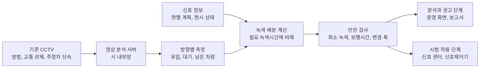
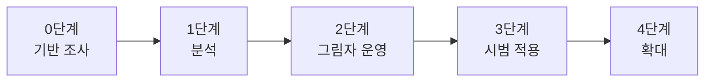

# 기존 CCTV를 활용한 시흥시 교차로 녹색신호 배분 개선

**시흥실록지리지 정책 제안서**

기준일 2026년 11월 13일

## 제안 요약

출퇴근 시간이나 행사 때 특정 방향에만 차가 몰려도, 대부분의 신호교차로는 미리 정한 시간표대로 녹색신호를 준다. 이 제안서는 시흥시 교차로에 이미 설치된 CCTV 영상으로 방향별 대기 차량을 파악하고, 신호주기는 그대로 둔 채 차가 몰리는 방향에 녹색시간을 더 배분하는 신호 운영 방식을 시흥시에 제안한다. 새 검지기를 설치하지 않으므로 스마트교차로 장비가 없는 교차로에도 적용할 수 있다.

| 항목 | 내용 |
| --- | --- |
| 무엇을 | 기존 CCTV 영상으로 방향별 대기를 재고, 차가 몰리는 방향에 녹색시간을 더 배분하는 신호 운영 |
| 어디에 | 시흥시 신호교차로. 스마트교차로 장비가 없고 방향별 수요 변동이 큰 교차로부터 시범 적용 |
| 누가(안) | 주관 시흥시 철도과 첨단교통팀, 신호 협의 시흥경찰서, 영상 운영 시흥시 도시정보통합센터 |
| 어떻게 | 실제 신호를 바꾸지 않고 분석하고 권고값을 기록하는 그림자 운영부터 시작해, 경찰이 승인한 교차로에 시범 적용한 뒤 넓혀 간다 |
| 재원(안) | 신호를 바꾸지 않는 단계는 시 예산, 확대 단계는 국토교통부 지자체 ITS 국고보조사업 공모 |
| 기대효과 | 차가 몰리는 방향의 대기 시간을 줄이고, 신호계획을 고칠 근거 자료를 확보하며, 기존 CCTV의 활용도를 높인다 |

계산 예시와 목표값은 설계를 위한 가상값이며 달성한 성과가 아니다. 영상 분석 방법, 배분 산식, 검증 계획과 전체 근거는 [기술설계서](기술설계/기술설계서.md)에 정리했다. 기술설계서는 이전 README를 장 번호 그대로 옮긴 문서이므로, 다른 팀 문서가 인용하는 "README 6장", "README 13장" 같은 장과 절 번호는 기술설계서의 같은 장과 절을 가리킨다.

## 목차

- [1. 제안 배경](#1-제안-배경)
- [2. 현황과 문제점](#2-현황과-문제점)
- [3. 제안 내용](#3-제안-내용)
- [4. 추진 방안](#4-추진-방안)
- [5. 기대효과와 성과지표](#5-기대효과와-성과지표)
- [6. 위험과 대응](#6-위험과-대응)
- [7. 관련 문서](#7-관련-문서)
- [8. 참고 자료](#8-참고-자료)

## 1. 제안 배경

### 1.1 시간표대로 움직이는 신호

대부분의 신호교차로는 시간대별로 미리 정한 신호계획에 따라 움직인다. 같은 시간대에는 매일 똑같은 녹색시간을 주지만, 실제 통행량은 요일, 행사, 공사, 사고, 하교 시간에 따라 달라진다. 계획이 수요와 맞지 않으면 한 방향은 녹색이 끝나도 차가 남고, 다른 방향은 지나갈 차가 없는데 녹색이 켜져 있다. 2023년 논문도 국내 신호교차로 대부분이 시간대별로 고정된 신호를 쓰고 있어 한 시간 안팎의 짧은 교통량 변화에 대응하지 못한다고 지적한다[자료 7](#자료-7-의왕시-실증-논문-2023).

### 1.2 시흥시의 교통신호 현황

| 구분 | 현황 | 출처 |
| --- | --- | --- |
| 스마트교차로 | 영상으로 접근 차량과 보행자 정보를 모으는 스마트교차로를 2020년까지 처음 구축한 뒤 늘려 와, 2025년 11월 기준 83개소다 | [자료 1](#자료-1-시흥시-its-구축-보도-2021), [자료 2](#자료-2-시흥시-스마트교차로-현황) |
| 실시간 신호정보 제공 | 2026년 3월부터 배곧동과 정왕동 주요 교차로의 신호 색상과 남은 시간을 민간 내비게이션에 제공한다 | [자료 3](#자료-3-시흥시-실시간-신호정보-보도-2026) |
| 긴급차량 우선신호 | 2026년 4월, 주요 교차로 400곳에 광역 긴급차량 우선신호를 구축하는 계획을 발표했다 | [자료 4](#자료-4-시흥시-긴급차량-우선신호-보도-2026) |
| AI 보행신호 자동연장 | 2026년 10월 횡단보도 17개소에서 운영을 시작했다. 시흥경찰서와 협의해 지점을 골랐고 도시정보통합센터에서 운영한다 | [자료 5](#자료-5-시흥시-보행신호-자동연장-보도-2026) |
| 관련 연구와 실증 | 2026년 ITS 기본계획 수립 용역 공고, 시흥시정연구원이 발주한 스마트교차로 연계 실시간 신호체계 시뮬레이션 분석 계약, 참여기업이 밝힌 5개 교차로 디지털 예측제어 실증이 있다 | [자료 6](#자료-6-시흥시-정책-조사-자료) |

시흥시는 스마트교차로, 신호정보 연계, 영상 기반 보행신호 연장을 이미 운영하고 있어 이 제안을 받아들일 기반을 갖추고 있다. 특히 보행신호 자동연장은 AI로 영상을 분석해 실제 신호를 바꾸는 시흥시 안의 선례다. 시흥경찰서와 협의해 지점을 고르고 도시정보통합센터에서 운영하는 경로도 이 제안과 같다. 다만 차량 통행량에 맞춰 녹색시간을 바꾸는 신호를 상시 운영하는 범위와 방식은 공개 자료에서 확인되지 않았다.

### 1.3 다른 지자체 사례

| 지자체 | 내용 | 결과 | 출처 |
| --- | --- | --- | --- |
| 의왕시(2022) | 철도박물관로 4개 교차로에서 스마트교차로 영상 교통량으로 경찰청 실시간 신호 알고리즘을 운영했다. 주기는 고정하고 녹색시간을 3초씩 옮겼다 | 4개 교차로의 평균 제어지체가 7.1~30.6% 줄었다. 옵셋을 다시 맞춘 뒤 구간 속도가 시속 약 3~5km 올랐다. 사전 하루와 사후 하루를 비교한 결과다 | [자료 7](#자료-7-의왕시-실증-논문-2023), [자료 8](#자료-8-의왕시와-고양시-사례-조사) |
| 고양시(2026) | 화정로 7개 교차로에서 스마트교차로 방향별 CCTV 교통량으로 AI가 신호시간을 계산해 현장 신호제어기에 자동 적용한다. 고양경찰서와 협의해 4월에 시범운영하고 5월에 정식 운영을 시작했다 | 지체 수치는 공개되지 않았다. 원래 원활한 구간이라 서비스 수준이 크게 나아지지는 않았다고 시가 설명했다 | [자료 9](#자료-9-고양시-실시간-교통신호-보도-2026) |
| 부산시 | 실시간 신호제어와 스마트 감응신호를 시범운영했다 | 지체시간이 각각 10% 이상, 36% 줄었다고 발표했다. 측정 주체와 방법은 기사에 없다 | [자료 10](#자료-10-부산시-ai-교통체계-보도-2026) |
| 강릉시 | 관광객이 몰리는 일대에서 AI가 대기 행렬을 분석해 신호 시간을 조절한다 | 관제 인력이 24시간 확인하며 판단하고, 대응 자동화는 장기 계획으로 두었다 | [자료 11](#자료-11-강릉시-ai-신호-보도-2026) |

다른 지자체에서도 이미 영상으로 교통량을 재서 신호를 바꾸고 있다. 다만 의왕시와 고양시는 모두 스마트교차로용 카메라를 썼다. 이 제안은 방범용과 교통 관제용으로 설치된 기존 CCTV까지 활용해, 스마트교차로가 없는 교차로에도 같은 방식을 적용하자는 것이다.

### 1.4 지금까지 확산되지 않은 이유

수요에 맞춰 신호를 바꾸는 시도는 1990년대부터 있었지만 현장에 자리 잡지 못한 경우가 많다. 이 제안은 아래 네 가지 실패 원인을 피하도록 설계했다(3.5절).

- **검지 장비를 믿을 수 없었다.** 도로에 묻는 루프검지기는 도로 파손과 재포장에 약해, 1997년 서울 조사에서 약 45%가 불량이거나 쓸 수 없는 상태였다[자료 12](#자료-12-치안정책연구소-차량검지기-연구-2010). 서울의 실시간 신호제어시스템(COSMOS)을 운영해 본 지자체들은 실시간 모드를 신뢰하지 않아 현장에서 쓰지 않게 됐다[자료 13](#자료-13-cosmos-포화도-진단-논문-2016).
- **경찰 협의가 막혔다.** 신호 운영을 바꾸려면 경찰과 협의해야 한다. 팀 조사 문서가 인용한 보도에 따르면, 110억 원을 들인 AI 신호 시스템이 경찰청 협의 지연으로 쓰이지 못했고, 경찰청 정책 변경으로 철거 위기에 놓인 스마트 교통안전 시스템도 있었다[자료 14](#자료-14-스마트교차로-사업-분석).
- **만든 뒤 운영비를 낼 주체가 없었다.** LH가 1,462억여 원을 들여 지은 영종지구 시설은 인천 중구가 운영비 과다 등을 이유로 인수를 거부해 수년간 쓰이지 못했다[자료 15](#자료-15-lh-영종지구-시설-인수-거부-2021). 같은 팀 조사 문서는 2019년 이후 스마트도시 사업 121개 중 52개가 완성되지 못하거나 서비스가 멈췄다는 보도를 인용한다[자료 14](#자료-14-스마트교차로-사업-분석).
- **수집 자료가 신호 운영으로 이어지지 않았다.** 스마트교차로가 늘었지만 수집 자료를 통계 분석 외에 신호 운영에 쓰는 사례는 드물다[자료 7](#자료-7-의왕시-실증-논문-2023).

## 2. 현황과 문제점

**첫째, 녹색시간이 수요 변화를 따라가지 못한다.** 시간대별 신호계획은 그날그날 달라지는 방향별 수요를 반영하지 못한다. 차가 몰린 방향에는 녹색이 끝나도 차가 남아 다음 신호까지 기다리고, 한산한 방향의 녹색시간은 비어 있는 채로 지나간다.

**둘째, 신호계획을 고칠 근거 자료가 부족하다.** 스마트교차로 장비가 없는 교차로에서는 방향별 대기와 남은 차량을 상시로 재는지 확인되지 않는다. 이런 교차로의 신호계획을 다시 짜려면 별도 교통량 조사가 필요하다.

**셋째, 이미 설치한 장비를 신호 운영에 활용하지 못하고 있다.** 교차로마다 방범, 교통 관제, 불법 주정차 단속용 CCTV가 있지만, 이 영상을 신호 운영에 쓴다는 공개 자료는 확인되지 않았다. 스마트교차로 자료도 전국적으로 통계 분석에 머무는 경우가 많다(1.4절).

## 3. 제안 내용

### 3.1 제안의 세 가지 원칙

1. **기존 CCTV를 다시 쓴다.** 방범, 교통 관제, 불법 주정차 단속용으로 이미 설치한 고정형 CCTV와 PTZ(회전 및 확대) CCTV를 쓴다. PTZ 카메라는 교통 측정용으로 등록한 화각(프리셋)에 있을 때만 측정하고, 시스템이 카메라를 움직이지는 않는다.
2. **주기는 그대로 두고 녹색 배분만 바꾼다.** 신호주기와 황색, 전적색 시간은 현행대로 두고, 현시별 녹색시간만 방향별 필요량에 비례해 다시 나눈다. 인접 교차로와의 연동 기준을 흔들지 않고, 기존 신호제어기의 주기식 운영 안에서 동작하기 위해서다.
3. **신호를 바꾸기 전에 근거부터 쌓는다.** 신호를 건드리지 않는 분석과 그림자 운영으로 먼저 효과를 확인하고, 경찰이 승인한 교차로와 시간대에서만 실제로 적용한다.

### 3.2 작동 방식

*그림 1 기존 CCTV 영상에서 녹색시간 배분까지의 흐름*

시 내부망의 분석 서버에서 영상을 처리하며, 원본 영상은 저장하지 않고 방향별 차량 집계값과 카메라 상태, 배분 판단 기록만 남긴다. 신호주기가 끝날 때마다 분석 서버가 방향별 유입 차량과 녹색신호가 끝난 뒤 남은 차량을 세어 필요한 녹색시간을 계산하고, 이 비율에 맞춰 다음 주기의 녹색시간을 나눈다. 계산 방법은 [기술설계서 6장](기술설계/기술설계서.md#6-녹색신호-가중-배분-알고리즘)에 있다.

### 3.3 계산 예시

신호주기 120초, 4현시, 한 주기의 녹색시간 합 100초인 가상 교차로에서 퇴근 시간에 동서 직진 방향으로 차가 몰린 상황이다.

| 현시 | 방향 | 현재 | 이 방향의 상황 | 1주기 뒤 | 2주기 뒤 | 목표 |
| --- | --- | --- | --- | --- | --- | --- |
| P1 | 동서 직진 | 30초 | 차가 몰려 녹색이 끝나도 6대가 남음 | 35초 | 38초 | 40초 |
| P2 | 동서 좌회전 | 20초 | 보통 | 21초 | 21초 | 21.6초 |
| P3 | 남북 직진 | 30초 | 한산함 | 26초 | 24초 | 21.6초 |
| P4 | 남북 좌회전 | 20초 | 한산함 | 18초 | 17초 | 16.8초 |

- 몰린 방향의 녹색시간은 늘고, 한산한 방향은 그만큼 준다. 녹색시간의 합(100초)과 신호주기(120초)는 변하지 않는다.
- 녹색시간을 목표치까지 한 번에 바꾸지 않고, 주기마다 현재 시간과 목표 시간 차이의 절반씩만 단계적으로 조정한다.
- 현행보다 10초 넘게 바뀌지 않도록 상한을 둔다. P1의 목표가 40초에서 멈춘 이유다.
- 남북 직진은 18초면 충분한 상황이라 24초로 줄어도 남는 차가 없을 것으로 예상한다. 실제로 차가 남으면 다음 주기에 그 방향의 녹색이 다시 늘어난다.

### 3.4 안전장치

- 충돌하는 방향에 동시에 녹색신호가 켜지지 않도록 막고, 황색신호와 전적색신호, 최소 녹색시간을 유지하는 역할은 현장 신호제어기가 최종적으로 맡는다. 시스템은 이 범위 안의 녹색시간 배분값만 보낸다.
- 차량 신호와 함께 켜지는 횡단보도의 보행시간보다 녹색시간이 짧아지지 않게 한다.
- 빠져나갈 공간이 없을 만큼 하류가 막힌 방향에는 녹색을 더 주지 않는다.
- 영상을 믿을 수 없거나(가림, 야간 화질 저하, PTZ 화각 이탈) 통신이 끊기거나 계산이 늦어지면 현행 신호계획으로 돌아간다.
- 운영자는 교차로별, 시간대별로 제어를 켜고 끌 수 있고 즉시 해제할 수 있다. 효과가 없는 시간대는 현행 계획을 쓴다.

### 3.5 기존 사업과 무엇이 다른가

배분 알고리즘은 의왕 실증과 같은 계열이다. 주기를 고정하고, 지나간 차량과 남은 차량으로 수요를 추정하며, 최소와 최대 녹색 안에서만 조정한다[자료 8](#자료-8-의왕시와-고양시-사례-조사). 그래서 알고리즘은 차별점으로 내세우지 않는다. 이 제안이 다른 점은 다음과 같다.

| 구분 | 의왕, 고양 사례 | 이 제안 |
| --- | --- | --- |
| 영상 | 스마트교차로용 카메라 | 방범, 교통 관제, 주정차 단속용 기존 CCTV(고정형, PTZ). 스마트교차로 자료도 같은 입력으로 받는다 |
| 적용 범위 | 스마트교차로가 설치된 교차로 | 스마트교차로가 없는 교차로까지 |
| 평가 | 사전 하루와 사후 하루 비교(의왕) | 제어를 켠 날과 끈 날을 번갈아 운영해 비교하고, 구간 통행속도까지 잰다 |

선행 사업의 실패 원인(1.4절)에는 다음과 같이 대응한다.

| 실패 원인 | 이 제안의 대응 |
| --- | --- |
| 검지 장비를 믿을 수 없었다 | 도로에 묻는 장비를 쓰지 않는다. 측정 품질을 주기마다 판정하고, 사람이 직접 센 표본과 정기적으로 대조해 정확도를 공개한다 |
| 경찰 협의가 막혔다 | 0단계부터 시흥경찰서와 협의하고, 그림자 운영 기록을 시와 경찰이 함께 검토한 뒤 시범 적용한다. 보행신호 자동연장과 같은 협의 경로를 쓴다 |
| 운영비를 낼 주체가 없었다 | 사업 계획에 교차로당 연간 운영비를 따로 적고, 부담 부서를 시행 전에 정한다. 고장은 원격으로 감시한다 |
| 수집 자료가 신호 운영으로 이어지지 않았다 | 측정, 녹색 배분, 신호 센터 전송을 처음부터 한 흐름으로 설계한다 |
| 녹색 배분만 바꾸면 구간 속도가 나아지지 않을 수 있다(의왕) | 구간 통행속도를 함께 재고, 옵셋 재조정을 후속 과제로 둔다 |

## 4. 추진 방안

### 4.1 추진 체계(안)

| 역할 | 기관 | 하는 일 |
| --- | --- | --- |
| 주관 | 시흥시 철도과 첨단교통팀 | 사업 추진, 대상 교차로 선정, 예산 확보 |
| 신호 협의와 승인 | 시흥경찰서(경기남부경찰청 확인 필요) | 그림자 운영 검토, 시범 적용 승인, 녹색시간 변경 범위 협의 |
| 영상 운영 | 시흥시 도시정보통합센터 | CCTV 영상 연계, 분석 서버 운영, 교통 측정용 프리셋 관리 |
| 신호 연계 | 시흥시 신호제어 사업자 | 신호 상태 수신, 녹색시간 변경 연계 |
| 연구와 평가 자문 | 시흥시정연구원, 교통공학 전문가 | 시뮬레이션 연계, 평가 설계 검토 |
| 협력(선택) | 시흥도시공사 | 개발사업지구의 신규 교차로, 공영주차장 주변 교차로 적용 검토 |
| 제안팀 | 시흥실록지리지 참가팀 | 분석 방법, 시뮬레이션, 운영 화면 시제품 |

신호기 설치와 관리는 도로교통법상 시장의 사무이고, 그 권한과 사무의 일부를 경찰에 위임하거나 위탁할 수 있다[자료 19](#자료-19-도로교통법). 시흥시에서 신호시간 변경 권한이 시와 경찰 사이에 어떻게 나뉘어 있는지는 0단계에서 확인한다.

### 4.2 단계별 추진 계획(안)

*그림 2 단계별 추진 순서. 1, 2단계는 실제 신호를 바꾸지 않는다.*

| 단계 | 기간(안) | 실제 신호 변경 | 하는 일 | 다음 단계로 가는 조건 |
| --- | --- | --- | --- | --- |
| 0. 기반 조사 | 2개월 | 없음 | CCTV 위치, 종류, 화각 조사. 시범 후보 선정. 시흥시정연구원 시뮬레이션과 예측제어 실증 결과 확인. 시흥경찰서 사전 협의 | 측정 가능한 교차로와 방향 목록 확정 |
| 1. 분석 | 3개월 | 없음 | 방향별 교통량과 대기 차량 통계를 내고 시간대별 신호계획 조정안을 마련한다 | 영상 측정 정확도 목표 충족 |
| 2. 그림자 운영 | 3개월 | 없음 | 주기마다 권고 녹색시간을 계산해 기록하고 시와 경찰이 검토 | 경찰의 시범 승인, 신호 연계 시험 통과 |
| 3. 시범 적용 | 3개월 | 승인된 교차로, 시간대, 변경 폭 안에서 | 제어를 켠 날과 끈 날을 번갈아 운영하며 효과 평가 | 지체가 줄고 어느 방향도 크게 나빠지지 않았음을 확인, 운영비 확보 |
| 4. 확대 | 평가 뒤 결정 | 확대 교차로 | 같은 생활권, 시 전역 순으로 확대하고 국비 공모 검토 | - |

기간은 제안값이며 시와 경찰의 협의로 조정한다. 참고로 고양시는 1월에 시스템 개발을 마치고 4월 한 달 시범운영을 거쳐 5월에 정식 운영을 시작했다[자료 9](#자료-9-고양시-실시간-교통신호-보도-2026).

### 4.3 시범 대상지 선정 기준

- 스마트교차로 장비가 없거나 방향별 수요 자료가 부족한 교차로
- 기존 CCTV가 접근로 대기열을 담는 화각을 갖춘 교차로
- 출퇴근이나 행사 때 방향별 수요가 크게 바뀌는 혼잡 교차로. 고양 화정로처럼 이미 원활한 구간에서는 효과가 작게 나올 수 있다
- 신호 상태를 받아 쓸 수 있는 교차로
- 녹색시간을 바꿨을 때 보행자의 횡단 시간이 충분한지 함께 확인할 수 있는 교차로

팀 조사에서는 둔대교차로, 시청, 장현 일대를 스마트교차로가 없는 지역으로 보고 카메라 현황 확인을 요청할 대상에 올렸다[자료 6](#자료-6-시흥시-정책-조사-자료). 실제 후보는 0단계 조사로 정한다.

### 4.4 개인정보와 법적 절차

- **영상 이용 근거:** 개인정보 보호법 제25조 제1항 제5호는 "교통정보의 수집ㆍ분석 및 제공을 위하여 정당한 권한을 가진 자가 설치ㆍ운영하는 경우"를 고정형 영상정보처리기기 설치와 운영의 허용 사유로 정한다[자료 17](#자료-17-개인정보-보호법). 방범용이나 주정차 단속용 CCTV에 교통정보 수집 목적을 더하려면 의견 수렴 절차가 필요하다는 개인정보보호위원회 질의응답이 있다[자료 18](#자료-18-개인정보보호위원회-질의응답).
- **처리 원칙:** 원본 영상을 저장하지 않고 집계값만 남긴다. 차량번호와 얼굴은 인식하지 않는다. 영상 처리는 시 내부망에서 하고, 외부 AI 서비스로 보내지 않는다. 시스템은 카메라를 조작하지 않는다.
- **신호 운영:** 주기를 고정하지 않는 실시간 신호는 법령에 기준이 없어 규제특례로만 실증했다는 자료가 있다[자료 20](#자료-20-ai-교통신호등-실증특례). 주기를 유지하고 녹색 배분만 바꾸는 이 방식을 특례 없이 적용할 수 있는지 0단계에서 경찰에 확인한다.

### 4.5 소요 예산과 재원

| 항목 | 내용 |
| --- | --- |
| 기반 조사 | 시범 후보 교차로의 카메라 조사와 대상지 선정 |
| 분석 서버 | 시 내부망에 두는 영상 분석 서버 |
| 소프트웨어와 설정 | 영상 분석, 녹색 배분, 운영 화면, 교차로별 측정 영역 설정 |
| 신호 연계 | 영상관리시스템과 신호 센터 연계 |
| 효과 평가 | 그림자 운영과 시범 적용의 평가 |
| 운영과 유지관리(연간) | 화각 변경 대응, 정확도 재검증, 장애 대응 |

새 카메라와 검지기는 설치하지 않는다. 금액은 0단계 조사로 측정 가능한 교차로 수가 정해진 뒤 산정하고, 같은 교차로에 전용 검지기를 설치하는 경우와 비교해 제시한다. 재원은 신호를 바꾸지 않는 0~2단계를 시 예산으로, 확대 단계를 국토교통부 지자체 ITS 국고보조사업 공모로 마련하는 방안을 제안한다. 이 공모는 2022년 신규사업 기준으로 국비가 40~60%이고 나머지를 시가 부담한다[자료 16](#자료-16-지자체-its-국고보조사업-선정-2021).

### 4.6 지속 운영 방안

- 교차로당 연간 운영비를 사업 계획에 따로 적고, 어느 부서 예산에서 낼지 시행 전에 정한다.
- 카메라와 분석 서버의 고장을 원격으로 감시해 담당자에게 알린다.
- 영상 측정 정확도를 사람이 직접 센 표본과 정기적으로 대조하고, 결과를 운영 화면에 공개한다.
- 시와 경찰이 같은 운영 화면과 변경 기록을 조회한다.
- 효과가 없거나 지체가 늘어난 시간대는 제어를 끄고 현행 신호계획을 쓴다.

## 5. 기대효과와 성과지표

### 5.1 기대효과

- **교통:** 차가 몰리는 방향의 남은 차량과 교차로 평균 지체가 줄어들 것으로 기대한다. 의왕 실증에서는 4개 교차로의 제어지체가 7.1~30.6% 줄었고, 부산은 시범운영에서 10% 이상과 36% 감소를 발표했다. 다만 조건이 달라 시흥에서 같은 크기를 기대할 근거는 아니며, 시범 적용으로 확인한다.
- **행정:** 방향별, 시간대별 수요 자료가 상시로 쌓여 신호계획을 다시 짤 때 근거로 쓸 수 있다.
- **투자 효율:** 새 장비 없이 이미 설치한 CCTV와 스마트교차로 자료를 신호 운영에 활용한다.
- **확산:** 시흥에서 검증한 절차와 점검 목록은 같은 문제를 가진 다른 지자체가 참고할 수 있다.

### 5.2 성과지표(안)

| 지표 | 측정 방법 | 목표(안) |
| --- | --- | --- |
| 시범 교차로 평균 지체(초/대) | 영상 측정, 제어를 켠 날과 끈 날 비교 | 현행 계획보다 감소 |
| 가장 나빠진 방향의 지체 | 영상 측정, 제어를 켠 날과 끈 날의 방향별 지체 비교 | 현행보다 10% 넘게 늘지 않음 |
| 녹색 뒤 남은 차량이 생긴 주기 비율 | 녹색신호가 끝날 때 통과하지 못한 차량이 남은 주기의 비율 측정 | 몰리는 방향에서 감소 |
| 구간 통행속도 | 인접 교차로를 포함한 구간 측정 | 현행보다 떨어지지 않음 |
| 영상 측정 정확도 | 사람이 센 표본과 비교한 방향별 5분 유입 대수 오차 | 주간 10% 이하 |
| 안전장치 작동 | 제약 위반과 현행 계획 복귀 기록 | 제약 위반 0건, 측정 불가 때 복귀 100% |
| 신호계획 개선 활용 | 영상 분석 결과를 반영해 시간대별 신호계획을 조정한 건수 | 시범 기간 중 확인 |

목표는 시범 적용 전에 시와 경찰이 함께 확정하고, 결과를 본 뒤 유리하게 바꾸지 않는다.

## 6. 위험과 대응

| 위험 | 대응 |
| --- | --- |
| 기존 CCTV 화각이 대기열을 충분히 담지 못한다 | 0단계에서 측정 가능한 교차로와 방향을 먼저 가린다. 측정할 수 없는 방향이 있는 교차로는 현행 계획을 유지한다 |
| PTZ 카메라가 관제 중 자주 돌아간다 | 프리셋에 머무는 비율을 재고, 비율이 낮으면 고정형 카메라가 있는 교차로부터 적용한다 |
| 경찰 승인이 늦어진다 | 분석과 그림자 운영만으로도 신호계획 조정 근거를 얻도록 단계를 나눈다 |
| 녹색이 한 방향으로 쏠려 다른 방향에서 민원이 생긴다 | 최소 녹색과 변경 폭 상한을 두고, 방향별 최대 대기를 운영 화면에 공개한다 |
| 영상 이용에 대한 개인정보 우려가 생긴다 | 원본 영상을 저장하지 않고 집계값만 남긴다. 목적 추가 절차와 처리 방식을 시민에게 공개한다 |
| 도입 뒤 운영비가 끊긴다 | 연간 운영비를 사업 계획에 따로 적고 부담 부서를 시행 전에 정한다 |

## 7. 관련 문서

| 문서 | 내용 |
| --- | --- |
| [기술설계서](기술설계/기술설계서.md) | 영상 분석, 녹색 배분 산식, 검증 계획, 선행 사업의 실패 원인과 경제성, 전체 출처 |
| [의왕시와 고양시 사례 조사](사례분석/uiwang-goyang-cases-2026-11-13.md) | 두 사례의 알고리즘과 결과, 이 제안과의 비교 |
| [시흥시 정책 조사 자료](정책분석/siheung-policy-sources-2026-11-13.md) | 시흥시 신호와 CCTV 관련 정책, 공개 데이터, 기관에 요청할 자료 |
| [스마트교차로 사업 분석(삭제 전 마지막 판)](https://github.com/ukj-luke/sisilji_traffic/blob/c0447ea/%EC%82%AC%EB%A1%80%EB%B6%84%EC%84%9D/%EC%8A%A4%EB%A7%88%ED%8A%B8%EA%B5%90%EC%B0%A8%EB%A1%9C_%EC%82%AC%EC%97%85%EB%B6%84%EC%84%9D.md) | 다른 지역 스마트교차로 사업의 성과와 실패 원인. 저장소에서는 삭제됐다 |

## 8. 참고 자료

확인 기준일은 2026년 11월 13일이다. 보도는 기사 시점의 계획과 실적이므로 현재 상태는 기관에 다시 확인한다. 팀 문서로 표시한 자료는 이 저장소의 조사 문서이며, 원래 출처는 각 문서에 있다.

### 자료 1 시흥시 ITS 구축 보도 2021

아주경제, 2021년 9월 24일. ITS 국고보조사업 3년 연속 선정, 스마트 교차로와 교통 CCTV, 신호제어기 무선 온라인 연계 구축.

[아주경제 기사 원문](https://www.ajunews.com/view/20210924073220305)

### 자료 2 시흥시 스마트교차로 현황

공공데이터포털 「경기도 시흥시_스마트교차로 현황」, 2025년 11월 5일 기준 83개소.

[공공데이터포털](https://www.data.go.kr/data/15090289/fileData.do)

### 자료 3 시흥시 실시간 신호정보 보도 2026

아시아경제, 2026년 8월 12일. 배곧동과 정왕동 주요 교차로의 실시간 신호정보 제공과 전국 확대 협약.

[아시아경제 기사 원문](https://view.asiae.co.kr/article/2026081213013317600)

### 자료 4 시흥시 긴급차량 우선신호 보도 2026

주간한국, 2026년 4월 24일. 광역 긴급차량 우선신호 시스템을 교차로 400곳에 우선 적용하는 계획.

[주간한국 기사 원문](https://weekly.hankooki.com/news/articleView.html?idxno=7161403)

### 자료 5 시흥시 보행신호 자동연장 보도 2026

데이터넷, 2026년 10월 23일. 횡단보도 17개소의 AI 영상분석 보행신호 자동연장, 시흥경찰서 협의, 도시정보통합센터 운영.

[데이터넷 기사 원문](https://www.datanet.co.kr/news/articleView.html?idxno=215317)

### 자료 6 시흥시 정책 조사 자료

팀 문서. 2026년 ITS 기본계획 수립 용역, 시흥시정연구원 시뮬레이션 분석 용역, 5개 교차로 디지털 예측제어 실증, 공개 데이터, 기관에 요청할 자료.

[시흥시 정책 조사 자료](정책분석/siheung-policy-sources-2026-11-13.md)

### 자료 7 의왕시 실증 논문 2023

이상욱, 전보배, 오석진, 윤일수, 「스마트교차로 데이터를 활용한 실시간 교통신호제어 운영 효과 분석」, 한국ITS학회논문지 22권 4호, 2023.

[논문 원문](https://koreascience.kr/article/JAKO202325543359055.pdf)

### 자료 8 의왕시와 고양시 사례 조사

팀 문서. 의왕 실증의 알고리즘과 교차로별 결과, 고양 화정로 운영, 이 제안과의 비교.

[의왕시와 고양시 사례 조사](사례분석/uiwang-goyang-cases-2026-11-13.md)

### 자료 9 고양시 실시간 교통신호 보도 2026

경기일보, 2026년 5월 27일. 화정로 7개 교차로 시범운영과 정식 운영, 고양경찰서 협의.

[경기일보 기사 원문](https://kyeonggi.com/article/20260527580176)

### 자료 10 부산시 AI 교통체계 보도 2026

파이낸셜뉴스, 2026년 9월 23일. 실시간 신호제어와 스마트 감응신호의 시범운영 결과.

[파이낸셜뉴스 기사 원문](https://www.fnnews.com/news/202609231714366849)

### 자료 11 강릉시 AI 신호 보도 2026

MTN 머니투데이방송, 2026년 9월 20일. AI 신호 시간 조절과 관제 인력의 24시간 확인.

[MTN 기사 원문](https://news.mtn.co.kr/news-detail/2026091923204035151)

### 자료 12 치안정책연구소 차량검지기 연구 2010

치안정책연구소, 「경찰교통의 첨단교통관리시스템(ATMS) 차량검지기 설치검지율에 관한 연구」, 2010. 루프검지기 고장 원인과 1997년 서울시 조사.

[보고서 원문](https://www.police.ac.kr/pds/PSI_2010-30_1297158168.pdf)

### 자료 13 COSMOS 포화도 진단 논문 2016

김준용, 김진태, 「교통조건, 기하구조 조건 및 검지기 설치위치에 따른 실시간신호제어시스템 포화도 산출방식 진단」, 대한교통학회지 34권 1호, 2016.

[논문 원문](https://cdn.apub.kr/journalsite/sites/kst/2016-034-01/N0210340107/N0210340107.pdf)

### 자료 14 스마트교차로 사업 분석

팀 문서. 다른 지역 스마트교차로 사업의 성과와 실패 원인, 경찰청 협의 지연과 스마트도시 사업 중단 보도 인용.

[스마트교차로 사업 분석(삭제 전 마지막 판)](https://github.com/ukj-luke/sisilji_traffic/blob/c0447ea/%EC%82%AC%EB%A1%80%EB%B6%84%EC%84%9D/%EC%8A%A4%EB%A7%88%ED%8A%B8%EA%B5%90%EC%B0%A8%EB%A1%9C_%EC%82%AC%EC%97%85%EB%B6%84%EC%84%9D.md)

### 자료 15 LH 영종지구 시설 인수 거부 2021

스마트투데이, 2021년 8월 10일. 감사원 「스마트도시 조성사업 추진실태」 감사보고서 연재. 영종지구 생활폐기물 자동집하시설의 인수 거부와 유지관리비.

[스마트투데이 기사 원문](https://www.smarttoday.co.kr/ko-kr/articles/21358)

### 자료 16 지자체 ITS 국고보조사업 선정 2021

스마트투데이, 2021년 9월 9일. 2022년 지자체 ITS 국고보조사업 신규 선정과 국비 매칭 비율.

[스마트투데이 기사 원문](https://www.smarttoday.co.kr/ko-kr/articles/21517)

### 자료 17 개인정보 보호법

제25조(고정형 영상정보처리기기의 설치ㆍ운영 제한) 제1항 제5호와 제5항.

[국가법령정보센터 개인정보 보호법](https://www.law.go.kr/법령/개인정보보호법)

### 자료 18 개인정보보호위원회 질의응답

개인정보보호위원회 「개인정보 질의응답 모음집」(2024년 12월) 가운데 방범용과 주정차 단속용 CCTV에 교통정보 수집 목적을 더하는 문항. 법률 정보 사이트에 옮겨진 내용으로 확인했다.

[질의응답 정리](https://www.nepla.ai/wiki/it-%EC%A0%95%EB%B3%B4-%EB%B0%A9%EC%86%A1%ED%86%B5%EC%8B%A0/%EA%B0%9C%EC%9D%B8%EC%A0%95%EB%B3%B4-%EC%9C%84%EC%B9%98%EC%A0%95%EB%B3%B4-%EC%8B%A0%EC%9A%A9%EC%A0%95%EB%B3%B4/-%EC%9D%BC%EB%AC%B8%EC%9D%BC%EB%8B%B5-%EB%B6%88%EB%B2%95-%EC%A3%BC%C2%B7%EC%A0%95%EC%B0%A8-%EB%8B%A8%EC%86%8D%EC%9A%A9-%EB%98%90%EB%8A%94-%EB%B0%A9%EB%B2%94%EC%9A%A9%EC%9C%BC%EB%A1%9C-cctv%EB%A5%BC-%EC%84%A4%EC%B9%98%C2%B7%EC%9A%B4%EC%98%81%ED%95%98%EB%8A%94-%EA%B3%B5%EA%B3%B5%EA%B8%B0%EA%B4%80%EC%9D%B4-%EC%84%A4%EC%B9%98-%EB%AA%A9%EC%A0%81%EC%97%90-%EA%B5%90%ED%86%B5%EC%A0%95%EB%B3%B4-%EC%88%98%EC%A7%91%EC%9D%84-%EC%B6%94%EA%B0%80%ED%95%A0-%EC%88%98-%EC%9E%88%EB%82%98%EC%9A%94-0vyn5zrzdnd7)

### 자료 19 도로교통법

제3조(신호기 등의 설치 및 관리) 제1항과 제147조(위임 및 위탁 등) 제1항.

[국가법령정보센터 도로교통법](https://www.law.go.kr/법령/도로교통법)

### 자료 20 AI 교통신호등 실증특례

스마트도시 종합포털의 '영상인식을 이용한 AI 교통신호등 서비스' 소개. 비주기 실시간 신호 기준 부재와 경찰청 협의 조건의 실증특례. 원문 페이지를 열지 못해 검색 결과 요약으로만 확인했다.

[스마트도시 종합포털 페이지](https://smartcity.go.kr/?p=39818)
