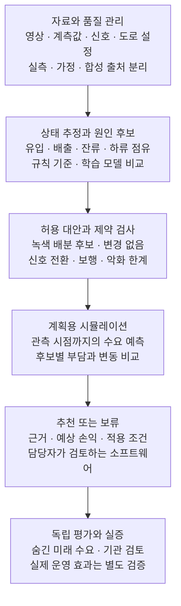

# 공공기관용 교통운영 대안 추천 알고리즘

**시흥시와 공기업을 대상으로 하는 창업 설계 계획서**

설계 기준일  2026년 11월 13일

## 사업 제안

영상·교통량·신호 자료에서 교통 상태와 병목 원인 후보를 파악하고, 운영 제약을 충족하는 대안을 비교해 담당자에게 추천하는 소프트웨어를 개발한다. 시흥시의 교통·ITS 업무 부서와 관리 대상이 명확한 공기업을 고객 후보로 삼는다. 기관의 기존 계측·관제체계에 자료 입력과 결과 모듈로 연결하는 제품을 지향한다.

학생팀의 첫 모델은 상류·중앙·하류 교차로 3개로 구성한 가상 도로축에서 중앙 교차로의 녹색 배분 후보를 검증한다. 계수 기능에 더해 원인 후보, 제약 검사, 반복 시뮬레이션과 추천 근거까지 구현한다. 현장 운영의 변경은 별도 실증과 관계기관의 판단을 거치는 범위로 둔다.

| 설계 항목 | 핵심 결정 |
| --- | --- |
| 첫 제품 | 교통운영 대안 검증·추천 소프트웨어 모듈과 실행·검증 기록 |
| 초기 알고리즘 | 상태 추정 → 규칙 기반 진단 → 허용 후보 축소 → 제약 검사 → SUMO 비교 → 추천 또는 보류 |
| 차별화 가설 | 불완전한 관측의 한계를 표시하고 원인 근거·대안 손익·인접 도로 악화를 연결 |
| 실증 구조 | 합성 기능 검증, 실측 보정, 제어 없는 그림자 운영, 승인된 현장 비교평가를 구분 |
| 수익 구조 | 유료 검증·현장 설정, 소프트웨어 사용권, 추가 분석망과 유지관리 계약 |

현재 둔대의 실제 영상·실행 신호 로그와 고객의 구매 의사는 확보되지 않았다. 수치와 실험 설정은 제안값이며 달성 성과가 아니다. 구현 기간과 추진 일정은 포함하지 않는다.

## 목차

- [1. 고객과 구매 문제](#1-고객과-구매-문제)
- [2. 제품과 첫 계약의 범위](#2-제품과-첫-계약의-범위)
- [3. 전체 기술 구조](#3-전체-기술-구조)
- [4. 데이터 확보와 공통 규격](#4-데이터-확보와-공통-규격)
- [5. 학생 초기 모델의 실행 사양](#5-학생-초기-모델의-실행-사양)
- [6. 상태 추정과 원인 후보 진단](#6-상태-추정과-원인-후보-진단)
- [7. 후보 탐색과 추천 목적함수](#7-후보-탐색과-추천-목적함수)
- [8. 학습 모델과 영상 AI의 위치](#8-학습-모델과-영상-ai의-위치)
- [9. 차별성 가설과 경쟁 검증](#9-차별성-가설과-경쟁-검증)
- [10. 합성 실험과 미래정보 분리](#10-합성-실험과-미래정보-분리)
- [11. 공정한 비교와 성능 지표](#11-공정한-비교와-성능-지표)
- [12. 공공기관 실증 방법](#12-공공기관-실증-방법)
- [13. 검수 기준과 기관의 구매 가치](#13-검수-기준과-기관의-구매-가치)
- [14. 수익모델과 가격 산정](#14-수익모델과-가격-산정)
- [15. 원가와 확장성 검증](#15-원가와-확장성-검증)
- [16. 실증 고객 확보와 공공 판매 경로](#16-실증-고객-확보와-공공-판매-경로)
- [17. 배포와 운영 설계](#17-배포와-운영-설계)
- [18. 역할과 진행 판단 기준](#18-역할과-진행-판단-기준)
- [19. 공공기관과 데이터 출처](#19-공공기관과-데이터-출처)
- [20. 기술과 제품 참고 자료](#20-기술과-제품-참고-자료)

## 1. 고객과 구매 문제

### 1.1 우선 고객

둔대교차로를 첫 사례로 유지할 경우 우선 수요 검증 대상은 시흥시의 교통·ITS 업무 부서이다. 2026년 11월 13일 공식 업무안내에서 철도과 첨단교통팀의 ITS 기본계획·교통량 DB 분석·ITS/BIS 구축·운영 업무를 확인했다. 교통시설 관련 업무와 계약 주체는 별도로 확인한다.[R1](#r1-시흥시-its-담당업무), [R2](#r2-시흥시-교통행정과-업무안내)

시흥도시공사는 공영주차장 운영기관이므로 진출입 대기와 주차시설 운영 분석의 확장 고객 후보가 될 수 있다. 주차시설은 게이트 배정·진입 관리 등 행동과 제약을 따로 설계해야 하며 초기 신호 모델의 납품 범위에 포함하지 않는다. 공기업이라는 이유로 시가지 신호 운영권이나 구매 수요가 있다고 가정하지 않는다.[R3](#r3-시흥도시공사-공영주차장-운영)

| 역할 | 확인할 대상과 질문 |
| --- | --- |
| 업무 사용자 | 분석·운영 담당자. 어떤 구간의 어떤 대안을 반복 검토하는가 |
| 구매·계약 담당 | 해당 사업의 예산·계약 책임 부서. 구매 단위와 절차는 무엇인가 |
| 자료 제공자 | 영상·신호·버스·도로망 보유기관. 어떤 형식과 범위의 자료를 제공할 수 있는가 |
| 시스템 운영자 | ITS 운영기관·사업자. 연계·설치·장애 대응의 책임은 누구에게 있는가 |
| 현장 적용 결정자 | 도로·교통 운영 관계기관. 대안 검토와 변경 승인 경로는 무엇인가 |

### 1.2 구매 가설

기관의 구매 가치는 혼잡 구간을 설명하고 운영 대안을 비교하는 작업의 품질·재현성·효율을 높이는 데서 검증한다. 확인할 문제는 자료 불일치, 반복적인 모형 설정, 대안 비교 부담, 근거 확인과 결과 설명 등이다. 이러한 문제가 시흥시에 실제로 얼마나 큰지는 담당자의 업무 사례로 확인한다.

시흥시 공식 발주계획에서 기존 ITS 유지관리 사업을 확인할 수 있지만, 기존 사업비를 신규 알고리즘의 매출로 계산하지 않는다. 기존 운영체계와 담당업무가 있다는 근거와 신규 제품에 대한 지불 의사는 구분한다.[R4](#r4-시흥시-공식-발주계획)

## 2. 제품과 첫 계약의 범위

### 2.1 기관이 구매할 결과물

판매 단위는 알고리즘 설명서나 분석 보고서 하나에 한정하지 않는다. 자료를 입력하고 대안을 실행·비교할 수 있는 프로그램, 결과 화면과 API, 설정 파일, 평가 코드와 검증 기록을 묶는다. 초기 배포는 파일 입력 방식의 독립 실행형으로 설계하고, 실제 연계 요구를 확인한 뒤 기관 내부 설치·기존 ITS 모듈 연결을 추가한다.

| 상품 | 구체적인 범위 | 검수할 납품물 |
| --- | --- | --- |
| 알고리즘 검증 패키지 | 합의한 교차로·접근로, 정해진 자료와 후보 정책 | 입력 명세, 보정·시험 기록, 기준과 추천안 비교, 실행 파일 |
| 운영 분석 소프트웨어 | 등록된 분석망에서 상태·근거·대안 비교 | 화면·API, 권한·설정 관리, 버전과 실행 기록 |
| 추가 분석망 설정 | 같은 신호 운영 문제의 새 교차로·도로축 연결·자료 매핑 | 설정 파일, 관측 범위, 신규 장소의 검증 결과 |
| 유지관리와 분석 지원 | 합의한 오류 대응·설정 변경·성능 점검 | 지원 기록, 변경 이력, 재검증 범위 |

### 2.2 첫 제품의 기능 경계

핵심은 관측 가능한 상태와 원인 후보, 허용 대안의 비교·추천이다. 현장 신호기 직접 제어, 신호기 교체, 도시 전역 실시간 관제와 대규모 통신 인프라 구축은 초기 계약의 전제로 두지 않는다. 보안·배포·연계 조건은 수요기관의 요구에 따라 범위를 정한다.

### 2.3 학생팀과 협력 영역

학생팀은 공통 데이터 규격, 상태·진단·후보 생성 코드, SUMO 실험기와 결과 화면을 개발할 수 있다. 실제 회전수요와 신호 자료 확보, 도로 연결 검토, 운영 제약 확정, 모형 보정의 타당성과 현장 적용 판단은 기관·교통공학 전문가의 협력이 필요한 영역이다. 자체 제약 검사 통과를 현장 안전 인증으로 표현하지 않는다.

## 3. 전체 기술 구조

공통 엔진과 장소별 설정을 분리한다. 원시 영상이 없어도 기관의 기존 계측값 또는 합성 관측값을 같은 데이터 규격으로 받는다. 자료가 부족한 경우에는 해당 판단을 비활성화하고 부족한 항목을 출력한다. 추천 당시의 정보와 평가용 정답도 저장 영역을 분리한다.



공통 엔진은 재사용하고 차로 연결·신호 제약·관측 범위·정류장 설정을 장소별로 교체한다.

*그림 1 공통 분석 엔진과 독립 평가를 분리한 제품 구조*

### 3.1 학생 초기 모델의 최소 구성

- 계측 모듈은 차량의 유입·배출·관측 정차와 자료 품질을 표준 특징으로 만든다.
- 규칙 진단기는 원인 후보와 근거를 산출한다. 학습 모델은 같은 입출력 계약으로 교체할 수 있다.
- 후보·제약 엔진은 변경 없음과 허용된 녹색 배분안을 생성하고 금지된 후보를 제거한다.
- 실험·추천 모듈은 계획용 수요에서 손익을 비교하며 근거·불확실성·보류 사유를 보여준다.

### 3.2 독립 평가

사건 주입 조건·실제 미래 수요·사후 최선 대안은 평가자만 사용한다. 추천기에 전달하는 값과 파일을 명시적으로 제한하고 실행별 자료 마감시각을 기록한다. 미래를 알고 선택한 대안은 추천 성과가 아닌 평가용 상한으로만 표시한다.

## 4. 데이터 확보와 공통 규격

| 자료 | 필요한 내용 | 미확보 시 처리 |
| --- | --- | --- |
| 교통 상태 | 방향별 진입·배출, 정차·대기, 하류 점유 | 합성값으로 기능 시험. 실측 성능은 미검증 |
| 신호 | 시간대별 계획과 실제 전환 로그, 이동방향 연결 | 가상 계획 명시. 계획을 실행 로그로 대체하지 않음 |
| 도로 형상 | 차로 연결·길이·정지선·하류 저장공간 | 참조 도로망으로 표시. 정밀 복제 주장 금지 |
| 영상 | 고정 시야, 원본 시각, 화질·가림·단절 정보 | 영상 AI 모듈 성능을 발표하지 않음 |
| 버스 선택자료 | 비식별 차량·노선·방향, 실제 도착·출발 | 관련 진단 비활성화. ETA를 실제 도착으로 대체하지 않음 |
| 운영 기준 | 허용 현시·최소시간·보행 조건·악화 한계 | 가상 제약과 현장 확인값을 분리 |

### 4.1 표준 식별자와 시간

기본 식별자는 기관·프로젝트·장소·차로·이동방향·신호군·실행 ID이다. 관측시각, 조회시각, 저장시각과 시뮬레이션 시간을 분리한다. 화면은 Asia/Seoul을 사용하고 원본 시각과 시간 보정 이력을 보존한다. source_type에는 실측·공개 통계·추정·가정·합성을 구분한다.

### 4.2 관측 한계

결측은 0으로 채우지 않는다. 화면 밖 대기열은 하한과 초과 표시로 기록하고 미터 보정이 없는 영상은 관측 정차차량 수를 제공한다. 신호와 영상의 시각 오차가 큰 구간은 세부 원인 판단을 보류한다. 신호가 보이지 않을 때 차량 정지만으로 적·녹을 확정하지 않는다.

### 4.3 공개자료의 역할

보유한 GITS 시간대별 평균속도는 조사 구간·시간대의 배경자료이다. 교차로 회전수요나 실제 현시의 정답으로 사용하지 않는다. GBIS 버스 위치정보 명세의 정류소 상태와 연속 궤적도 구분한다. 기관 협조 자료의 제공·반출·보관 조건은 자료별로 확인한다.[R5](#r5-경기버스정보-버스-위치정보-명세)

## 5. 학생 초기 모델의 실행 사양

### 5.1 가상 참조 도로망

상류 A·중앙 B·하류 C 교차로를 잇는 소규모 도로축을 구성한다. B의 변경이 A의 대기와 C의 저장공간에 미치는 영향을 평가한다. 초기 제어 변수는 B의 녹색 배분이며 모든 비교 정책에서 A·C의 프로그램·옵셋은 동일하게 유지한다. 아래 값은 둔대 실측값이 아닌 재현용 가상 설정이다.

| 설정 | 초기 가상값과 정의 |
| --- | --- |
| 교차로와 거리 | 신호교차로 3개, 교차로 사이 300m. 차로 연결은 설정 파일에 명시 |
| 집계와 관측 이력 | 10초 상태 집계와 최근 4개 완료 주기 이력. 주기 진단은 완료된 값 사용 |
| 신호주기 | 120초. 4현시 녹색 30·20·30·20초, 현시별 황색 3초·전적색 2초 |
| 녹색 후보 | 가상 최소 15초·최대 45초, 현시쌍 사이 5초 이동, 총주기 유지 |
| 후보 템플릿 | 변경 없음 1개와 현시쌍의 양방향 재배분 8개. 제약 통과 후 9개 이하 |
| 추천용 평가 | 최근 유입률 기반 9개 계획 표본. 첫 1주기 후보 적용, 둘째 주기 기준 복귀 |
| 보행 조건 | 차량 기전 시험에서는 가상 고정 제약. 사람의 대기·안전 성능은 별도 미검증 표시 |

### 5.2 입출력

입력은 판단시각까지의 유입·배출·정차·신호·하류 상태와 품질 정보이다. 출력은 추천 후보 ID, 바뀌는 녹색시간, 예상 누적 부담과 방향별 악화, 근거 ID와 적용 조건이다. 자료 부족·제약 미충족·효과 불명확·계산 지연이면 유지 또는 보류를 반환한다.

### 5.3 실행 방식

Python과 SUMO·TraCI로 구현하며 파일 입력과 반복 실행부터 검증한다. 추천 결과가 예정된 적용 시점까지 계산되지 않으면 해당 추천은 적용 대상으로 삼지 않는다. 실시간 가능 여부는 실제 장비와 후보 실행시간을 측정한 뒤 판단한다. TraCI는 외부 프로그램에서 시뮬레이션 상태와 신호를 다루는 인터페이스로 사용한다.[R6](#r6-eclipse-sumo-traci-신호-예제)

## 6. 상태 추정과 원인 후보 진단

### 6.1 상태 변수

이동방향별 유입·배출 대수, 정지선 통과, 녹색 중 배출, 녹색 종료 후 잔류, 하류 저장공간 사용률과 품질 정보를 사용한다. 유입·배출 보존으로 추정한 구간 내 전체 차량 수와 영상에서 본 정차차량 수는 별도 필드로 둔다. 보이지 않는 차량을 완전히 아는 실험도 별도로 표시한다. 계산 정의는 7장 세부 규칙에 고정한다.

### 6.2 규칙 기반 기준 모델

첫 진단기는 이해 가능한 규칙으로 구성한다. 다음 수치는 가상 실험의 초기 임계값이며 검증 집합에서 조정한 뒤 시험 전에 고정한다. 여러 후보가 동시에 발생할 수 있고, 필요한 관측이 없으면 해당 판단을 보류한다.

| 후보 | 가상 초기 규칙의 예 | 검토할 반대 근거 |
| --- | --- | --- |
| 유입 증가 | 최근 주기 유입이 앞선 3주기 평균의 1.2배 초과이며 행렬 증가 | 기준 유량이 너무 작거나 신호·하류 변화가 동시 발생 |
| 녹색 배분 불균형 | 2주기 연속 녹색 종료 후 잔류, 하류 점유 0.6 미만 | 유입 급증·차로 차단이 잔류를 설명할 가능성 |
| 하류 막힘 | 기동 구간을 제외한 녹색 중 무배출과 하류 점유 0.8 이상 동반 | 하류 미관측·정지선 오계수·수요 없음 |
| 버스 간섭 확장 | 정차·재진입과 같은 차로 배출 저하가 시공간상 중첩 | 이미 광역 정체가 선행하거나 독립 정차 공간 사용 |

### 6.3 정상과 미상

적색 중 차량이 기다리는 것은 정상 운영에서도 나타난다. 자료 품질이 좋고 혼잡 지표와 후보 점수가 모두 낮을 때만 정상으로 표시한다. 혼잡이 큰데 규칙으로 설명되지 않으면 기타·판단불가로 남긴다. 후보 진단은 원인 확정이 아니며 관측 사실·가설·추가 자료를 구분한다.

수요 증가나 하류 제약은 중앙 교차로의 녹색 재배분만으로 해결되지 않을 수 있다. 추천이 개선을 만들지 못하는 상황도 정상적인 시험 결과이며, 외부 병목을 삭제해 얻은 효과를 알고리즘 성과로 처리하지 않는다.

## 7. 후보 탐색과 추천 목적함수

### 7.1 후보 생성과 제약

중앙 교차로의 현시쌍 P1·P2, P2·P3, P3·P4, P4·P1 사이에서 한쪽에 녹색 5초를 더하고 다른 쪽에서 회수한다. 매 판단에서 승인된 기준 벡터를 참조하고 직전 추천에 변경을 누적하지 않는다. 양방향 8개와 변경 없음 1개를 후보 템플릿으로 둔다. 제약 통과 후 후보 수는 9개 이하이다.

진단 결과는 후보 우선순위를 정하는 데 사용하고 초기 추천기는 변경 없음을 포함한 최대 5개를 평가한다. 단일 원인에 해당하는 후보만 남겨 다른 대안을 모두 배제하지 않는다. 현시 충돌, 최소·최대 녹색, 확인된 보행시간과 허용 전환을 검사하고 위반 후보는 제거한다.[R7](#r7-eclipse-sumo-traffic-lights)

### 7.2 계획용 수요

최근 3개 완료 주기의 평균 유입률과 회전비율이 지속된다고 예측하고 0.8·1.0·1.2배 수요에 각각 3개 도착열을 생성해 총 9개 계획 표본을 만든다. 배율은 가상 민감도 값이며 실제 확률이나 신뢰구간이 아니다. 모든 후보를 같은 표본에서 비교한다. 첫 적용 주기에 후보를 쓰고 둘째 주기는 공통 기준으로 복귀하는 행동계획을 평가한다.

### 7.3 누적 부담과 선택 규칙

목적함수 J는 공통 평가 구간의 각 시점에서 도로망 안 차량 수와 예정 출발시각을 넘긴 미삽입 차량 수를 합해 시간에 따라 누적한 값이다. 단위는 차량초이다. 이 값은 아직 도착하지 못한 차량과 도로 밖 진입 대기도 포함하며, 예정된 버스 정차 부담도 포함되므로 혼잡 지연과 정차시간을 보조 지표로 분리한다.

| 선택 단계 | 초기 구현 규칙 |
| --- | --- |
| 제약 통과 | 설정된 신호·보행·전환 제약을 위반한 후보 제거 |
| 악화 검사 | 종료 잔여량·경계 대기·최악 방향 악화가 설정 한계 이내인지 확인 |
| 후보 순위 | 표본별 기준 대비 J 변화율을 계산. 허용 후보 중 최악 변화율이 작은 후보 우선 |
| 추천 보류 | 기준 유지보다 효과가 불명확하거나 예측 변동·자료 결측·계산 지연이 큰 경우 |

악화 한계와 채택 조건은 검증 전에 정한다. 현장 적용값은 기관과 합의하며, 가상 한계를 실제 운영의 안전 기준으로 사용하지 않는다.

### 7.4 학생 초기 모델의 계산 규칙

#### 상태의 계산 정의

구간 내 차량 수는 직전 값에 해당 구간의 유입을 더하고 배출을 빼서 갱신한다. 초기값은 시작 시 관측하거나 빈 도로망에서 초기화한 뒤 안정화한다. 계산값이 음수·저장용량 초과이면 품질 오류를 남기고 해당 상태의 추천 사용을 보류한다. 유입·배출이 결측이면 값을 유지하되 경과시간을 기록하고 유효한 상태로 간주하지 않는다.

하류 점유는 시간 점유율이 아니라, 정해진 하류 구간의 관측 차량 수를 설정한 차량 저장용량으로 나눈 사용률로 정의한다. 단위는 0~1 비율이다. 저장용량·관측 범위를 확인하지 못하면 미상으로 둔다. 실제 영상의 가림으로 차량 수가 부족하게 보일 수 있으므로 품질과 관측 완전성을 함께 확인한다.

#### 후보를 최대 다섯 개로 줄이는 규칙

녹색을 받는 이동방향과 각 현시의 연결을 설정한다. 후보 우선순위는 녹색을 추가받는 방향의 저장용량 대비 잔류 비율 합에서 회수당하는 방향의 비율 합을 뺀 값으로 시작한다. 유입 증가·녹색 부족 후보에는 이 점수를 적용하고, 하류 막힘 후보 방향으로 녹색을 늘리는 대안은 우선순위에서 제외한다. 진단 근거가 부족하면 해당 필터 없이 잔류 순위를 사용하고, 필수 상태가 미상이면 추천을 보류한다.

변경 없음은 항상 포함하고 나머지 상위 4개를 평가한다. 동점은 후보 ID 순서로 고정한다. 복합 후보는 하류 수용 한계를 우선 확인한 뒤 잔류 기준을 적용한다. 진단 없는 비교안은 하류 진단 필터 없이 같은 잔류 순위와 후보 개수로 평가하여 진단의 기여를 분리한다.

| 가상 채택 파라미터 | 초기 예시 규칙 |
| --- | --- |
| 자료 품질 | 필수 신호 상태가 완전하고 최근 특징 창의 90% 이상이 유효할 것 |
| 최소 개선 | 9개 표본의 평균 J 개선율이 1% 이상일 것 |
| 변동 허용 | 각 계획 표본에서 J 악화가 2%를 넘지 않을 것 |
| 대기 전가 | 표본별 종료 전체 차량은 기준+2대 이하, 미삽입 수요는 기준보다 늘지 않을 것 |
| 방향별 한계 | 이동방향별 종료 대기차량이 기준의 1.1배와 기준+2대 중 큰 값 이하일 것 |

모든 수치는 재현용 가상 실험의 제안값이다. 기준 J가 0이면 비교 개선율을 계산하지 않고 유지한다. 통과 후보 중 최악 J 변화율, 평균 변화율, 후보 ID 순으로 선택한다. 이는 관측 가능한 안전을 보장하는 규칙이 아니라 가상 후보의 채택 기준이다.

### 7.5 추천 시점과 반복 실행 계약

#### 자료와 계산의 마감

가상 초기 계약은 다음 적용 주기 시작 20초 전에 자료를 마감하고 추천 계산을 시작하는 방식이다. 계획 시뮬레이션도 이 시점에서 시작하여 적용 시각까지 기존 운영을 유지한다. 이후 첫 120초에는 후보, 다음 120초에는 기준 벡터를 적용한다. 계산이 주기 시작 전에 끝나지 않으면 해당 추천은 보류한다. 20초는 가상 계산 예산이며 처리 성능을 달성했다는 뜻이 아니다.

#### 초기 추천 루프

```text
1. Freeze observations and configuration as of cutoff.
2. Check required signal, storage and quality fields.
3. Estimate state; generate nine planning demand samples.
4. Build baseline-relative templates and check constraints.
5. Keep no-change plus up to four ranked alternatives.
6. Branch planning runs from the same estimated state.
7. Run current plan until the permitted cycle boundary.
8. Apply candidate for one cycle, then reference for one.
9. Compute J, residuals and direction-level changes.
10. Apply acceptance rules; recommend, keep, or abstain.
11. Log input hashes, evidence, runtime and decision.
```

#### 한 시점 시험과 장기 반복 시험

한 시점 시험은 같은 초기 상태에서 후보를 분기하여 의사결정 한 번의 품질을 평가한다. 장기 반복 시험에서는 각 정책이 자신의 이전 상태와 관측으로 진화하고 매 주기 다시 판단한다. 매번 관측된 기준 상태로 되돌리지 않는다. 외생 출발 수요·버스 요구와 공통 조건은 같게 유지한다.

둘째 주기의 기준 복귀는 짧은 계획을 비교하기 위한 가정이다. 실제 반복 정책은 다음 판단에서 새 추천을 생성할 수 있다. 오프라인 검증에서 2·4·8주기 지평의 순위·잔여량·악화를 비교하고 결과가 민감하면 지평이나 종료 제약을 수정한 뒤 다시 잠근다. 짧은 지평 뒤로 부담이 밀리는 현상을 별도로 확인한다.

예측용 상태·수요와 평가자만 가진 실제 미래는 끝까지 분리한다. 계산 예산을 초과한 추천을 시간 내 산출된 것으로 취급하거나, 사후 최선을 실제 추천으로 표시하지 않는다.

## 8. 학습 모델과 영상 AI의 위치

### 8.1 첫 제품의 AI 구성

영상이 확보되면 사전학습 객체 검출기와 추적기로 유입·배출·관측 정차 특징을 만든다. 고정 카메라의 영역·정지선·통과선을 설정하고 중복 계수와 추적 식별자 변경을 검수한다. 미터 보정이 없는 영상에서 실제 속도·행렬 길이를 생성하지 않는다. YOLO 계열과 ByteTrack은 검토 가능한 구성의 하나이다.[R8](#r8-ultralytics-객체-추적-문서)

### 8.2 LightGBM 진단 확장

독립 상황의 정답이 충분해지면 네 원인 후보별 이진 LightGBM 분류기를 규칙 기준과 비교한다. 입력은 현재·과거의 상태와 변화량·결측 정보이고 출력은 다중 후보 점수와 보류 사유이다. 학습 규모가 작거나 규칙보다 개선이 없으면 규칙 기준을 유지한다.[R9](#r9-lightgbm-공식-문서)

정답표에는 주입 조건, 관측 사건, 병목 영향 여부를 나눠 기록한다. 기본 학습 목표는 동일 수요의 사건 미주입 대조 실행 등으로 영향이 확인된 후보이다. 짧은 버스 정차를 넣었다는 이유만으로 병목 영향 라벨을 주지 않는다. 시나리오 이름·주입 변수·미래 상태·사후 최선은 입력에서 제외한다.

### 8.3 행동 조건부 예측 모델

허용 정책별 실험 자료가 축적되면 현재 상태와 후보 정책으로 미래 행렬·배출·하류 점유를 예측하는 대리모형을 검토한다. LightGBM 회귀를 기준으로 두고 시간·그래프 정보 모델을 비교할 수 있다. 초기에는 상위 후보를 SUMO로 다시 검증하는 방식으로 제한하며 예측 범위·물리 일관성·새 도로망의 오차를 평가한다.

### 8.4 설명과 라이선스

설명은 수치와 근거 ID를 분석 코드로 생성하고 LLM은 선택적으로 문장을 정리한다. 입력에 없는 수치나 원인을 생성하면 정해진 설명 틀로 대체한다. 모델·가중치·추적 코드의 사용 조건도 기록한다. Ultralytics 등 공급사의 공개·기업용 사용권 조건은 실제 상용 배포 구성에 맞춰 확인하고 비용에 반영한다.[R10](#r10-ultralytics-라이선스-안내)

초기 모델의 목적은 기관이 검토할 대안을 실제로 생성·비교하는 것이다. 거대 모델이나 강화학습의 도입은 필수 조건으로 두지 않는다.

## 9. 차별성 가설과 경쟁 검증

영상 계수와 신호 최적화·보고서는 이미 상용 제품의 기능이다. GoodVision은 녹화 영상의 분류·회전 교통량·궤적과 보고서 기능을, PTV Vistro는 신호 분석·대안 관리·최적화와 시뮬레이션 연결을 안내한다. 해당 기능을 단독 신규성으로 제시하지 않는다.[R11](#r11-goodvision-video-insights), [R12](#r12-ptv-vistro)

| 차별화 가설 | 제품 구현 | 검증 방법 |
| --- | --- | --- |
| 관측 한계까지 설명 | 자료 품질·결측·미상과 후보별 근거 연결 | 결측·새 조건에서 오진과 보류의 적절성 |
| 상황에 맞는 탐색 | 진단으로 후보 우선순위 조정 | 진단 없는 탐색과 동일 정보·유사 계산 예산 비교 |
| 정체 전가 제한 | 상·하류·경계 대기와 방향별 악화 표시 | 중앙 지표와 전체 망 지표의 손익 동시 평가 |
| 재사용 가능한 연결 | 공통 규격과 장소별 설정 분리 | 새 가상망·현장 설정 시 코드 변경량과 검증 작업량 |
| 기관의 검토 편의 | 원본·가정·대안·실행 버전 추적 | 실무자의 근거 확인·수정·재분석 작업량 비교 |

### 9.1 알고리즘 기여도

진단을 제거해도 같은 추천이 나오면 진단의 기여가 설명 편의인지 탐색 효율인지 구분한다. 진단 없이 전체 후보를 평가하는 방식과 최대 5개만 평가하는 기준을 함께 비교한다. 사후 최선은 진단과 무관한 전체 허용 후보 9개에서 계산해 잘못 제외한 대안의 손실도 드러낸다.

### 9.2 기관과 경쟁제품 비교

기관이 실제 사용하는 자료·도구·산출물을 확인한 뒤 같은 업무에서 비교한다. 경쟁사의 공개 설명만으로 기능 부재나 성능 열위를 단정하지 않는다. 기관의 요구와 맞지 않거나 효과가 같다면, 검토 작업량·연계 비용·재현성에서 유용한 차이가 있는지 확인한다.

알고리즘의 독창성과 특허 가능성은 선행기술 검토 후 판단한다. 권한을 얻어 축적한 오류 사례·교정 절차·현장 설정과 검증 체계가 제품 자산 후보이며, 공공·고객 자료를 자동으로 독점 학습자산으로 취급하지 않는다.

## 10. 합성 실험과 미래정보 분리

### 10.1 시험 상황

| 시험군 | 바꾸는 조건 | 검증 질문 |
| --- | --- | --- |
| 정상·자연 변동 | 수요·회전비율·도착열 | 정상 적색 대기를 과잉 진단하는가 |
| 유입 증가 | 접근로·회전별 수요 강도 | 수요 변화와 서비스 부족을 구분하는가 |
| 녹색 배분 | 같은 주기의 현시별 배분 | 유효 대안을 고르고 타 방향 악화를 제한하는가 |
| 하류 제약 | 출구 수용능력과 하류 배출 | 중앙 녹색 조정의 한계를 보이고 보류하는가 |
| 복합·관측 열화 | 동시 사건·가림·결측·시각 오차 | 복합 후보·미상 처리와 강건성은 어떠한가 |
| 외부 구조 | 차로·구간 길이·연결 변경 | 설정 교체와 전이 성능이 유지되는가 |

### 10.2 시점과 상태의 분기

추천 요청에는 자료 마감시각과 판단시각을 저장한다. 계획용 수요는 그 이전 정보로만 생성하고 평가용 실제 미래 수요는 추천기에 공개하지 않는다. 추천을 고정한 뒤 같은 실현 수요로 기준·추천·사후 최선을 평가한다. 비교 정책은 동일 시점의 상태에서 분기하고 판단 이후 허용 전환부터 적용한다.

SUMO의 완전한 내부 상태를 초기화에 쓰면 완전 상태 가정 실험으로 표시한다. 관측 가능한 값으로 복원한 상태를 쓰는 실험과 구분한다. 신호를 변경한 뒤 차량 궤적은 다시 계산하며 기존 궤적 재생만으로 개입 효과를 계산하지 않는다.

### 10.3 자료 분리와 반복

같은 수요·사건·초기 상태에서 파생한 기준·후보 실행과 영상·특징 전체를 상황 ID로 묶어 학습·검증·시험을 분리한다. 검증 자료로 임계값·모델·후보 규칙을 정한 뒤 시험을 잠근다. 시험 조건별 10개 난수 반복을 초기 설계값으로 두고 변동과 신뢰구간에 따라 반복 수를 조정한다. 창 수를 독립 사건 수처럼 보고하지 않는다.

## 11. 공정한 비교와 성능 지표

### 11.1 비교 정책

적절히 조정한 고정 신호, 표준 감응신호, 진단 없는 후보 탐색, 제안 알고리즘을 비교한다. 허용 현시·전환·보행·최대 대기 제약과 외생 수요 파일을 동일하게 둔다. 실제 실행 신호를 확보하지 못한 기준은 가정한 기준 운영으로 명명한다.

| 평가 축 | 지표와 집계 기준 |
| --- | --- |
| 전체 망 부담 | J, 총 체류·출발 대기, 완료율·처리량, 종료 잔여량 |
| 방향별 손익 | 평균·상위 지체, 잔류·최대 행렬, 가장 악화된 방향 |
| 망 경계 | 미삽입 차량·삽입 지연·하류 정체. 모형 밖 전가 확인 |
| 선택 품질 | 추천 J에서 전체 후보의 사후 최선 J를 뺀 추천 손실 |
| 계산과 보류 | 후보 실행 수, 전체 계산시간, 적용 시점 초과, 보류율 |
| 추가 모드 | 자료가 있을 때 버스 혼잡 지연·간격, 보행 대기 별도 평가 |

### 11.2 미완료 수요와 이상 실행

SUMO 출력에서 완료 차량 평균만 사용하면 지체가 큰 차량이 빠질 수 있다. 미완료 출력과 전체 통계를 함께 사용하고 아직 삽입되지 못한 예정 차량·진입 지연도 기록한다. 수요 종료 후 공통 해소 구간을 두거나 고정 종료 시의 관측 누적 부담과 잔여량을 함께 보고한다. 차량 삭제·teleport로 혼잡이 줄어든 실행은 원인을 조사한다.[R13](#r13-eclipse-sumo-tripinfo), [R14](#r14-eclipse-sumo-statistic-output)

### 11.3 결과 판정

같은 수요·난수 조건의 정책 차이를 짝지어 비교하고 실행 단위 평균 차이와 95% 신뢰구간을 제시한다. 전체 개선과 특정 방향 악화, 완료율·경계 대기를 함께 판정한다. 단일 개선율을 약속하지 않고 실패·악화·추천 보류 상황도 공개한다. 사후 최선은 후보집합 안의 참조값이며 전역 최적 운영을 의미하지 않는다.

## 12. 공공기관 실증 방법

| 실증 수준 | 수행 내용 | 확인할 수 있는 성과 |
| --- | --- | --- |
| 합성 검증 | 가상망·사건·대조 정책으로 반복 실행 | 기능·제약·재현성·합성 영역의 선택 품질 |
| 실측 보정과 외부 검증 | 실제 도로·수요·신호 반영, 미사용 날짜 시험 | 현장 자료의 계측 오차와 모형 재현성 |
| 그림자 운영 | 실제 신호를 바꾸지 않고 추천·계산·담당자 검토 기록 | 현장 자료 처리, 추천 적합성·보류·업무 활용 |
| 승인된 현장 비교 | 관계기관이 선택한 대안 적용과 비교평가 | 해당 조건의 실제 운영 효과와 부작용 |

### 12.1 실측 검증

수작업 표본으로 통과량·정차·행렬 추정 오차를 먼저 확인한다. 신호 전환과 버스 사건을 공통 시간축에 맞추고 관측 오차를 기록한다. 모형 보정에 사용한 날짜와 외부 검증 날짜를 분리한다. 시간대별 구간 평균속도 하나만 맞춘 모형을 현장 재현성이 검증된 모형으로 제시하지 않는다.

### 12.2 그림자 운영의 계약

자료 제공 범위, 실행 환경, 원본 반출·보관, 추천 검토자, 평가 지표와 결과 공개 범위를 합의한다. 추천 이유·제약 탈락·보류·계산 지연을 기록하고 담당자가 수용·수정·거절한 이유를 남긴다. 그림자 운영에서 추천이 수용되었다는 사실은 실제 혼잡 감소의 증거와 구분한다.

### 12.3 실제 효과 평가

현장 운영 변경의 주체와 협의 경로는 기관별로 확인한다. 효과 평가에서는 요일·수요·날씨·공사 등 변화 요인을 기록하고 가능한 비교 지점·비교일을 두어 사전·사후 차이를 검토한다. 교통 효과, 제약 위반 여부와 관계기관의 적용 판단을 각각 남긴다. 가상 결과만으로 현장 효과를 약속하지 않는다.

자료 협조와 실증 참여는 아직 확보된 성과가 아니다. 기관의 관심 표현, 자료 제공 합의, 검증 참여, 계약과 후속 구매를 별도 단계의 증거로 관리한다.

## 13. 검수 기준과 기관의 구매 가치

수용 기준은 실증 목적과 자료 품질을 확인한 뒤 기관과 확정한다. 아래 수치는 연구용 초기 목표의 예이며 이미 달성한 성능이나 공공계약의 필수 기준이 아니다. 최종 시험 결과를 보고 기준을 유리하게 바꾸지 않는다.

| 항목 | 평가와 제안 기준 |
| --- | --- |
| 영상 계수 선택 모듈 | 미사용 영상의 방향별 5분 계수 WAPE 5% 이하를 목표 예로 검토. 절대 누락·중복 병기 |
| 규칙과 학습 진단 | 정상 오탐·원인별 정밀도·재현율·보류율 보고. 학습 확장 시 합성 macro F1 0.80 목표 예 |
| 제약 검사 | 명시된 제약 위반 후보가 추천에 포함되지 않을 것. 현장 안전 인증과 구분 |
| 정책 효과 | 전체 J의 짝지은 차이·신뢰구간, 종료 잔여량과 방향별 악화 한계 동시 확인 |
| 추천의 시의성 | 완료 시각과 적용 마감 비교. 지연 추천은 폐기 또는 유지 처리 |
| 재현과 전이 | 같은 입력·버전의 결과 재현, 새 도로망의 코드 변경량·성능 하락 공개 |

### 13.1 기관 업무 지표

동일한 분석 범위와 품질 기준에서 자료 준비·모형 설정·후보 비교·근거 확인·결과 수정의 총 인력시간을 비교한다. 자동 계산시간만 줄어든 것을 전체 업무 절감으로 계산하지 않는다. 담당자의 결과 활용, 재분석 요청과 후속 발주도 기록한다.

### 13.2 구매 판단의 증거

기관에는 실행 가능한 프로그램, 기준 대비 결과, 오차·미상·실패 사례, 연계·지원 범위와 재현 방법을 제공한다. 기술 성능, 실제 교통 효과와 구매 가치는 각각 검증한다. 수상·지원사업 선정·무료 시연은 제품 판매와 반복 매출의 증거로 바꾸어 표현하지 않는다.

유료 검증을 추진할 때는 대상 망·자료 버전·수용 기준·검수자·재작업 조건·납품 형식·지원 종료 조건을 먼저 정한다. 기준을 충족하지 못한 경우의 추가 보정과 계약상 처리는 별도로 합의한다.

## 14. 수익모델과 가격 산정

### 14.1 판매 구조

| 매출 항목 | 가격 단위와 범위 | 가격 결정에 필요한 자료 |
| --- | --- | --- |
| 초기 유료 검증 | 분석망과 검증 범위를 고정한 프로젝트 | 자료 상태·도로망·보정·검수·전문가 검토 작업량 |
| 연계·설치 | 자료 연결 종류와 배포 환경별 설정 | 파일/API·보안·내부 서버·기존 시스템 연계 책임 |
| 소프트웨어 사용권 | 기관·등록 망·기능별 사업 단위 또는 연간 사용권 | 실제 사용 빈도·실행 환경·계약의 권리 조건 |
| 추가 분석망 | 신규 교차로·도로축 설정과 검증 | 재사용 설정과 신규 자료·보정 작업량 |
| 유지관리·지원 | 합의한 오류 대응·갱신·설정 변경·지원 등급 | 대응 범위·재검증·운영비·지원 투입량 |

### 14.2 초기 제안 패키지

첫 유료 검증의 범위 예시는 중앙 교차로와 연결 상·하류, 합의한 날짜·시간대 자료, 중앙 녹색 배분 후보, 고정·감응·제안안 비교와 검증 기록이다. 현장 신호 제어와 도시 전역 연계는 포함 여부를 별도로 정한다. 가격은 아직 원가·예산·지불 의사가 확인되지 않았으므로 실제 견적 시험으로 결정한다.

### 14.3 원가에 기반한 견적

견적은 자료 정리·도로망 설정·보정·검수·연계·보고·지원에 필요한 인력비와 계산·저장·도구 사용권·외부 검토 비용을 합한 원가에 목표 이익과 프로젝트 불확실성을 반영한다. 학생 본인의 작업도 대체 가능한 인력비로 포함한다. 새 자료가 추가되거나 범위가 바뀌면 추가 업무 기준을 적용한다.

### 14.4 계약의 권리 범위

공통 엔진, 기관 맞춤 설정·개발물, 원본 자료와 산출물의 사용·재사용·공개 범위를 계약에서 구분한다. 모든 공공계약이 반복 사용권 매출을 허용한다고 가정하지 않는다. 계약 조건에 따라 기관 직접 공급 또는 기존 사업자에 대한 모듈 공급의 수익 구조를 조정한다.

## 15. 원가와 확장성 검증

| 관리 항목 | 계산·기록 방식 | 사업 판단 |
| --- | --- | --- |
| 건별 이익 | 매출에서 직접 인건비·계산·저장·외주·배분 사용권 비용 차감 | 맞춤 검증 프로젝트의 손익 확인 |
| 공통 개발·영업 | 제품 개발·제안·계약·공통 운영비 별도 기록 | 건별 이익을 회사 전체 이익으로 오인하지 않음 |
| 신규 장소 비용 | 설정·자료 변환·보정·검수 투입량 | 두 번째 장소에서 재사용이 실제 원가를 줄이는지 |
| 지원 부담 | 장애·오류·자료 변경별 대응량과 재검증 | 사용권 가격에 비해 지원 원가가 과도하지 않은지 |
| 반복 수요 | 추가 망·운영 변경 후 분석·유지관리 발주 | 일회성 용역과 반복 제품 매출을 구분 |

### 15.1 소프트웨어 확장성

같은 엔진으로 다른 망을 처리할 때 변경되는 것은 차로 연결·신호 제약·관측 범위·자료 어댑터 등의 설정이어야 한다. 코드 변경, 기관별 예외 처리와 전문가 보정이 계속 늘어나면 그 부담을 원가에 반영한다. 모든 장소에서 큰 맞춤 작업이 필요하면 전문 분석 용역의 사업성이 우선 입증된 것이며, 구독형 소프트웨어의 확장성이 입증된 것은 아니다.

### 15.2 시장규모 산정 방법

목표 기관과 적용 가능한 업무를 먼저 목록화하고 실제 자료·예산·구매 단위를 확인한다. 검증된 고객 수, 기관별 대상 분석망, 구매 가능한 기능과 계약 빈도로 매출 가설을 계산한다. 전국 교차로 수에 임의 단가를 곱해 즉시 확보 가능한 시장이나 예상 매출로 제시하지 않는다.

### 15.3 사업 지속 조건

기관이 결과를 활용하고 반복 구매할 이유가 있으며, 설정·검수·지원 비용을 포함해 이익이 남는지 확인한다. 교통 상태가 변하거나 운영안이 수정될 때 재검증 수요가 생기는지는 검증할 반복 매출 가설이다. 알고리즘이 존재한다는 사실만으로 매년 유지관리 계약이 갱신된다고 가정하지 않는다.

## 16. 실증 고객 확보와 공공 판매 경로

### 16.1 기관 수요 확인

철도과 첨단교통팀 등 관련 업무 부서에 반복적으로 검토하는 구간·대안·기존 도구·필요 산출물을 확인한다. 실제 자료 제공 가능 범위, 사용자·구매자·검수자, 운영기관과 기존 ITS 사업자의 역할도 함께 확인한다. 현재 수행한 인터뷰나 협력 확약이 있는 것으로 표현하지 않는다.[R1](#r1-시흥시-its-담당업무), [R2](#r2-시흥시-교통행정과-업무안내)

| 판매 경로 | 초기 제안 | 확인할 조건 |
| --- | --- | --- |
| 기관 직접 검증 | 한 구간의 재현 가능한 알고리즘 검증과 업무 활용 | 검증 목적·자료 권한·계약 주체·예산·검수 |
| 기존 ITS 기업 협업 | 기존 관제·운영 제품에 분석·추천 모듈 공급 | 연계 규격·기술 권리·책임·유지관리·공급 조건 |
| 공기업의 관리시설 | 주차장 등 별도 확장 제품의 수요 확인 | 게이트·진입 관리용 행동·제약 모듈의 추가 개발과 검증 |
| 혁신조달 등 제도 | 성숙한 제품·서비스의 제도 해당 여부 검토 | 제품·기업·공고 요건과 지정·신청·계약 절차 |

### 16.2 혁신제품 제도의 위치

조달청은 혁신제품 지정기업의 계획, 수요기관의 시범사용 신청, 기관·기업 매칭과 계약, 시험·평가의 절차를 안내한다. 공모전 아이디어나 수상만으로 지정·시범구매·직접계약이 성립하지 않는다. 해당 제품·기업의 요건과 실제 공고를 확인한 뒤 선택할 경로이다.[R15](#r15-조달청-혁신제품-지정과-시범구매)

### 16.3 제안에 필요한 증거

기능 시연과 독립 시험 결과, 기관이 제공해야 할 최소 자료, 적용 가능한 망 규모, 배포 환경과 지원 범위, 실패·미상 처리, 보정·검증 절차를 제시한다. 유료 검증에서는 기관이 얻고자 하는 결과와 수용 기준을 먼저 맞춘다. 실제 계약과 후속 구매로 사업 가설을 검증한다.

## 17. 배포와 운영 설계

### 17.1 모듈과 인터페이스

| 모듈 | 입력 | 출력 |
| --- | --- | --- |
| 수집·어댑터 | 영상·계측·신호 파일과 설정 | 출처·품질이 있는 표준 사건 |
| 상태·진단 | 현재·과거 사건과 관측 범위 | 방향별 상태·원인 후보·근거 |
| 후보·제약 | 신호 계획·허용 변경·진단 | 후보 목록·탈락 이유 |
| 계획·실험 | 추정 상태·계획 수요·후보 | J·방향 손익·변동·실행 상태 |
| 추천·화면 | 후보 평가와 적용 마감 | 추천/보류·조건·근거 재생 |
| 평가·감사 | 고정된 추천과 숨긴 실현 수요 | 독립 성능·버전·재현 기록 |

### 17.2 실행 계약

분석 요청에는 기관·프로젝트·장소·자료 마감시각·설정·모델·후보 규칙 버전을 넣는다. 긴 실험은 작업 ID를 발급하고 상태와 결과를 분리 조회한다. 결과에는 추천 시각·적용 가능 구간·수요 가정·제약 검사·근거 ID·보류 사유를 포함한다. 현장 제어 인터페이스는 초기 제품과 분리한다.

### 17.3 자료와 재현성

원본은 수정하지 않고 특징·설정·모델·결과와 변경 이력을 분리한다. 실행마다 입력 해시·코드 버전·환경·난수 seed를 저장한다. 기관별 접근권한과 자료 보존·삭제, 반출·재학습 조건을 정한다. 기관 자료를 외부 AI 서비스로 보내거나 학습에 재사용하는 기능은 별도 권한을 확인한 경우로 제한한다.

기본 배포는 저장 파일을 처리하는 독립 실행형이며, 기관 내부 설치와 API 연계는 수요·보안·운영 조건을 확인한 뒤 결정한다. 장애 시 추천 보류·기존 운영 유지의 처리와 지원 책임을 계약에 반영한다.

## 18. 역할과 진행 판단 기준

| 담당 영역 | 필요 작업 |
| --- | --- |
| 학생 개발팀 | 자료 규격·영상 연결·규칙 진단·후보 생성·제약 엔진·실험·화면·재현 기록 |
| 교통공학 검토 | 실제 연결·신호·수요 검토, 보정과 지표·제약의 타당성 확인 |
| 기관 업무 담당 | 문제·산출물·자료·수용 기준·검토자와 업무 적용 조건 정의 |
| 운영·연계 담당 | 자료 전달·설치·접근권한·장애 대응과 기존 시스템 책임 분담 |
| 계약·사업 담당 | 구매 단위·검수·권리·가격·지원과 제도 경로 확인 |

### 18.1 기능에서 실증으로 넘어가는 조건

입력·버전·정답 분리가 재현되고 제약 위반 후보가 차단되며, 기준 대비 성능과 실패 상황을 설명할 수 있어야 한다. 실측 단계에는 사용 가능한 자료·시각 정렬·형상과 신호 매핑이 필요하다. 그림자 운영에는 검토자와 업무 목적, 현장 비교에는 적용 권한과 평가 설계가 필요하다.

### 18.2 사업 진행 또는 수정

유효한 개선 후보가 없거나 기준 알고리즘과 차이가 없으면 강점이 진단·설명·검토 편의에 있는지 평가한다. 실제 업무 가치도 부족하면 후보 범위나 적용 문제를 조정한다. 자료 권한·현장 제약을 확보할 수 없으면 검증 범위를 유지하고 현장 효과를 주장하지 않는다. 지원 원가가 수익을 넘으면 가격·지원·연계 범위를 수정한다.

### 18.3 제출과 시연 산출물

제품 구조도와 작동 시연, 가상·실측 구분, 독립 실험 성능표, 기준 대비 손익 그래프, 실패·보류 사례, 기관별 고객·계약 가설, 원가·가격 산식과 실증 절차를 제시한다. 둔대는 첫 참조 사례이며 시흥시·공기업을 확보된 고객이나 협력기관으로 표시하지 않는다.

사업의 검증 단위는 학생팀이 만든 추천 알고리즘이 실제 자료와 운영 제약 아래에서 유용한 대안을 제공하고, 기관이 그 결과를 검토·활용하며 구매할 이유가 있는가이다. 소프트웨어 성능과 공공 구매 가치를 함께 확인한다.

## 19. 공공기관과 데이터 출처

확인 기준일은 2026년 11월 13일이다. 공식 업무·제도·제품·기술 문서는 설계 근거이며 기관의 구매 의사, 학생팀의 달성 성능이나 현장 효과를 입증하는 자료가 아니다. 변동 가능한 자료는 실제 제안·계약 시 다시 확인한다.

### R1 시흥시 ITS 담당업무

철도과 첨단교통팀의 ITS 계획·교통량 DB 분석·구축·운영 업무. 2026년 11월 13일 공식 원문 확인. 구매 의사·실증 확약과 구분.

[시흥시 ITS 담당업무 원문](https://www.siheung.go.kr/main/staff/list.do?mId=0503030000&searchType=info&searchTxt=ITS)

### R2 시흥시 교통행정과 업무안내

교통시설·경찰서 교통안전심의 관련 업무와 주차 분야 담당을 확인할 공식 안내. ITS 운영·계약 권한 전체를 한 부서로 단정하지 않음.

[시흥시 교통행정과 업무안내 원문](https://www.siheung.go.kr/main/staff/list.do?deptCode=40103230000&mId=0503030000)

### R3 시흥도시공사 공영주차장 운영

공기업의 실제 관리 대상에 맞춘 고객 정의의 근거. 공공도로 신호 운영 권한을 뜻하지 않음.

[시흥도시공사 공영주차장 운영 원문](https://parking.shsi.or.kr/mainPage.do)

### R4 시흥시 공식 발주계획

기존 ITS 운영·유지관리 사업 확인 경로. 신규 제품 예산이나 참여 자격·구매를 보장하지 않음.

[시흥시 공식 발주계획 원문](https://www.siheung.go.kr/main/nara/plan/list.do?mId=0307010100)

### R5 경기버스정보 버스 위치정보 명세

정류소·차량 상태, 조회시각 등 데이터 구조 참고. 연속 GPS·과거 운행 궤적·실제 도착 정답과 구분.

[경기버스정보 버스 위치정보 명세 원문](https://www.gbis.go.kr/gbis2014/publicService.action?cmd=mBusLocation)

### R6 Eclipse SUMO TraCI 신호 예제

외부 Python 프로그램과 실행 중인 시뮬레이션의 상태·신호 연결 참고.

[Eclipse SUMO TraCI 신호 예제 원문](https://eclipse.dev/sumo/docs/Tutorials/TraCI4Traffic_Lights.html)

### R7 Eclipse SUMO Traffic Lights

현시 프로그램·전환·감응 제어와 자동 생성 신호의 한계에 관한 공식 문서.

[Eclipse SUMO Traffic Lights 원문](https://eclipse.dev/sumo/docs/Simulation/Traffic_Lights.html)

## 20. 기술과 제품 참고 자료

### R8 Ultralytics 객체 추적 문서

검출·다중 객체 추적과 ByteTrack 등 구성 참고. 실제 선택 버전과 현장 성능은 별도 확인.

[Ultralytics 객체 추적 문서 원문](https://docs.ultralytics.com/modes/track/)

### R9 LightGBM 공식 문서

표 형식 특징의 분류·회귀 모델 구현 참고. 제안 교통 모델의 성능을 보장하지 않음.

[LightGBM 공식 문서 원문](https://lightgbm.readthedocs.io/en/stable/)

### R10 Ultralytics 라이선스 안내

공개·기업용 사용권에 관한 공급사 안내. 실제 코드·가중치·배포 구성의 조건을 확인할 자료.

[Ultralytics 라이선스 안내 원문](https://www.ultralytics.com/license)

### R11 GoodVision Video Insights

녹화 영상의 교통량·궤적·보고서 등 공개 제품 기능 확인. 제공사 성능 주장은 독립 비교 결과와 구분.

[GoodVision Video Insights 원문](https://goodvisionlive.com/products/video-insights)

### R12 PTV Vistro

신호 분석·최적화·시나리오·보고서·시뮬레이션 연결의 공개 기능 확인.

[PTV Vistro 원문](https://www.ptvgroup.com/en/products/traffic-engineering-software-ptv-vistro)

### R13 Eclipse SUMO TripInfo

통행·지체·예정 정차 및 미완료 차량 출력의 정의 참고.

[Eclipse SUMO TripInfo 원문](https://eclipse.dev/sumo/docs/Simulation/Output/TripInfo.html)

### R14 Eclipse SUMO Statistic Output

미완료·미삽입 차량과 출발 대기를 포함하는 공정 비교 및 전체 통계 참고.

[Eclipse SUMO Statistic Output 원문](https://eclipse.dev/sumo/docs/Simulation/Output/StatisticOutput.html)

### R15 조달청 혁신제품 지정과 시범구매

지정·기관 신청·매칭·계약·시험·평가 경로. 실제 제품·기업·공고 요건은 개별 확인.

[조달청 혁신제품 지정과 시범구매 원문](https://www.pps.go.kr/kor/content.do?key=00648)
