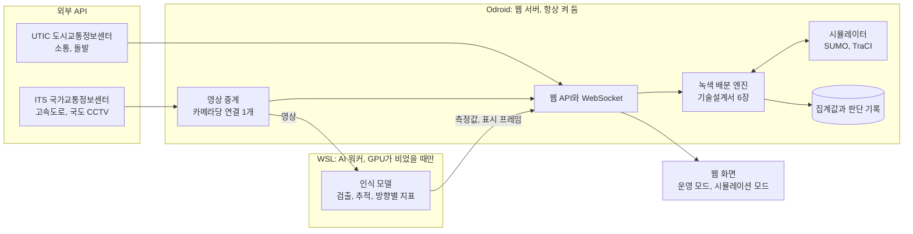

# 기존 CCTV 기반 교차로 신호 관제 시스템 기획서

**웹 관제 화면과 녹색시간 배분 AI 모델의 개발 기획**

- 작성: hyeokju1313
- 기준일: 2026년 11월 18일
- 상태: 초안. 만들면서 고치고, 레퍼런스 UI를 정하면 화면 설계를 다시 쓴다.

**2026년 11월 23일 운영 범위 결정.** 공개 관제 사이트에서는 시흥시 중부권 6개 행정동의 시내 교차로 CCTV만 사용합니다. 아래 초안의 고속도로 개발 영상과 광역 CCTV 층은 운영 화면에서 제외합니다. 현행 등록 기준은 [시제품 실행 안내](../system/README.md)에 정리했습니다.

## 요약

[정책 제안서](../README.md)와 [기술설계서](기술설계서.md)가 정한 방식, 곧 기존 CCTV 영상으로 방향별 대기를 재고 신호주기는 그대로 둔 채 차가 몰리는 방향에 녹색시간을 더 나누는 방식을 실제로 돌려 보는 시제품을 만든다.

| 항목 | 내용 |
| --- | --- |
| 만드는 것 1 | 교통상황을 관제하고 녹색시간을 조정하는 웹사이트. 운영 모드와 시뮬레이션 모드가 같은 화면을 쓴다. 지도에서 CCTV를 눌러 팝업을 띄우고, 토글로 AI가 차량을 검출하고 방면별로 세는 과정을 영상 위에서 볼 수 있다(3.2절) |
| 만드는 것 2 | AI 모델. CCTV 영상에서 방향별 교통량과 대기를 재는 인식 모델과, 그 값으로 현시별 녹색시간을 계산하는 배분 엔진으로 이루어진다 |
| 대상 | 시흥시 중부권(월곶동, 군자동, 장곡동, 능곡동, 연성동, 목감동) 신호교차로에서 시작하고, 같은 구조로 시 전역에 넓힐 수 있게 만든다 |
| 확인하려는 질문 | 출퇴근 방향 쏠림이 매일 되풀이되는 교차로에서, 신호주기는 그대로 두고 실시간 CCTV로 잰 방면별 통행량에 따라 녹색시간을 주기마다 다시 나누면 정체가 줄어드는가(1.4절) |
| 공개 API 확인 결과 | 발급받은 키로 확인했다(2026년 11월 18일). ITS와 UTIC에는 시흥시 교통관제 CCTV가 없고, 교차로 방향별 교통량을 주는 API도 없다. 시흥시 신호계획도 공개 API에 없다(2장) |
| 시흥 시내 CCTV | 경기도교통정보센터 웹 지도에는 시흥 시내 교차로 CCTV가 있다. 중부권 스마트교차로 바로 옆 카메라만 8곳이다. 다만 경기도교통정보센터 오픈API에는 CCTV 항목이 없어, 우리 시스템에 쓰려면 경기도교통정보센터나 시흥시의 협조를 받아야 한다(2.2절) |
| 중부권 영상 확보 | 경기도교통정보센터와 시흥시에 영상 이용을 요청한다. 협조를 받기 전까지 측정 기능은 ITS 공개 스트림과 팀 촬영 영상으로 개발한다(2.6절) |
| 실행 환경 | 웹 서버는 Odroid, AI 모델은 GPU가 있는 WSL에서 돌린다. 두 컴퓨터는 UTIC 키를 신청한 집 라우터 뒤에 있다. WSL GPU는 연구에도 쓰므로 AI 모델을 돌리기 전에 GPU 사용 상태를 확인한다(6.4절) |
| 운영 모드의 범위 | 실제 신호는 바꾸지 않는다. 실제 영상으로 교통량을 재고 권고 녹색시간을 보여 주는 그림자 운영까지 한다. 정책 제안서의 1~2단계에 해당한다 |
| 시뮬레이션 모드의 범위 | 사용자가 교통량을 늘리고 줄이면 AI가 녹색시간을 다시 나누는 과정을 보여 주고, 사람이 녹색시간을 직접 바꿀 수도 있다. 기술설계서 10.2절의 시뮬레이션 검증을 화면으로 옮긴 것이다 |

## 목차

- [1. 목적과 범위](#1-목적과-범위)
- [2. 공개 API로 교통량을 잴 수 있는지 확인한 결과](#2-공개-api로-교통량을-잴-수-있는지-확인한-결과)
- [3. 웹사이트 설계](#3-웹사이트-설계)
- [4. AI 모델 설계](#4-ai-모델-설계)
- [5. 시뮬레이터](#5-시뮬레이터)
- [6. 시스템 구조와 기술 선택](#6-시스템-구조와-기술-선택)
- [7. 개발 단계](#7-개발-단계)
- [8. 지킬 원칙](#8-지킬-원칙)
- [9. 위험과 대응](#9-위험과-대응)
- [10. 정할 것과 확인할 것](#10-정할-것과-확인할-것)
- [11. 참고 자료](#11-참고-자료)

## 1. 목적과 범위

### 1.1 왜 만드는가

정책 제안서는 세 가지 원칙을 세웠다. 기존 CCTV를 다시 쓰고, 주기는 그대로 두고 녹색 배분만 바꾸며, 신호를 바꾸기 전에 근거부터 쌓는다([정책 제안서 3.1절](../README.md#31-제안의-세-가지-원칙)). 이 시스템은 세 원칙을 각각 화면으로 보여 준다.

| 정책 제안서의 원칙 | 시스템에서 보여 주는 방법 |
| --- | --- |
| 기존 CCTV를 다시 쓴다 | 운영 모드에서 실제 교통관제 CCTV 영상에 측정 필터를 켜, 차량을 어떻게 세고 대기를 어떻게 재는지 보여 준다 |
| 주기는 그대로 두고 녹색 배분만 바꾼다 | 시뮬레이션 모드에서 교통량을 바꾸면 녹색시간 합과 주기는 그대로이고 현시별 배분만 바뀌는 것을 보여 준다 |
| 신호를 바꾸기 전에 근거부터 쌓는다 | 운영 모드는 권고값을 계산하고 기록만 하며 실제 신호에 적용하지 않는다. 적용 버튼은 경찰 승인 전까지 잠가 둔다 |

[기술설계서 14.1절](기술설계서.md#141-학생팀의-첫-구현)은 학생팀이 처음 구현할 대상으로 영상 분석, 녹색 가중 배분 엔진, SUMO 실험, PTZ 프리셋 판정, 운영 화면 다섯 가지를 정했다. 이 기획서는 다섯 가지 기능을 하나의 웹사이트로 묶는 순서와 방법을 정한다.

### 1.2 두 모드

두 모드는 화면 구성과 조작 방법이 같고, 화면에 들어오는 데이터만 다르다.

| 항목 | 운영 모드 | 시뮬레이션 모드 |
| --- | --- | --- |
| 지도에 표시하는 교차로 | 중부권 교차로. 영상 상태(실시간, 녹화, 연계 전)를 함께 표시한다 | 시뮬레이션 모형을 만든 교차로 |
| CCTV 팝업의 영상 | 실제 CCTV 실시간 영상. 시흥시 영상을 받기 전에는 공개 스트림과 팀이 촬영한 녹화 영상을 쓰고, 녹화 영상은 화면에 녹화라고 표시한다 | 시뮬레이터가 그린 교차로 화면(위에서 본 2D) |
| 교통량 | 인식 모델이 영상에서 측정한 값 | 사용자가 정한 유입량으로 시뮬레이터가 만든 차량. 측정값은 영상 측정 오차를 흉내 내 만든다(5.3절) |
| 녹색시간 | 현행 계획과 AI 권고값을 나란히 표시 | AI 자동 배분을 바로 적용. 수동으로 바꿀 수도 있다 |
| 실제 신호 변경 | 하지 않는다 | 시뮬레이터 안에서만 바뀐다 |
| 정책 제안서 단계 | 1단계 분석, 2단계 그림자 운영 | 기술설계서 10.2절 시뮬레이션 검증 |

### 1.3 만들지 않는 것

기술설계서 3.3절의 제외 범위를 그대로 따른다([기술설계서 3.3절](기술설계서.md#33-첫-단계에서-제외하는-것)).

- 실제 신호제어기나 신호 센터로 명령을 보내지 않는다. 연계 형식만 정의해 둔다(3.5절).
- 신호주기 길이를 바꾸거나 여러 교차로의 옵셋을 조정하지 않는다.
- 차량번호와 얼굴을 인식하지 않고, 단속 기능도 넣지 않는다.
- PTZ 카메라를 돌리거나 확대하지 않는다. 웹사이트는 카메라를 조작하지 않는다.

### 1.4 확인하려는 질문

사거리 교차로에는 네 방면에서 차가 들어온다. 이 시스템은 실시간 CCTV 영상에서 방면별 통행량을 세고, 네 방면 전체의 신호주기는 그대로 둔 채 주기마다 차가 많은 방면에 녹색시간을 더 나눈다. 측정과 배분이 끊기지 않고 계속 돌아, 차가 몰리는 방면이 바뀌면 녹색 배분도 따라 바뀐다. 시흥에서 이 방식을 검토하는 이유는 출퇴근 시간대에 차가 몰리는 시간과 방향이 날마다 되풀이되기 때문이다. 국도42호선 목감 구간은 조회한 평일 4일 모두 출근과 퇴근 시간에 주행 속도가 새벽보다 30~40% 낮았다([hyeokju1313 기획서 1.3절](../통합보고서/hyeokju1313/기획서_hyeokju1313.md#13-시흥시-정체-실태)).

효과는 시뮬레이션 모드에서 세 가지 운영을 같은 교통 수요로 돌려 비교한다. 시스템이 실제로 하는 운영은 C이고, A와 B는 비교 기준이다. 이 비교는 [hyeokju1313 기획서 4.6절](../통합보고서/hyeokju1313/기획서_hyeokju1313.md#46-효과를-이렇게-확인합니다)의 A, B, C 비교와 같다.

| 운영 | 내용 | 비교로 답하는 질문 |
| --- | --- | --- |
| A 현행 계획 | 지금의 시간대별 고정 신호 | 기준 |
| B 고친 고정 계획 | 시간대별 평균 방면 비율로 녹색을 한 번 다시 나눈 고정 계획 | "시간표만 고치면 되지 않느냐"는 질문에 답한다 |
| C 실시간 배분 | 주기마다 CCTV 측정값으로 녹색을 다시 나눈다(기술설계서 6장) | C가 A, B보다 지체를 얼마나 줄이는지, 평소와 다른 날(행사, 사고, 날씨)에 차이가 얼마나 커지는지 |

많은 방면과 적은 방면의 교통량 비(예: 1:1에서 3:1까지)와 날마다의 변동 폭을 바꿔 가며 돌리고, 영상으로 잰 실제 비율이 생기면 그 값으로 다시 돌린다.

방면별 통행량을 셀 때 두 가지를 지킨다.

- **지나간 차량만 세지 않는다.** 차가 몰린 방면은 녹색시간만큼만 빠져나가므로, 정지선을 지나간 차량 수는 녹색 길이에 묶여 실제 수요보다 작게 나온다. 진입선을 지난 도착 차량과 녹색이 끝난 뒤 남은 차량을 함께 센다(기술설계서 6.2절).
- **녹색시간은 현시 단위로 나뉜다.** 방면마다 따로 녹색을 주는 교차로에서는 방면별 가중치가 그대로 현시 가중치가 된다. 마주 보는 두 방면이 함께 녹색을 받는 교차로에서는 두 방면 가운데 더 붐비는 쪽이 그 현시의 필요 녹색시간을 정한다(기술설계서 6.2절).

아직 모르는 것도 있다. 지금 자료는 정체 시간대가 매일 되풀이된다는 것을 보여 주지만, 교차로에서 방면별로 얼마나 쏠리는지는 잰 적이 없다. 국도42호선 목감 구간도 상행과 하행이 비슷하게 느려졌다. 방면별 쏠림의 크기가 효과의 크기를 좌우하므로, 실시간 영상 계수(M2)로 확인한다.

## 2. 공개 API로 교통량을 잴 수 있는지 확인한 결과

### 2.1 확인 방법

2026년 11월 18일에 ITS 국가교통정보센터와 UTIC 도시교통정보센터의 오픈데이터 안내 페이지를 직접 받아 읽었고, ITS의 차량검지기(VDS) 시설물 목록 파일을 내려받아 시흥 범위의 검지기를 셌다. 같은 날 발급받은 키로 두 API를 직접 호출했다. UTIC 키는 신청한 IP에서만 동작하므로 그 IP를 쓰는 Odroid에서 확인 스크립트를 실행했다(2.5절).

시흥 범위는 시흥 전역을 덮는 사각형(경도 126.70~126.90, 위도 37.32~37.48)으로 잡았다. 사각형에는 인천, 부천, 광명, 서울, 안산의 경계 지역이 일부 들어간다.

### 2.2 API별 제공 범위

| API | 제공하는 것 | 시흥에 적용할 때 | 이 시스템에서 쓰는 곳 |
| --- | --- | --- | --- |
| ITS CCTV 화상자료 | 고속도로(`type=ex`)와 국도(`type=its`) CCTV. 경위도 사각형으로 조회하고, 실시간 HLS 스트리밍(HTTP, HTTPS), mp4 동영상, 정지 영상 중 고른다(`cctvType` 1~5). 응답에 영상 주소가 바로 들어 있다 | 시흥 범위에 고속도로 카메라 104대가 있고 국도 카메라는 0대다. 가까운 6대의 HLS가 열렸고 모두 720x480, 약 1Mbps였다. 고속도로 본선과 분기점을 비추므로 신호교차로 화면은 없다 | 측정 기능 개발용 영상(2.6절). 지도에 고속도로 소통 화면으로도 띄운다 |
| ITS 차량검지(VDS) | 고속도로와 국도에 설치한 검지기의 차로별 교통량, 속도, 점유율 | 시흥 범위 안의 VDS 110개는 모두 고속국도에 있고 일반국도 VDS는 없다(시설물 목록 확인) | 교차로 교통량의 정답 자료로 쓸 수 없다. 고속도로 카메라로 계수 정확도를 시험할 때만 쓸 수 있다 |
| UTIC CCTV 영상정보 | 교통관제용 CCTV. 목록에는 UTIC 사업으로 연결된 지방자치단체 CCTV만 들어 있다. 키와 신청한 C클래스 IP로 인증한다. 키로 받으면 JSON이 아니라 CCTV 목록 HTML과 좌표 속성 엑셀 파일을 주고, 영상은 UTIC 보기 창으로 연다. 분석용 원본 스트림 주소를 주는 방법은 공식 안내에 없다 | 33개 센터, 14,392건 가운데 시흥 센터는 없다. 시흥시 교통관제 CCTV(66대, [2027 유지관리 현황표 기준](../통합보고서/hyeokju1313/기획서_hyeokju1313.md#12-시흥시가-이미-갖춘-장비와-데이터))는 연결돼 있지 않다. 시흥 범위의 142건은 고속도로 104건(ITS와 같은 카메라), 인천 29건, 부천 4건, 서울 4건, 한강홍수통제소 1건이다 | 시흥에는 쓸 수 없다. 인천 남동구 교차로 카메라를 분석에 쓸 수 있는지는 UTIC에 문의한다(10장) |
| 경기도교통정보센터(GITS) | 웹 지도에서 경기도 CCTV를 보여 준다. [오픈API](https://openapigits.gg.go.kr/api/jsp/openApi_info.jsp)는 돌발, 주차, 도로와 링크 소통 정보만 제공하고 CCTV 항목은 없다. 키로 확인해 보니(2026년 11월 18일) 링크 약 12만 개의 속도와 혼잡 등급을 몇 분 단위로 갱신해 준다. 교통량 값은 고속도로 위주의 링크 2,414개에만 있다 | 웹 지도의 CCTV 목록(3,736건) 가운데 시흥 범위가 247건이고, 시흥 시내 교차로 카메라가 들어 있다. 중부권 스마트교차로에서 70m 안: 목감지하차도, 월곶교차로, 하중교차로, 시흥경찰서사거리, 마전교차로, 물왕교차로, 논곡삼거리, 상곡교차로. 그 밖에 목감호반더레이크삼거리, 포동사거리, 둔대교차로 등 | CCTV는 중부권 실시간 영상의 가장 가까운 출처다. 오픈API가 아니므로 경기도교통정보센터나 시흥시의 이용 허락을 받은 뒤에 쓴다. 웹 지도 내부 주소로 영상을 꺼내 쓰지 않는다. 오픈API의 링크 속도와 혼잡 등급은 지도의 도로 혼잡 표시와 구간 통행속도 지표에 쓴다. 중부권 일반도로 링크에는 교통량 값이 없다 |
| UTIC 신호 개방 데이터 | 교차로 기반정보(위치, 현시 구성), 시간대별 계획(TOD), 시그널 맵. 하루 한 번 갱신 | 인천시, 대전시, 대구시 3개 시만 제공한다. 시흥시 신호계획은 받을 수 없다 | 시흥에는 쓸 수 없다. 데이터 항목(주기, 옵셋, A링과 B링 현시 값)은 우리 신호계획 입력 형식을 정할 때 참고한다 |
| UTIC 교통소통정보 | 국토교통부 표준 노드링크 기준 전국 실시간 소통정보. 안내 페이지에 "교통량 데이터는 제공하지 않음"이라고 적혀 있다 | 시흥 도로 링크의 소통 상태를 받을 수 있을 것으로 본다 | 지도에 도로 혼잡을 색으로 표시하고, 구간 통행속도 지표의 보조 자료로 쓴다 |
| UTIC 교통돌발정보 | 사고, 공사 같은 돌발 상황의 위치와 내용 | 시흥 지역 돌발이 나온다 | 지도에 표시하고, 측정값이 평소와 다를 때 원인을 확인하는 데 쓴다 |

UTIC CCTV 안내 페이지에는 이용 조건도 적혀 있다. 같은 URL에 1초에 5회 넘게 접속하거나 10초에 3회 넘게 502 오류를 일으키는 클라이언트는 IP 단위로 차단한다. 영상은 지자체 사정으로 언제든 끊길 수 있고, 목록은 수시로 바뀌므로 하루 한 번 이상 다시 받으라고 안내한다. 고속도로와 국도 CCTV는 UTIC 목록에서 빼고 ITS API로 받으라고 한다.

### 2.3 결론

1. **공개 API 가운데 교차로 방향별 교통량을 주는 것은 없다.** UTIC 소통정보는 교통량을 주지 않고, ITS VDS는 시흥에서 고속도로에만 있다. 교차로 교통량은 인식 모델로 CCTV 영상을 분석해 직접 구해야 한다.
2. **시흥 시내 CCTV는 있지만 공개 API로는 받을 수 없다.** ITS와 UTIC로 받을 수 있는 시흥 범위 영상은 고속도로 카메라와 경계 너머 다른 시의 카메라뿐이다. 시흥 시내 교차로 카메라는 경기도교통정보센터 웹 지도에 있고, 중부권 시범 후보 교차로(물왕교차로, 논곡삼거리, 하중교차로 등)도 들어 있다. 경기도교통정보센터 오픈API에는 CCTV가 없으므로 경기도교통정보센터나 시흥시에 이용을 요청한다. 허락을 받기 전에는 팀이 직접 촬영한 영상으로 대신한다(2.6절).
3. **시흥시 신호계획과 현시 상태는 공개 API로 받을 수 없다.** 운영 모드에서 녹색이 끝난 뒤 남은 차량(잔류 대기)을 재려면 현시가 바뀌는 시각을 알아야 한다. 현시 상태를 알 수 없으므로 운영 모드의 첫 버전은 현시 정보 없이 잴 수 있는 유입 대수와 대기 차량 수, 시간대별 권고값까지만 계산한다. 주기 단위 지표는 시흥시 신호계획을 받거나 영상에서 신호등 색을 인식할 수 있을 때 추가한다(4.1절).
4. **영상은 서버가 받아서 나눠 준다.** UTIC 키는 신청할 때 등록한 IP에서만 동작해 사용자 브라우저가 직접 받을 수 없고, UTIC는 반복 접속을 차단한다. ITS 영상도 같은 방식으로, Odroid가 카메라마다 연결을 한 번만 열고 받은 영상을 브라우저와 AI 모델에 나눠 준다(6.2절).

### 2.4 기존 CCTV로 교통량을 잴 수 있다고 판정하는 기준

카메라마다 아래 네 가지를 확인해 운영 모드 대상으로 쓸지 정한다.

| 기준 | 확인 방법 | 통과 조건(안) |
| --- | --- | --- |
| 위치 | 카메라 좌표와 중부권 교차로의 거리 | 대상 교차로에서 300m 안이고, 화면에 교차로가 보인다 |
| 화각 | 실제 영상의 정지 화면을 보고 판정 | 접근로 하나 이상의 정지선과 대기 영역이 보인다 |
| 화질 | 스트림의 해상도, 초당 프레임 수, 대역폭 | 대기 영역에 있는 승용차가 검출기로 인식할 수 있는 크기로 보인다. 통과 기준은 실제 검출 시험을 거쳐 정한다 |
| 안정성 | 영상을 30분 이상 받으며 끊김과 화각 변경 횟수 기록 | 끊김 없이 이어지고, PTZ라면 같은 화각으로 돌아온다 |

기존 CCTV로 교통량을 셀 수 있다는 근거(행정안전부 AI CCTV 교통량 조사, 감시와 교통정보 수집을 함께 하는 CCTV 연구)와 한계(안개, 야간, 가림, 화각 밖 대기열)는 [hyeokju1313 기획서 4.9절](../통합보고서/hyeokju1313/기획서_hyeokju1313.md#49-기존-cctv로-잴-수-있다는-근거와-한계)에 정리돼 있다.

### 2.5 키로 확인한 결과(M0)

확인 스크립트 `system/api_check/check_cctv_api.py`를 만들었다. `system/.env.example`을 `system/.env`로 복사해 키를 넣고, UTIC 키를 신청한 IP를 쓰는 컴퓨터에서 실행한다. 키와 결과 파일(영상 주소에 토큰이 들어 있음)은 Git에 올리지 않는다(`system/.gitignore`). 스크립트는 UTIC 목록과 좌표 파일을 한 번씩만 받고, 스트림을 확인할 때도 요청 사이에 쉬는 시간을 둔다.

| 확인 항목 | 결과(2026년 11월 18일) |
| --- | --- |
| ITS 고속도로 CCTV, 시흥 범위 | 104대. 중부권 스마트교차로에서 300m 안에 있는 것은 6대이고, 모두 영동선 월곶 부근과 서해안선 목감IC 부근의 고속도로 카메라다 |
| ITS 국도 CCTV, 시흥 범위 | 0대 |
| ITS HLS 접속 | 가까운 6대 모두 열림. 720x480, 약 0.8~1.1Mbps |
| UTIC CCTV 목록 | 33개 센터, 14,392건. 시흥, 안산, 광명 센터는 없다 |
| UTIC 좌표, 시흥 범위 | 142건. 고속도로 104건, 인천 29건(남동구 교차로 등), 부천 4건, 서울 4건, 한강홍수통제소 1건 |
| UTIC 영상 주소 | 목록에는 카메라 번호만 있고 영상은 UTIC 보기 창으로 열린다. 보기 창 내부 주소를 직접 부르면 "비정상적인 접근"으로 막히므로 쓰지 않는다 |
| GITS 오픈API 6종 | 돌발, 도로 목록, 구간 소통, 지정체, 주차장 기본, 주차장 가용 모두 정상 응답. 구간 소통은 중부권 지명이 들어간 링크 약 1,800개에 속도와 혼잡 등급이 있고(수집 시각이 조회 시점 기준 10여 분 안), 교통량 값은 서해안선 목감IC와 수도권제1순환선 조남JC 같은 고속도로 링크에만 있다. 시흥시 주차장 기본정보 39곳, 가용정보 0곳. 확인 스크립트는 `system/api_check/check_gits_api.py` |

ITS 국도 카메라는 시흥 밖으로 넓히면 화성의 국도 39호선, 77호선에 이름이 "교차로"인 카메라가 여럿 있다(시흥에서 12~25km). 정지 영상 몇 장을 보니 국도 본선을 비추는 화각이고, 한 곳(국도 39호선 함백교차로)은 앞쪽 신호등이 화면에 들어온다. 차량은 720x480 화면에서 또렷하게 보인다.

### 2.6 측정 기능을 개발할 영상

공개 API로 중부권 교차로 영상을 받을 수 없으므로, 측정 기능(M2)은 아래 영상으로 개발한다.

| 영상 | 쓰는 곳 | 한계 |
| --- | --- | --- |
| ITS 고속도로와 국도 공개 스트림 | 차량 검출, 추적, 진입선 계수를 실시간 영상으로 개발하고 정확도를 잰다. 신호등이 보이는 국도 카메라에서는 신호 앞 대기를 시험한다 | 신호교차로의 정지선과 방향별 대기를 정면으로 잡은 화면이 아니다 |
| 팀이 중부권 교차로를 직접 촬영한 영상 | 검지 영역 설정, 방향별 대기와 잔류 대기 측정, 신호등 색 인식을 개발한다. 발표 시연에서 녹화 영상으로 재생한다 | 실시간이 아니다. 촬영 위치, 시간, 보관 기간, 비식별 처리 기준을 먼저 정한다(기술설계서 14.1절) |
| 경기도교통정보센터나 시흥시가 이용을 허락한 시흥 시내 CCTV 영상 | 실제 운영 모드와 정확도 검증. 중부권 교차로 8곳은 스마트교차로 바로 옆이라 스마트교차로 집계와 비교할 수 있다 | 이용 허락이 필요하다. 시흥시와는 정책 제안서 0단계의 협의로 진행한다 |

웹사이트의 영상 입력은 실시간 HLS와 녹화 파일을 같은 방식으로 받게 만들어, 영상 출처가 바뀌어도 화면과 측정 기능을 그대로 쓴다.

## 3. 웹사이트 설계

화면 배치는 레퍼런스 사이트를 정한 뒤 그 사이트의 UI에 맞춰 다시 짠다. 아래 내용은 화면 배치가 바뀌어도 유지할 기능과 데이터 흐름이다.

### 3.1 메인 지도

- 지도는 중부권이 한 화면에 들어오게 시작한다. 시 전역으로 넓히거나 다른 권역으로 옮겨 갈 수 있다.
- 교차로마다 CCTV 버튼(마커)을 둔다. 한 교차로에 카메라가 여러 대면 버튼 하나에 대수를 표시하고, 팝업 안에서 카메라를 고른다.
- 운영 모드 지도에는 중부권 교차로(우선 스마트교차로 18곳)를 모두 표시한다. 영상을 아직 받지 못한 교차로는 "영상 연계 전"으로, 팀 촬영 영상이 있는 교차로는 "녹화"로 표시한다. 시흥 범위의 ITS 고속도로 카메라는 따로 끄고 켜는 층으로 둔다.
- 버튼 색은 측정한 대기 수준을 나타낸다. 측정할 수 없는 카메라(영상 끊김, 화각 이탈)는 회색으로 표시해, 값이 없는 것과 한산한 것을 구분한다.
- 지도 위에 UTIC 소통정보로 도로 혼잡을, 돌발정보로 사고와 공사를 겹쳐 볼 수 있다. 끄고 켤 수 있다.
- 화면 위쪽에 운영 모드와 시뮬레이션 모드를 바꾸는 스위치를 둔다. 두 모드는 다른 색 띠로 구분해, 지금 보는 영상이 실제인지 시뮬레이션인지 헷갈리지 않게 한다.

### 3.2 CCTV 팝업과 측정 필터

CCTV 버튼을 누르면 팝업이 열린다. 운영 모드와 시뮬레이션 모드의 팝업 구성은 같다.

```text
+--------------------------------------------------------------------+
| 물왕교차로 | 카메라 1/2 | [측정 필터 켜기] | 측정 품질: 정상 | [닫기] |
+--------------------------------------+-----------------------------+
|                                      | 현시     현행  AI 권고  근거  |
|                                      | P1 동서직진  30   35  잔류 6대 |
|            CCTV 영상                  | P2 동서좌회전 20  21           |
|   (필터를 켜면 차량 상자, 추적 번호,     | P3 남북직진  30   26           |
|    진입선, 정지선, 대기 영역을 표시)     | P4 남북좌회전 20  18           |
|                                      | [적용] (운영 모드: 승인 전 잠금)  |
|                                      | 방향별 대기 차량 막대           |
+--------------------------------------+-----------------------------+
| 5분 유입 대수 그래프 | 방향별 대기 추이 | 카메라 상태(화각 일치, 수신 프레임) |
+--------------------------------------------------------------------+
```

*그림 1 CCTV 팝업 구성안. 숫자는 기술설계서 6.6절의 가상 계산 예시다.*

측정 필터를 켜면 영상 위에 다음을 그린다.

| 표시 | 내용 |
| --- | --- |
| 차량 상자와 차종 | 검출한 차량을 승용차, 버스, 화물차, 이륜차로 나눠 색으로 표시 |
| 추적 번호와 궤적 | 여러 프레임에 걸쳐 같은 차량을 추적한 결과를 선으로 잇는다. 추적 번호는 화면에만 표시하고 저장하지 않는다 |
| 검지 영역 | 접근로마다 진입선, 정지선, 대기 영역, 하류 출구 영역([기술설계서 5.3절](기술설계서.md#53-방향별-지표)) |
| 계수 | 진입선을 지난 차량 수, 대기 영역에 서 있는 차량 수를 접근로 옆에 숫자로 표시 |
| 관측 한계 | 대기열 끝이 화면 밖으로 넘어가면 그 접근로에 "관측 한계" 표시 |
| 품질 | 화각이 등록한 프리셋과 맞지 않거나 검출 신뢰도가 낮으면 영상 테두리를 바꾸고 측정을 멈춘다 |

필터를 켠 영상은 서버가 분석한 프레임에 직접 상자를 그려 보낸다. 브라우저가 HLS 영상 위에 따로 상자를 그리면, HLS 재생이 몇 초 늦게 따라오기 때문에 상자와 차량 위치가 어긋난다. 필터를 끄면 서버가 중계하는 원래 영상을 재생한다.

### 3.3 시뮬레이션 제어 메뉴

시뮬레이션 모드에서는 팝업 오른쪽에 제어 메뉴가 더 열린다.

| 메뉴 | 기능 |
| --- | --- |
| 교통량 | 접근로별 유입량(대/시)을 슬라이더로 바꾼다. 회전 비율도 바꿀 수 있다 |
| 시나리오 | 평상시, 한 방향 수요 급증, 출퇴근 방향 전환, 하류 막힘, 측정 오차와 결측을 버튼 하나로 불러온다([기술설계서 10.2절](기술설계서.md#102-시뮬레이션)) |
| 제어 방식 | 현행 고정 계획, 표준 감응 제어, AI 배분, 수동 중에서 고른다 |
| 수동 조정 | 현시별 녹색시간을 직접 입력한다. 녹색시간 합, 최소와 최대 녹색, 보행시간 제약을 어기면 적용하지 않고 어긴 제약을 알려 준다. 수동으로 바꾸는 동안에도 AI 권고값은 옆 칸에 계속 보인다 |
| AI 설정 | 점진 계수 $\alpha$, 현행 대비 허용 폭 $B$, 최근 주기 반영 비율 $\beta$를 바꾼다(고급 메뉴) |
| 실행 | 재생, 일시정지, 배속(1배, 2배, 5배, 10배), 초기화. 같은 난수 시드로 제어 방식만 바꿔 다시 돌릴 수 있다 |
| 지표 | 교차로 평균 지체, 방향별 최대 대기, 잔류가 생긴 주기 비율, 처리량, 가장 나빠진 방향의 지체를 실시간 그래프로 보여 준다. 두 제어 방식을 나란히 비교한다 |

AI 배분을 고르면 주기가 끝날 때마다 다음 주기의 녹색시간이 바뀌고, 바뀐 이유(가중치, 걸린 제약)가 팝업 오른쪽 "근거" 칸에 나온다.

### 3.4 운영 모드의 권고 화면

운영 모드의 팝업 오른쪽에는 현행 녹색시간과 AI 권고값이 나란히 나온다. 현행 계획은 시흥시에서 자료를 받기 전까지 팀이 현장에서 잰 값이나 가정값을 입력하고, 입력 출처를 함께 표시한다. 적용 버튼은 잠겨 있고 "경찰 승인 전에는 권고만 기록합니다" 같은 안내를 띄운다. 권고값과 계산에 쓴 입력값은 모두 기록해, 기술설계서 10.3절의 그림자 운영 기록으로 쓴다.

### 3.5 신호 연계 자리

실제 신호를 바꾸는 기능은 만들지 않지만, 나중에 붙일 수 있도록 배분 엔진의 출력 형식을 기술설계서 7.1절의 단계별 연계(분석, 권고, 제어)에 맞춰 정한다([기술설계서 7.1절](기술설계서.md#71-단계별-연계)). 시뮬레이션 모드에서는 같은 출력이 시뮬레이터로 들어간다. 시뮬레이터 연결부를 실제 신호 센터 연결부로 바꾸면 제어 단계로 넘어갈 수 있게 한다.

## 4. AI 모델 설계

AI 모델은 영상에서 교통량을 재는 인식 모델과, 잰 값으로 녹색시간을 나누는 배분 엔진 두 부분으로 나눈다.

### 4.1 인식 모델

| 단계 | 방법 | 근거 |
| --- | --- | --- |
| 차량 검출 | 사전학습된 YOLO 계열 검출기. COCO의 car, bus, truck, motorcycle 분류를 기술설계서의 네 차종에 대응시킨다 | [기술설계서 5.5절](기술설계서.md#55-검출과-추적-모델) |
| 추적 | ByteTrack 다중 객체 추적 | 같은 절 |
| 방향별 지표 | 검지 영역을 지난 차량과 서 있는 차량을 세어 유입 대수, 대기 차량 수, 배출 대수, 잔류 대기, 하류 점유율을 계산 | [기술설계서 5.3절](기술설계서.md#53-방향별-지표) |
| 화각 판정 | PTZ 카메라는 현재 화면과 프리셋 기준 화면의 특징점을 맞춰 화각 일치를 판정하고, 벗어나면 측정을 멈춘다 | [기술설계서 5.2절](기술설계서.md#52-ptz-카메라-처리) |
| 품질 판정 | 화각 일치, 수신 프레임 비율, 검출 신뢰도, 가림으로 측정 품질을 정하고, 결측을 0으로 채우지 않는다 | [기술설계서 5.6절](기술설계서.md#56-품질-판정과-측정-불가-처리) |

현시 상태를 받을 수 없으므로(2.3절) 지표를 두 단계로 나눠 만든다.

| 단계 | 지표 | 필요한 것 |
| --- | --- | --- |
| 1차 | 방향별 5분 유입 대수, 대기 차량 수와 대기열 길이, 관측 한계 도달 여부 | CCTV 영상만 있으면 계산할 수 있다 |
| 2차 | 주기별 배출 대수, 잔류 대기, 포화 차두시간 | 현시가 바뀌는 시각이 필요하다. 시흥시 신호계획과 현시 기록을 받거나, 화면에 보이는 신호등 색을 인식해 구한다 |

카메라마다 검지 영역을 그리는 설정 화면을 만든다. 운영자가 정지 화면 위에 진입선, 정지선, 대기 영역, 하류 출구 영역을 그리고 각 영역을 이동류(직진, 좌회전, 우회전)에 연결한다. PTZ 카메라는 프리셋마다 한 번 그린다.

### 4.2 녹색시간 배분 엔진

배분 엔진은 기술설계서 6장의 산식을 그대로 구현한다([기술설계서 6장](기술설계서.md#6-녹색신호-가중-배분-알고리즘)).

1. 이동류별 수요를 최근 유입의 지수평균과 잔류 대기의 합으로 추정한다.
2. 현시별 필요 녹색시간을 출발 손실시간과 포화 차두시간으로 계산하고, 필요량에 비례해 가중치를 정한다.
3. 녹색시간 합 $G$를 가중치로 나누되 최소 녹색, 보행시간, 최대 녹색, 현행 대비 허용 폭, 하류 막힘, 관측 한계 제약을 지킨다.
4. 목표값으로 한 번에 옮기지 않고 주기마다 차이의 $\alpha$만큼만 움직인 뒤 정수 초로 맞춘다.

기술설계서 6.6절의 가상 계산 예시(현행 30, 20, 30, 20초에서 35, 21, 26, 18초를 거쳐 38, 21, 24, 17초)를 단위 시험으로 만들어, 구현이 설계서와 같은 값을 내는지 확인한다. 녹색시간 합 유지, 범위 준수, 반올림 규칙도 시험한다.

운영 모드처럼 2차 지표가 없을 때는 시간대별 평균 수요를 같은 산식에 넣어 시간대별 권고 배분값을 계산한다. 기술설계서 3.2절이 분석 단계에서 시간대별 조정안을 만드는 방법과 같다.

배분은 학습한 모델 대신 산식으로 계산한다. 기술설계서는 경찰과 시가 권고 이유를 확인할 수 있어야 한다는 점을 차별화 가설로 세웠다([기술설계서 9.2절](기술설계서.md#92-차별화-가설)). 산식을 쓰면 계산에 쓴 가중치와 걸린 제약을 화면에 그대로 보여 줄 수 있다. 맥스 프레셔나 강화학습 같은 방법은 시뮬레이션 모드에 비교 대상으로 추가한다([기술설계서 6.7절](기술설계서.md#67-비교-대상)).

### 4.3 학습 자료와 정확도 확인

- 처음에는 사전학습된 검출기를 그대로 쓰고, 공개 CCTV 영상에서 정확도를 잰다.
- 사람이 5분 동안 직접 센 값과 시스템 측정값을 비교해 방향별 유입 대수 오차(WAPE)를 낸다. 목표는 기술설계서 11장의 주간 10% 이하다. 주간, 야간, 우천은 따로 보고한다.
- 정확도가 모자라면 시흥 카메라 화면에서 표본 프레임을 골라 직접 라벨을 붙여 검출기를 추가 학습한다. 표본 프레임은 번호판과 얼굴을 흐리게 처리하고, 저장소에 올리지 않는다(8장).
- 중부권 스마트교차로가 설치된 교차로에서는 시흥시 집계 자료를 받아 시스템이 측정한 값과 비교한다([hyeokju1313 기획서 4.2절](../통합보고서/hyeokju1313/기획서_hyeokju1313.md#42-중부권에서-시작하는-이유와-시범-후보)).

## 5. 시뮬레이터

### 5.1 도구

SUMO와 TraCI를 쓴다. 기술설계서 10.2절이 정한 도구이고, 시흥시 교통량과 시흥경찰서 신호정보로 SUMO 시뮬레이션을 한 2024년 논문도 있다([시뮬레이션 조사 5.1절](../사례분석/siheung-signal-simulation-research.md#51-시흥시-실측-자료를-이용한-2024년-학술논문)). 팀원 ljk5998이 2026년 11월 13일에 SUMO 교차로와 제약 조건이 있는 신호 권고를 구현해 올렸다가 되돌린 기록(커밋 `029b732`, 되돌린 커밋 `5ac286e`)이 있으므로, 다시 쓸 수 있는 부분이 있는지 팀원과 확인한다.

### 5.2 모형

1. 첫 모형은 기술설계서 6.6절의 가상 교차로(주기 120초, 4현시, 황색 3초와 전적색 2초)로 만든다. 지도에는 가상 설정이라고 표시한다.
2. 다음으로 중부권 시범 후보 교차로의 도로 형상을 OpenStreetMap에서 가져와 모형을 만든다. 후보는 [hyeokju1313 기획서 4.2절](../통합보고서/hyeokju1313/기획서_hyeokju1313.md#42-중부권에서-시작하는-이유와-시범-후보)의 목록에서 고른다.
3. 운영 모드에서 측정한 값이나 시흥시 자료를 확보하면 실측 교통량과 신호계획을 모형에 넣는다. 자료를 확보하기 전까지는 가정한 수요와 신호계획을 쓰고, 화면에 가정값이라고 표시한다.

### 5.3 웹과 연결하는 방법

- 사용자가 슬라이더로 유입량을 바꾸면 서버는 바뀐 유입량에 맞춰 매초 차량을 새로 만들어 넣는다. 미리 정한 경로 파일 대신 TraCI로 차량을 추가해, 실행 중에도 교통량을 바꿀 수 있게 한다.
- 시뮬레이터는 시뮬레이션 시간 1초마다 차량 위치와 신호 상태를 웹으로 보내고, 브라우저가 위에서 본 교차로를 그린다.
- 측정 필터를 켜면 시뮬레이터의 검지 영역 값(유입, 대기, 잔류)을 같은 방식으로 표시한다. AI 배분에 넣는 값에는 운영 모드에서 잰 영상 측정 오차를 흉내 낸 오차를 더할 수 있다. 오차를 넣은 결과와 넣지 않은 결과(완전 관측)를 비교하면, 성능 차이가 영상 측정 오차에서 오는지 알고리즘 한계에서 오는지 나눠 볼 수 있다(기술설계서 6.7절).
- 시뮬레이션이 끝날 때 아직 도로에 들어오지 못한 차량도 집계하고, 같은 수요와 난수 시드로 제어 방식만 바꿔 10회 이상 반복해 평균 차이와 95% 신뢰구간을 낸다(기술설계서 10.2절).

## 6. 시스템 구조와 기술 선택

### 6.1 구성



*그림 2 시스템 구성. 웹 서버, 영상 중계, 배분 엔진, 시뮬레이터는 Odroid에서, 인식 모델은 WSL에서 돌린다. WSL 워커가 꺼져 있어도 원래 영상과 시뮬레이션 모드는 그대로 동작한다.*

### 6.2 영상 경로

- UTIC의 IP 인증과 접속 제한(2.2절)을 지키기 위해 Odroid는 카메라마다 스트림 연결을 하나만 연다. 화면을 보는 사람이 여럿이어도 ITS와 UTIC에는 Odroid가 연 연결 하나만 유지된다.
- Odroid는 영상을 풀지 않고 HLS 조각을 그대로 브라우저에 중계한다. 영상을 푸는 일은 ARM 32비트에 메모리 2GB인 Odroid에 무겁기 때문이다.
- WSL의 AI 워커는 외부 API가 아니라 Odroid 중계에서 영상을 받아 풀고, 초당 5~10프레임만 분석한다. 외부로 나가는 연결이 늘지 않는다. 실제 처리 가능 프레임 수는 M2에서 재고 정한다.
- 연결은 WSL 워커가 Odroid로 먼저 건다. WSL의 네트워크 설정과 상관없이 동작하고, 워커를 껐다 켜도 웹 서버는 영향을 받지 않는다.
- 워커가 없는 동안 측정 필터에는 "AI 분석 서버 대기 중"을 띄우고 원래 영상만 보여 준다.
- 팀 촬영 영상 같은 녹화 파일은 Odroid 저장 공간에 두고, 실시간 스트림과 같은 경로로 브라우저와 워커에 보낸다.
- CCTV 목록은 하루 한 번 받아 저장하고, 지도는 저장한 목록으로 그린다.

### 6.3 기술 선택

| 구성 | 선택 | 이유 |
| --- | --- | --- |
| 프런트엔드 | React, TypeScript, Vite | 운영 모드와 시뮬레이션 모드가 같은 화면 부품을 쓰고 데이터 공급원만 바꾸는 구조를 만들기 쉽다. Odroid에는 Node가 없으므로 Mac에서 빌드하고, Odroid는 만들어진 정적 파일만 제공한다 |
| 지도 | 카카오맵 JavaScript API | 국내 지도와 주소 검색을 쓸 수 있고, UTIC 지도 화면도 카카오맵을 쓴다. 지도 부품을 분리해 레퍼런스 UI에 맞춰 바꿀 수 있게 한다 |
| 영상 재생 | hls.js | ITS와 UTIC가 HLS로 영상을 준다 |
| 그래프 | 차트 라이브러리 하나(레퍼런스 UI를 정할 때 고른다) | 지표 그래프와 비교 그래프 |
| 백엔드 | Python FastAPI와 WebSocket, uvicorn | 인식 모델, 시뮬레이터(TraCI), 배분 엔진이 모두 Python이라 한 언어로 묶을 수 있다. Odroid의 Python 3.14(armv7l)용 pydantic-core 패키지가 있는 것을 확인했다. uvloop와 httptools는 armv7l 패키지가 없어 uvicorn 기본 설치만 쓴다 |
| 영상 디코딩 | PyAV(WSL 워커에서만) | ffmpeg 라이브러리를 함께 설치해 시스템에 ffmpeg를 따로 설치하지 않아도 된다 |
| 인식 | Ultralytics YOLO와 내장 ByteTrack(WSL 워커) | 검출과 추적을 바로 쓸 수 있다. AGPL-3.0이라 소스를 공개해야 하는데, 이 저장소는 이미 공개 저장소다. 시에 납품하거나 비공개로 운영하게 되면 상용 라이선스를 받거나 Apache 2.0 검출기로 바꾼다. 검출기 부분을 따로 떼어 두어 바꾸기 쉽게 만든다 |
| 시뮬레이터 | SUMO와 TraCI(Odroid) | 기술설계서 10.2절과 같다. Odroid에 SUMO 1.25.0을 설치했다(2026년 11월 18일). 3x3 격자 교차로에 차량 2,300대를 넣은 1시간 분량을 2.7초에 계산해, 실시간 화면용으로 충분히 빠르다. TraCI는 순수 Python 패키지다. 서비스로 띄울 때 환경변수 `SUMO_HOME=/usr/share/sumo`를 지정한다 |
| 저장 | SQLite로 시작하고 필요하면 PostgreSQL | 원본 영상 없이 집계값과 판단 기록만 저장하므로 양이 적다 |

### 6.4 실행 위치와 WSL GPU 사용 원칙

| 컴퓨터 | 확인한 사양 | 맡는 일 |
| --- | --- | --- |
| Odroid XU4 | ARM 32비트(armv7l), 메모리 2GB, Armbian, Python 3.14 | 웹 서버, 영상 중계, 배분 엔진, 시뮬레이터, 기록 저장. 항상 켜 둔다 |
| WSL(GPU PC) | x86_64, RTX 4070 Ti 12GB | AI 워커(검출, 추적, 방향별 지표). GPU가 비었을 때만 돌린다 |

두 컴퓨터 모두 UTIC 키를 신청한 집 라우터 뒤에 있어 UTIC IP 인증을 통과한다. Odroid에서는 다른 서비스가 이미 여러 포트를 쓰고 있으므로, 웹 포트는 겹치지 않게 골라 배포할 때 정한다.

WSL GPU는 연구에도 쓰므로 AI 워커는 다음 원칙을 지킨다.

1. 워커를 켜기 전에 GPU 메모리 사용량, 사용률, 실행 중인 연구 작업을 확인한다. WSL에 원격 접속하면 `nvidia-smi`가 PATH에 없으므로 `/usr/lib/wsl/lib/nvidia-smi`로 확인한다. Windows 쪽 작업은 프로세스 목록에 보이지 않지만 사용량에는 잡힌다.
2. 연구 작업이 GPU를 쓰고 있으면 워커를 켜지 않는다. 2026년 11월 18일 확인했을 때도 연구 작업이 GPU 메모리 12GB 가운데 약 10GB를 쓰고 사용률이 98%였다.
3. 워커는 시작할 때 남은 GPU 메모리를 기준으로 쓸 수 있는 양에 상한을 건다. 실행 중에도 다른 작업의 GPU 사용을 주기적으로 확인하고, 연구 작업이 시작되면 스스로 멈춘다.
4. GPU 없이 CPU로 낮은 프레임 수만 분석하는 방식은 M2에서 처리 속도를 재 본 뒤에 쓸지 정한다.

### 6.5 폴더 구성

```text
system/
  api_check/   M0 확인 스크립트
  data/        공개 데이터 사본(스마트교차로 위치 등)
  backend/     Odroid: FastAPI 서버, 영상 중계, 배분 엔진, 시뮬레이터 연결
  worker/      WSL: 인식 모델(검출, 추적, 방향별 지표)
  frontend/    React 웹 화면(Mac에서 빌드해 Odroid에 올림)
```

`backend/`, `worker/`, `frontend/`는 M1부터 만든다.

## 7. 개발 단계

| 단계 | 내용 | 먼저 끝나야 할 것 | 완료 기준 |
| --- | --- | --- | --- |
| M0 API 확인 | 발급받은 키로 시흥 CCTV 목록, 스트림 접속, 해상도 확인 | 키, UTIC 신청 IP | **완료(2026년 11월 18일).** ITS와 UTIC에는 시흥시 교통관제 CCTV가 없고, 경기도교통정보센터 웹 지도에는 있지만 오픈API로는 받을 수 없음을 확인했다(2.2절, 2.5절). 개발 영상은 2.6절대로 정했다 |
| M1 지도와 CCTV 팝업 | 지도(중부권 교차로, 고속도로 카메라 층), 팝업에서 실시간 HLS와 녹화 영상 재생, 모드 전환 스위치. Odroid에 배포 | M0 | Odroid에서 돌아가는 사이트에서 버튼을 눌러 ITS 영상과 녹화 영상을 볼 수 있다. 영상이 끊기면 회색 표시와 안내가 나온다 |
| M2 측정 필터 | WSL 워커의 검출과 추적, 검지 영역 설정 화면, 영상 위 표시, 1차 지표 | M1, 팀 촬영 영상 | ITS 공개 스트림 1대와 팀 촬영 영상 1개에서 필터를 켜면 상자와 계수가 보인다. 사람이 센 5분 표본과 비교한 오차를 기록한다 |
| M3 시뮬레이션 모드 | Odroid의 SUMO 가상 교차로, 교통량 조절, AI 배분, 수동 조정, 제어 방식 비교 | 없음. M1의 화면 부품을 다시 쓴다 | 기술설계서 6.6절 예시를 재현하는 단위 시험을 통과한다. 1.4절의 A, B, C를 방면별 교통량 비와 날마다의 변동을 바꿔 가며 비교하는 그래프가 나온다 |
| M4 운영 모드 권고 | 현행 계획 입력, 시간대별 권고 배분, 판단 기록 저장, 잠긴 적용 버튼 | M2 | 대상 카메라에서 권고값이 계속 계산되고 기록된다 |
| M5 검증과 시연 | 정확도 표, 시뮬레이션 반복 실험, 발표 시연 순서 | M2, M3, M4 | 주간과 야간 정확도, 시나리오별 10회 반복 결과와 95% 신뢰구간을 정리한다 |

M3는 영상 확보와 상관없이 만들 수 있으므로 M1, M2와 동시에 진행한다. 기간은 팀 일정에 맞춰 정한다.

M0에서 중부권 교차로를 비추는 공개 카메라가 없다는 것을 확인했으므로 다음처럼 진행한다. 측정 필터는 ITS 공개 스트림과 팀 촬영 영상으로 개발하고 정확도를 잰다. 중부권은 시뮬레이션 모드와 팀 촬영 영상으로 보여 주고, 실시간 영상은 정책 제안서 0단계대로 시흥시에 요청한다. 기술설계서 14.1절도 시흥시 영상을 받기 전에는 이용 조건을 확인한 공개 영상을 쓰고, 팀이 직접 촬영할 때는 기준을 먼저 정하기로 했다.

## 8. 지킬 원칙

- **원본 영상을 저장하지 않는다.** 집계값, 카메라 상태, 판단 기록만 남긴다([기술설계서 8장](기술설계서.md#8-개인정보와-영상-보안)). 추적 번호는 화면 표시와 계수에만 쓰고 저장하지 않는다.
- **학습용 표본은 최소로 남긴다.** 정확도 확인과 추가 학습에 쓸 프레임만 고르고, 번호판과 얼굴을 흐리게 처리해 각자 컴퓨터에만 둔다. 저장소에는 올리지 않는다.
- **키와 IP는 공개하지 않는다.** 키는 `system/.env`에 두고, 스트림 주소처럼 토큰이 들어간 결과 파일도 Git에 올리지 않는다.
- **UTIC 이용 조건을 지킨다.** 목록은 하루 한 번 받고, 카메라마다 연결을 하나만 열고, 실패하면 간격을 두고 다시 시도한다.
- **실시간 영상을 외부에 다시 내보내기 전에 이용 조건을 확인한다.** 공개 웹사이트에서 UTIC와 ITS 영상을 다시 보여 줘도 되는지, 출처 표시를 어떻게 해야 하는지 각 기관 안내를 확인한다. 확인하기 전에는 팀원만 접속할 수 있게 운영한다.
- **실제 신호에 명령을 보내지 않는다.** 운영 모드의 적용 버튼은 잠가 둔다.

## 9. 위험과 대응

| 위험 | 대응 |
| --- | --- |
| 중부권 교차로를 비추는 카메라가 공개 목록에 없다(M0에서 확인) | 2.6절의 영상으로 개발한다. 측정 기능은 ITS 공개 스트림과 팀 촬영 영상으로 만들고, 중부권은 시뮬레이션 모드, 녹화 영상, 시흥시 영상 요청으로 다룬다 |
| 공개 스트림에 신호교차로의 정지선과 대기열이 없다 | 진입선 계수와 추적은 공개 스트림으로, 방향별 대기와 잔류 대기는 팀 촬영 영상으로 개발한다 |
| 연구 작업 때문에 WSL GPU를 쓸 수 없다 | 6.4절 원칙대로 워커를 켜지 않는다. 그동안 웹사이트는 원래 영상과 시뮬레이션 모드를 그대로 보여 주고, 측정은 GPU가 빈 시간에 녹화 영상으로 몰아서 한다 |
| Odroid의 연산과 메모리가 부족하다 | Odroid는 영상을 풀지 않고 중계만 한다. SUMO 단독 계산은 시험에서 충분히 빨랐다(6.3절). TraCI로 웹과 주고받는 부담은 M3에서 재고, 느리면 동시 실행 수를 하나로 제한한다 |
| 교통관제 CCTV가 PTZ라 화각이 자주 바뀐다 | 기술설계서 5.2절의 프리셋 일치 판정을 구현하고, 시간대별로 프리셋에 머무는 비율을 기록해 화면에 보여 준다 |
| 해상도가 낮거나 카메라가 멀어 대기 차량을 셀 수 없다 | 카메라마다 잴 수 있는 지표를 따로 정한다. 대기 차량을 못 세는 카메라는 유입 대수만 쓰고, 화면에 측정 가능 지표를 표시한다 |
| 스트림이 끊기거나 늦게 온다 | 측정 불가로 표시하고 결측을 0으로 채우지 않는다. 끊긴 시간과 재연결 횟수를 기록한다 |
| UTIC가 접속을 차단한다 | 6.2절의 연결 하나 원칙과 목록 하루 1회 원칙을 지키고, 오류가 나면 바로 다시 부르지 않고 간격을 늘려 가며 다시 시도한다 |
| UTIC 키가 신청한 IP에서만 동작한다 | Odroid와 WSL은 신청한 집 라우터 뒤에 있다. 집 인터넷의 공인 IP가 바뀌거나 서버를 옮기면 IP를 다시 신청한다 |
| 현시 상태를 받을 수 없어 잔류 대기를 못 잰다 | 운영 모드는 1차 지표와 시간대별 권고로 시작한다(4.1절). 신호등이 보이는 카메라와 팀 촬영 영상에서 신호등 색 인식을 실험한다 |
| 인식 모델이 실시간으로 따라가지 못한다 | 분석 프레임 수와 대상 카메라 수를 줄인다 |
| 검출기 라이선스(AGPL-3.0) | 저장소를 공개로 유지한다. 납품이나 비공개 운영 단계에서는 6.3절대로 바꾼다 |

## 10. 정할 것과 확인할 것

| 항목 | 필요한 이유 | 누가 |
| --- | --- | --- |
| 경기도교통정보센터에 시흥 시내 CCTV 영상 이용 문의 | 중부권 교차로의 실시간 영상을 운영 모드와 측정 기능에 쓸 수 있다. 오픈API에 CCTV가 없으므로 이용 범위(분석, 웹사이트 표시)와 제공 방식을 묻는다 | 팀 |
| 팀 촬영 계획(교차로, 시간대, 촬영 위치, 보관 기간, 비식별 처리) | M2 대기 측정 개발과 발표 시연 | 팀 |
| 사이트 접속 방식(팀원 전용 접속) | 8장의 이용 조건을 확인하기 전까지 팀원만 접속하게 한다 | 담당자를 정할 예정 |
| UTIC에 인천 남동구 교차로 카메라를 분석에 쓸 수 있는지 문의 | 시흥과 붙어 있는 신호교차로의 실시간 영상으로 대기 측정을 시험할 수 있다. UTIC 신호 개방 데이터도 인천을 제공하므로 신호계획과 함께 쓸 수 있다 | 팀 |
| 레퍼런스 UI | 3장 화면 배치를 그 UI에 맞춰 다시 짠다. 같은 성격의 화면으로 UTIC 지도의 CCTV 화면과 ITS 교통지도가 있다 | 팀 |
| 카카오맵 앱 키 발급과 사이트 도메인 등록 | M1 지도 | 담당자를 정할 예정 |
| 팀원 SUMO 구현(커밋 `029b732`)을 다시 쓸지 | M3 개발량이 달라진다 | ljk5998과 확인 |
| 영상을 웹사이트에서 다시 보여 줄 때의 이용 조건 | 공개 웹사이트로 열 수 있는지 정한다 | UTIC(한국도로교통공단), ITS 안내 확인 |
| 시흥시 신호계획, 현시 기록, 스마트교차로 집계 | 2차 지표, 정확도 비교, 실제 교차로 시뮬레이션 | 정책 제안서 0단계의 시흥시 요청과 함께 |

## 11. 참고 자료

확인 기준일은 2026년 11월 18일이다.

### 외부 자료

| 자료 | 확인한 내용 |
| --- | --- |
| [ITS 국가교통정보센터 오픈데이터, CCTV 화상자료](https://www.its.go.kr/opendata/opendataList?service=cctv) | 요청 변수 `type`(ex 고속도로, its 국도), `cctvType`(1 HLS, 2 mp4, 3 정지 영상, 4 HLS HTTPS, 5 mp4 HTTPS), 경위도 범위, 출력 형식. 요청 주소 `https://openapi.its.go.kr:9443/cctvInfo` |
| [ITS 국가교통정보센터 오픈데이터, 차량검지(VDS) 정보](https://www.its.go.kr/opendata/opendataList?service=detectorInfo) | 차로별 교통량, 속도, 점유율. [VDS 시설물 목록](https://www.its.go.kr/file/opendata/vds/vdsStatus.xlsx)에서 시흥 범위 검지기를 셌다 |
| [UTIC CCTV영상정보 레퍼런스](https://www.utic.go.kr/guide/utisRefCctv.do) | 제공 범위, 키와 C클래스 IP 인증, 접속 차단 기준, 고속도로와 국도 CCTV를 ITS로 안내 |
| [UTIC 신호 개방 데이터 레퍼런스](https://www.utic.go.kr/guide/utisRefSig.do) | 인천시, 대전시, 대구시의 교차로 기반정보, TOD, 시그널 맵. 하루 한 번 갱신 |
| [UTIC 교통소통정보 레퍼런스](https://www.utic.go.kr/guide/utisRefTraffic.do) | 표준 노드링크 기준 전국 실시간 소통정보, 교통량 미제공 |
| [UTIC 교통돌발정보 레퍼런스](https://www.utic.go.kr/guide/utisRefIncident.do) | 사고와 공사 같은 돌발 정보 |
| [경기도교통정보센터 오픈API 안내](https://openapigits.gg.go.kr/api/jsp/openApi_info.jsp) | 제공 항목(돌발, 주차장, 도로와 링크 소통). CCTV 항목은 없다 |
| [경기도교통정보센터 CCTV 지도](https://gits.gg.go.kr/web/trafficInfo/webMapInfo.do?opt=3) | 시흥 시내 교차로 CCTV가 지도에 표시된다 |
| [공공데이터포털 경기도 시흥시 스마트교차로 현황](https://www.data.go.kr/data/15090289/fileData.do) | 2025년 11월 5일 기준 83개소의 위치. `system/data/`에 UTF-8 사본을 두었다 |

검출기, 추적기, SUMO의 참고 문서는 기술설계서의 [R15](기술설계서.md#r15-eclipse-sumo-traci-신호-예제)~[R19](기술설계서.md#r19-ultralytics-라이선스-안내)를 따른다.

### 팀 문서

| 문서 | 이 기획서에서 쓴 내용 |
| --- | --- |
| [정책 제안서](../README.md) | 세 가지 원칙, 단계별 추진(분석, 그림자 운영, 시범 적용) |
| [기술설계서](기술설계서.md) | 영상 분석(5장), 배분 산식(6장), 신호 연계(7장), 개인정보(8장), 검증 계획(10장), 성과 지표(11장), 학생팀 구현 범위(14장) |
| [hyeokju1313 기획서](../통합보고서/hyeokju1313/기획서_hyeokju1313.md) | 중부권 범위, 시흥시 장비 현황, 시범 후보 교차로, 기존 CCTV 측정의 근거와 한계 |
| [시뮬레이션 조사](../사례분석/siheung-signal-simulation-research.md) | 시흥 실측 자료로 SUMO 시뮬레이션을 한 2024년 논문, 시정연구원 시뮬레이션 용역 |
