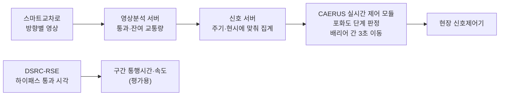
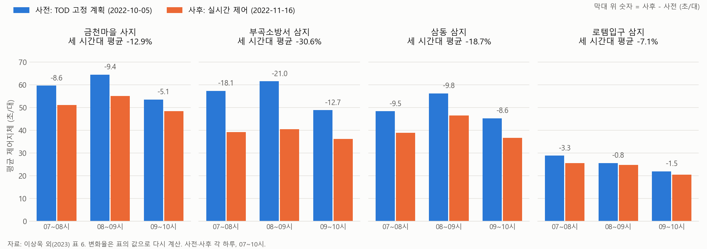
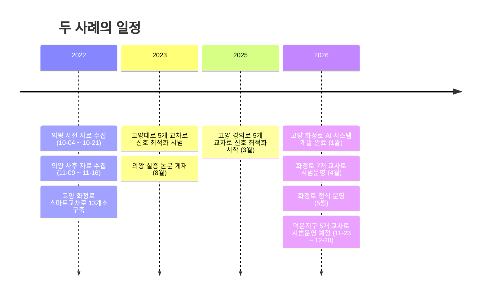

# 의왕시·고양시 영상 기반 실시간 신호제어 사례

조사 기준일: 2026년 11월 13일

교차로 영상으로 교통량을 재고 그 값으로 실제 신호시간을 바꾼 국내 사례 두 건을 정리했다. 의왕시 사례는 학술논문 본문(표와 그림 포함)을 직접 읽고 정리했고, 고양시 사례는 보도 기사만으로 확인했다. 두 사례의 근거 수준이 다르므로 수치를 같은 무게로 비교하지 않는다.

## 요약

- **의왕시(2022):** 철도박물관로 4개 교차로에서 스마트교차로 영상분석 교통량을 경찰청 실시간 신호 알고리즘(CAERUS)에 넣어, 주기는 고정한 채 현시별 녹색시간을 3초 단위로 다시 나눴다. 4개 교차로 모두 평균 제어지체가 줄었다(세 시간대 평균 -7.1% ~ -30.6%). 옵셋을 그대로 둔 동안에는 구간 속도가 나아지지 않았고, 옵셋을 다시 맞춘 뒤 양방향 속도가 약 5km/h, 약 3km/h 올랐다. 효과 평가는 사전 하루와 사후 하루, 각 07~10시 비교이며, 사후 교통량이 교차로별로 시간당 38~78대 적었다.
- **고양시(2026):** 화정로 7개 교차로에서 스마트교차로 방향별 CCTV 교통량으로 AI가 신호시간을 산출해 현장 신호제어기에 자동 적용했다. 4월 한 달 시범운영 뒤 5월 정식 운영에 들어갔고, 신호시간은 최소 4초에서 최대 26초까지 조정됐다. 지체나 속도 수치는 공개되지 않았고, 시는 서비스 수준(LOS)이 "크게 개선되지는 않았다"고 밝혔다. 덕은지구 5개 교차로 시범운영이 2026-11-23~12-20로 잡혀 있다.
- **이 기획과의 관계:** 의왕 실증의 알고리즘은 기술설계서 6장의 녹색 가중 배분과 주기 고정, 수요 = 통과 + 잔여, 이동평균, 최소·최대 녹색, 계획 복귀가 같다. 다른 것은 배분 기준(포화도 대 필요 녹색시간)과 변경 방식(3초 계단 대 비례 이동)이다. 두 사례 모두 스마트교차로용 카메라를 썼으므로, 이 기획의 차별점은 알고리즘이 아니라 방범·관제용 기존 CCTV를 재사용하는 데 있다.

## 목차

- [1. 의왕시 철도박물관로 실증 (2022)](#1-의왕시-철도박물관로-실증-2022)
- [2. 고양시 화정로 시범운영 (2026)](#2-고양시-화정로-시범운영-2026)
- [3. 두 사례 비교](#3-두-사례-비교)
- [4. 이 기획에 주는 의미](#4-이-기획에-주는-의미)
- [5. 확인하지 못한 것](#5-확인하지-못한-것)
- [6. 출처](#6-출처)

## 1. 의왕시 철도박물관로 실증 (2022)

### 1.1 개요

| 항목 | 내용 |
| --- | --- |
| 논문 | 이상욱, 전보배, 오석진, 윤일수, 「스마트교차로 데이터를 활용한 실시간 교통신호제어 운영 효과 분석」, 한국ITS학회논문지 22권 4호, 48~62쪽, 2023. DOI 10.12815/kits.2023.22.4.48 |
| 저자 소속 | 더로드아이앤씨(주), 김포시청 교통과, 호남대학교, 아주대학교(교신) |
| 연구비 | 경찰청 재원, 과학치안진흥센터 과제 「네트워크 제어를 위한 교통정체 및 혼잡 운영관리 기술 개발」 |
| 장소 | 의왕시 철도박물관로, 금천마을 사지교차로에서 의왕역까지 |
| 기간 | 사전 자료 수집 2022-10-04 ~ 10-21, 사후 자료 수집 2022-11-09 ~ 11-16 |
| 효과 평가일 | 사전 2022-10-05, 사후 2022-11-16, 각 07~10시 |
| 비교 | 사전 = 시간대별 고정 신호계획(TOD), 사후 = 실시간 제어 |

### 1.2 대상 구간

논문 그림 1의 위치도 기준으로, 북쪽 금천마을에서 남쪽 의왕역 방향 순서다. 네 교차로 모두 스마트교차로다.

*그림 1 철도박물관로 대상 구간의 교차로 순서. 거리와 방위는 축척을 따르지 않는다.*

### 1.3 자료 흐름과 알고리즘

| 자료 | 수집 방법 | 쓰임 |
| --- | --- | --- |
| 교통량 | 스마트교차로 영상분석 소프트웨어. 주기마다 이동류별·차종별 통과교통량과, 신호 종료 n초 뒤 검지영역 안의 잔여교통량 | 알고리즘 입력 |
| 신호 운영 현황 | 신호제어기 DB 업로드 | 사전·사후 비교 |
| 통행시간과 속도 | 하이패스 단말기가 연속한 두 DSRC-RSE를 지난 시각으로 구간 통행시간을 계산 | 효과 평가 |

*그림 2 의왕 실증의 자료 흐름. 논문 3·4장 서술을 바탕으로 그렸다.*

CAERUS는 경찰청 과제(2019)에서 개발한 실시간 신호 알고리즘으로 사전제어, 실시간 제어, 과포화 제어의 세 모듈로 이루어진다. 이 실증은 실시간 제어 모듈만 썼다. 사전제어 모듈은 기존 신호운영 DB를 쓰므로 적용하지 않았고, 과포화 모듈은 필요한 자료를 모을 수 없어 뺐다. 저자들이 현장에 맞게 바꾼 점은 다음과 같다.

| 항목 | 원래 CAERUS | 의왕 실증 |
| --- | --- | --- |
| 링 구조 | 단일링·이중링 모두 가능, 주기 증감을 먼저 판단 | 단일링, 주기 고정 상태에서 배리어 간 배분 |
| 수요 | 구간·방향별 예측 통행시간으로 교통량 추정, 5분 자료 | 현시별·주기별 통과교통량 + 잔여교통량, 최근 3주기 가중이동평균 |
| 승용차 환산 | - | 승용차 1, 화물차 1.5, 버스 2.0, 이륜차 0.5 |
| 포화교통류율 | - | 직진 1,900대/시, 좌회전 1,800대/시 |
| 포화도 단계 | 0~0.5 / 0.5~0.8 / 0.8~1.0 / 1.0 이상 | 3단계 하한을 0.7로 낮춤. 논문 표현으로 "0.8 이상의 포화도 값이 나오는 경우가 거의 없었기 때문" |
| 조정 조건 | - | 어느 배리어든 3단계 이상이 있고, 배리어 간 포화도 차이가 0.25 이상일 때 |
| 조정 폭 | 1초 단위 | 포화도가 가장 낮은 배리어 -3초, 가장 높은 배리어 +3초. 여러 단위를 시험해 3초가 가장 나았다고 보고 |
| 한계값 | - | 최소 녹색 이하나 최대 녹색 이상이 되는 배리어는 조정 대상에서 뺌 |
| 복귀 | - | 조정이 없으면 TOD 시간 경계의 계획을 따름 |

수요의 가중이동평균은 $V = 0.5V_{k-1} + 0.3V_{k-2} + 0.2V_{k-3}$ 이다. $V_{k-1}$ 은 한 주기 전, $V_{k-3}$ 은 세 주기 전의 수요교통량이다. 저자들은 잔여교통량을 더한 이유로, 앞막힘이 생긴 과포화 교차로에서는 녹색 동안 통과한 차량이 적어 통과교통량만 쓰면 알고리즘이 오히려 녹색을 줄일 수 있다는 점을 들었다.

### 1.4 결과

*그림 3 교차로별·시간대별 평균 제어지체. 논문 표 6의 값이며, 변화율은 표의 값으로 다시 계산했다.*

| 교차로 | 사전 (07 / 08 / 09시대, 초/대) | 사후 (초/대) | 차이 (초/대) | 세 시간대 평균 변화율 |
| --- | --- | --- | --- | --- |
| 금천마을 사지 | 59.6 / 64.4 / 53.5 | 51.0 / 55.0 / 48.4 | -8.6 / -9.4 / -5.1 | -12.9% |
| 부곡소방서 삼지 | 57.3 / 61.5 / 48.8 | 39.2 / 40.5 / 36.1 | -18.1 / -21.0 / -12.7 | -30.6% |
| 삼동 삼지 | 48.3 / 56.2 / 45.2 | 38.8 / 46.4 / 36.6 | -9.5 / -9.8 / -8.6 | -18.7% |
| 로템입구 삼지 | 28.8 / 25.6 / 21.9 | 25.5 / 24.8 / 20.4 | -3.3 / -0.8 / -1.5 | -7.1% |

**구간 속도와 옵셋.** 녹색시간만 조정하고 옵셋을 그대로 두었을 때 구간 속도는 조정 전과 차이가 없었다. 저자들은 주도로뿐 아니라 좌회전과 부도로의 녹색시간도 바뀌어, 기존 차량 도착 흐름에 맞춘 옵셋이 새 흐름을 따라가지 못했기 때문으로 보았다. 양방향이 고르게 연동되도록 옵셋을 다시 맞춘 뒤 3시간 평균 구간 속도는 의왕역 방향 약 5km/h, 금천마을 방향 약 3km/h 올랐다. 저자들은 결론에서 이 상승을 "크게 개선된 효과는 보지 못했"다고 평가했고, 좌회전 교통량이 늘어 좌회전 포화도가 올라간 점과 주도로의 방향별 교통량 차이를 원인으로 들었다. 옵셋을 그대로 둔 기간의 속도 수치와 사전 속도값은 논문에 없으므로 상승률(%)은 계산할 수 없다.

**저자들의 결론**
- 스마트교차로 영상분석 자료의 신뢰도를 95% 이상으로 조정·검증해 썼다. 무엇과 비교해 어떻게 검증했는지는 본문에 없다.
- 스마트교차로 자료를 실제 신호운영 서버에 연계하는 것은 가능했다. 그러나 그 자료를 활용할 신호제어 알고리즘이 다양하게 준비되어 있지 않다.
- 남은 과제로 옵셋 자동 조정 전략, 주기 변경과 이중링 운영, 대기행렬과 앞막힘 검지를 통한 과포화 제어를 들었다.

### 1.5 결과를 읽을 때 주의할 점

| 항목 | 내용 |
| --- | --- |
| 바꾼 것 | 신호 운영 방식(TOD 고정 계획에서 실시간 제어로), 그리고 사후 측정 전 옵셋 재조정 |
| 고정한 것 | 구간, 교차로, 시간대(07~10시), 주기 길이 |
| 고정하지 못한 것 | 날짜(10월 5일과 11월 16일, 6주 차이)와 교통량. 사후 교통량이 금천마을 68대, 부곡소방서 78대, 삼동 38대, 로템입구 61대(시간당) 적었고, 구간 교통량은 의왕역 방면 78대, 금천마을 방면 145대(시간당) 적었다. 저자들은 "큰 차이는 보이지 않았다"고 판단했다 |
| 반복과 흩어짐 | 효과 평가는 사전 하루, 사후 하루뿐이다. 날짜 간 변동이나 신뢰구간은 보고되지 않았다 |
| 효과의 분리 | 지체 감소에는 신호 재배분과 옵셋 재조정, 교통량 감소가 함께 들어 있어 각각의 몫을 나눌 수 없다 |
| 주장의 세기 | "4개 교차로 모두 지체가 줄었다"는 위 조건의 하루 비교에서 관측된 결과다. 다른 날이나 다른 구간에서도 같은 크기로 나온다는 근거는 아니다 |

## 2. 고양시 화정로 시범운영 (2026)

### 2.1 개요

아래 내용은 모두 보도 기사로 확인했다. 시의 공식 보도자료나 효과 분석 보고서는 찾지 못했다.

| 항목 | 내용 | 출처 |
| --- | --- | --- |
| 장소 | 덕양구 화정역 앞 화정로 일대 7개 교차로 | 경기일보 2026-05-27 |
| 일정 | 2026년 1월 시스템 개발 완료, 4월 한 달 시범운영, 5월 정식 운영 | 같은 기사 |
| 방식 | "스마트 교차로에 설치된 방향별 폐쇄회로(CC)TV를 통해 실시간 교통량 데이터를 수집하고 AI가 이를 분석해 최적의 신호시간을 산출한 뒤 현장 신호제어기에 자동 적용" | 같은 기사 |
| 경찰 | 고양경찰서와 "협의를 거쳐" 시범운영. 기사에 "승인"이라는 표현은 없다 | 같은 기사 |
| 조정 폭 | 교차로별 신호시간을 "최소 4초에서 최대 26초까지 자동 조정" | 같은 기사 |
| 운영 예 | 충장로·화정로 삼거리에서 직진·좌회전 동시신호 운영을 줄이고 충장로 양방향 직진 신호시간을 늘림 | 같은 기사 |
| 결과 | 지체·통행시간·속도 수치 없음. LOS가 A~D로 이미 원활한 편이어서 "크게 개선되지는 않았지만" 안정성과 효율성은 확인했다는 시의 설명 | 같은 기사 |
| 카메라 | 화정로에는 2022년에 구축한 스마트교차로 13개소가 있다. 2026년 시범운영 7곳이 이 13곳에 포함되는지는 기사에 없다 | 아주경제 2025-04-07 |
| 확대 | 경찰 측: 상습정체구간과 도시개발사업지구로 확대 적용 계획. 덕은지구 으뜸로 5개 교차로 시범운영 2026-11-23 ~ 12-20 | 경기일보 2026-05-27, CBCI 2026-11-09(검색 요약) |

### 2.2 고양시의 앞선 신호 개선

화정로 AI 시스템과 별개인 사업이다. 같은 시의 결과라도 AI 실시간 제어의 효과로 인용하지 않는다.

| 사업 | 내용 | 결과 | 출처 |
| --- | --- | --- | --- |
| 고양대로 5개 교차로 신호 최적화 시범(2023) | 고양대로 스마트교차로 수집 교통정보로 신호 최적화 | 평균 통행시간 원당 방면 19.6초, 파주 방면 13초 감소. 비교 기간과 표본은 기사에 없음 | 아주경제·더팩트 2025-04-07 |
| 경의로 5개 교차로 신호 최적화(2025년 3월 시작) | 곡산역~가구단지사거리 7.6km, 스마트교차로 16개소·감응신호 1개소 자료 | 기사에 결과 없음 | 같은 기사 |
| 고봉로 등 7개 구간 신호 개선 | 주기 연장, 신호시간과 연동값 조정 | 통행속도 21.6%(5.2km/h) 향상, 지체 1km당 42.6%(23.8초/km) 감소 | 같은 기사 |

### 2.3 일정

*그림 4 의왕·고양 사례의 일정. 고양 2022년 구축 시점은 연 단위로만 확인됐다.*

## 3. 두 사례 비교

| 항목 | 의왕 철도박물관로 | 고양 화정로 |
| --- | --- | --- |
| 근거 | 학술논문 본문(표·그림) | 보도 기사 |
| 규모 | 4개 교차로 | 7개 교차로 |
| 카메라 | 스마트교차로 영상 | 스마트교차로 방향별 CCTV |
| 알고리즘 | 경찰청 CAERUS 실시간 제어 모듈을 수정 | "AI"로만 서술, 방식 비공개 |
| 주기 | 고정 | 기사에 없음 |
| 조정 폭 | 배리어 간 3초 단위 | 4초 ~ 26초 |
| 신호 반영 | 신호 서버를 거쳐 신호제어기 | 현장 신호제어기에 자동 적용 |
| 경찰 | 경찰청 재원 연구 | 고양경찰서와 협의 |
| 정량 결과 | 제어지체 -7.1% ~ -30.6%, 옵셋 재조정 후 속도 +3 ~ +5km/h | 없음 (LOS 큰 변화 없음) |
| 평가 설계 | 사전 하루, 사후 하루, 07~10시 | 공개되지 않음 |
| 이후 | 논문 이후 운영 여부 확인 못 함 | 정식 운영, 덕은지구로 확대 |

## 4. 이 기획에 주는 의미

**알고리즘은 차별점이 되지 않는다.** 의왕 실증과 기술설계서 6장의 녹색 가중 배분은 다음과 같이 겹친다.

| 요소 | 의왕 실증 | 기술설계서 6장 |
| --- | --- | --- |
| 주기 | 고정 | 고정 |
| 수요 | 통과 + 잔여, 3주기 가중이동평균(0.5 / 0.3 / 0.2) | 유입의 지수평균 + 잔여 |
| 배분 기준 | 배리어별 포화도 | 현시별 필요 녹색시간의 비율 |
| 변경 방식 | 조건을 넘으면 3초씩 이동 | 목표와의 차이의 $\alpha$ 만큼 이동, 현행 대비 $B$ 초 이내 |
| 안전 범위 | 최소·최대 녹색 | 최소(보행 포함)·최대 녹색, 하류 막힘, 관측 한계 |
| 복귀 | 조정이 없으면 TOD 계획 | 측정 불가면 현행 계획 |

기술설계서 6.3절에 의왕 실증을 같은 계열의 선행 방법으로 밝혀 두고, 차별점은 9.2절의 기존 CCTV 재사용(방범·관제용 고정형과 PTZ)에 둔다.

**옵셋 문제는 이미 실측됐다.** 녹색 배분만 바꾸고 옵셋을 두면 교차로 지체는 줄어도 구간 속도는 그대로일 수 있다는 점이 의왕에서 관측됐다. 기술설계서가 구간 통행속도를 평가 지표에 넣고 옵셋 재조정을 확장 기능으로 둔 판단과 맞다.

**평가 설계는 의왕보다 강해야 한다.** 의왕은 하루 대 하루 비교였고 사후 교통량이 적었다. 기술설계서 10.4절의 켠 날·끈 날 교대 운영이나 비교 교차로 방식으로 하면 날짜와 수요 변화의 영향을 줄일 수 있다.

**고양의 진행 경로는 시흥의 참고 경로다.** 스마트교차로 구축(2022) -> 수집 자료로 오프라인 최적화(2023~2025) -> 경찰서 협의 후 자동 적용 시범(2026) -> 정식 운영과 도시개발사업지구 확대 순이다. 기술설계서의 분석 -> 권고 -> 제어 단계와 순서가 같다.

**시흥과 이어지는 업체.** 의왕 논문의 주저자 소속인 더로드아이앤씨는 `정책분석/siheung-policy-sources-2026-11-13.md` 1-3절의 시흥시 5개 교차로 디지털 예측제어 실증 참여기업과 같은 이름이다. 시흥 실증의 위치와 결과를 확인할 때 같이 볼 대상이다.

## 5. 확인하지 못한 것

| 항목 | 상태 |
| --- | --- |
| 의왕 실증 이후 철도박물관로의 실시간 제어 운영 여부 | 찾지 못함 |
| 의왕 영상 자료 신뢰도 95%의 검증 방법 | 논문 본문에 없음 |
| 고양 화정로 AI 시스템의 개발 업체, 예산, 알고리즘 | 기사에 없음 |
| 고양 화정로 시범운영의 지체·속도 측정값과 측정 방법 | 기사에 없음 |
| 고양 시범운영 7곳과 2022년 스마트교차로 13곳의 관계 | 기사에 없음 |
| 덕은지구 기사 원문 | 페이지가 열리지 않음. 검색 결과에 「출근길 지체 7.6% 감소」 제목이 보이지만, 기사 날짜(11-09)가 시범운영 시작일(11-23)보다 앞서 사전 시뮬레이션 값일 수 있다. 원문 확인 전에는 인용하지 않는다 |

## 6. 출처

| 자료 | 내용 | 확인 수준 |
| --- | --- | --- |
| [이상욱 외, 한국ITS학회논문지 22권 4호, 2023 (PDF)](https://koreascience.kr/article/JAKO202325543359055.pdf) | 의왕 실증의 장소, 기간, 알고리즘 수정, 표 6 제어지체, 속도, 결론 | 원문 확인 |
| [같은 논문 서지 (earticle)](https://www.earticle.net/Article/A434402) | 권호, 쪽수 | 원문 확인 |
| [경기일보, 2026-05-27](https://kyeonggi.com/article/20260527580176) | 화정로 7개 교차로 시범운영과 정식 운영 | 원문 확인 |
| [아주경제, 2025-04-07](https://www.ajunews.com/view/20250407120251513) | 고양시 스마트교차로 구축 현황, 고양대로 5개 교차로 결과, 고봉로 등 신호 개선 | 원문 확인 |
| [더팩트, 2025-04-07](https://news.tf.co.kr/read/ogmeta/2194919.htm) | 위 기사와 같은 보도자료 | 원문 확인 |
| [CBCI, 2026-11-09](https://www.cbci.co.kr/news/articleView.html?idxno=624735) | 덕은지구 5개 교차로 시범운영 일정 | 검색 요약 |
| [아주경제, 2022-05-13](https://www.ajunews.com/view/20220513125549622) | 의왕시 ITS 국비 42억 원, 스마트교차로 71개소 계획. 논문 실증과의 관계는 기사에 없음 | 원문 확인 |

그림 1, 2, 4는 mermaid로, 그림 3은 논문 표 6의 값으로 matplotlib에서 새로 그렸다. 논문의 그림은 옮겨 싣지 않았다.
